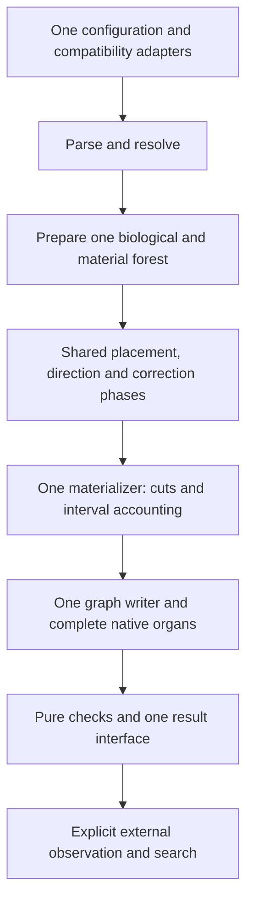

# AI coding guide for DeepRootGen

Current fresh-generation input is schema 4. Use the [execution and parameter guide](NATIVE_EXECUTION.md).
Earlier interface descriptions below document previous versions.

The [verified schema-4 cutover](research/SINGLE_INPUT_IMPLEMENTATION_REPORT.md)
follows the [native-engine repair report](research/NATIVE_ENGINE_REPAIR_REPORT.md).
Schema-3 global planned selection has been removed; historical failure examples
below remain lessons, and the repair report identifies current guarantees.

Maintained 18 November 2026. Start here for AI-assisted code changes in this
repository. Use the companion [lessons learned](AI_CODING_LESSONS.md) for concrete
failure modes and review questions.

This guide applies within the user's active task. It does not expand that task
or introduce another approval process. Continue routine implementation and
verification already authorized by the user. Clarify only unresolved scientific
definitions, material ambiguity, or work outside the granted scope. Current user
instructions and applicable repository instructions take precedence over this
guide; historical plans do not grant continuing authority for unrelated work.

## 1. Establish the current state

Read only the material relevant to the change:

1. [Repository instructions](../AGENTS.md), their inherited parent instructions,
   and the [Python engineering skill](../.agents/skills/deeprootgen-python-engineering/SKILL.md).
2. [Architecture](ARCHITECTURE.md), the actual functions being changed, and their
   callers. Use function names and source searches; historical line numbers move.
3. [Current native execution interface](NATIVE_EXECUTION.md) and the
   [single-engine revision plan](research/NATIVE_FEATURE_COMPOSITION_REVIEW_AND_PLAN.md)
   when changing construction or configuration. Follow its
   [post-merge review and improvement sequence](research/NATIVE_ENGINE_REVIEW_AND_IMPROVEMENT_PLAN.md)
   for the current findings and remaining work.
4. [Active SO4 state](research/ACTIVE_SO4_RESEARCH.md) or
   [active Calvin state](research/ACTIVE_CALVIN_RESEARCH.md) when the task involves
   those research contracts. Reading public state does not authorize raw-data
   inspection or fitting.
5. [RUNNING.md](../RUNNING.md), [development evidence](DEVELOPMENT.md), current
   [dependency specification](../pyproject.toml), lock, pytest settings and
   [CI workflow](../.github/workflows/tests.yaml) before choosing runtime commands.
   Read [review notes](REVIEW_NOTES.md) for statistics/calibration changes and
   recheck every historical finding against current code.

**Implementation snapshot, 18 November, merge `0d5746a`:** native and supported
extended construction-step/cohort inputs enter `RootSystemSimulation.run()` and
the shared fixed-phase engine. The complete worker bodies are removed and schema
3 executes eight feature blocks. The post-merge review found material,
geometry, observer and provenance defects, plus remaining global native/planned
coupling and SO4 options that have no schema-3 key. The archived
`graph_segments_v1` experiment in [search evaluation](../deeprootgen/research/search_evaluation.py)
also retains a separate fresh-INITIAL construction/replay path; inventory that
bypass explicitly during caller migration. The `*.proposed.json` feature example
is now executable despite its historical name. Reverify this snapshot before
using it in a later task, and update it when implementation changes. A passing
suite does not establish that every enabled setting has a numerical consumer.

Older documentation retains historical recipes and findings. In particular,
October development examples include obsolete gravity values and an unavailable
Python environment; the historical architecture map also describes growth that
current static `run()` does not invoke. Prefer current source and source-bound
receipts over an undated inference from those passages.

## 2. What can change, and what must remain intact

The middle column assumes the work is part of an authorized coding task. A
scientific change can be implemented when explicitly in scope and its meaning
and validation are defined; this table is not a permanent ban on model evolution.

| Area | Appropriate changes within scope | Preserve unless an explicit migration or scientific change is in scope |
|---|---|---|
| Internal structure | Extract functions, consolidate state, remove duplicate calculations/writers, improve diagnostics. | Native default behavior; one owner for each common stage; no new complete generator hidden behind a flag. |
| Inputs | Implement agreed typed options, explicit activation, strict validation and useful errors. | Existing supported inputs through adapters, seed consistency and documented units. No silently discarded switches or competing sources for one value. |
| Parameters | Trace consumers and remove genuinely unused fields from a new canonical schema. | Old file interpretation/serialization where promised, aliases needed for migration, fields used by other APIs. `t` is absent from static execution but still used by `grow()` and scope validation. |
| Sampling and geometry | Reuse existing kernels; integrate optional laws at their owning stages. | Frozen draw order/namespaces, original construction intervals, physical corners, insertion conventions and daughter birth context. Export cuts must not alter biology. |
| Material and classification | Centralize material queries, interval integration and classification dispatch. | Cylinder versus point-diameter semantics, native versus cohort classification rules, strict tolerances and separate crown accounting. |
| Identity and serialization | Consolidate graph allocation, organ registration and result views. | Node/edge columns, parent links, root-class strings, biological IDs, primary-tree-to-vine mapping, frame and unit meanings. Inspect affected consumers first. |
| Scientific definitions | Implement the explicitly agreed hypothesis or correction with its own checks. | Objectives, priors, observation support, density assumptions, formulas and acceptance tolerances during a software-only refactor. No automatic adoption of fitted parameters. |
| Tests and documentation | Add small meaningful fixtures; update current usage/status; mark superseded plans clearly. | Independent frozen expectations, old receipts and failed attempts. Do not rewrite expected outputs to make a candidate pass. |
| Environment and services | Reuse a verified environment and direct offline execution. | Lock/dependency versions unless upgrades are in scope. No incidental service startup, training, deployment, supervisor integration or upload. |
| Worktree and data | Edit a bounded set of task files; write new local receipts. | Unrelated user/agent changes, raw data, empirical configurations, sealed results, CONTRIBUTING and CODE_OF_CONDUCT. Do not push unless requested. |

Do not equate “unused by this function” with “safe to delete.” Search Python,
configuration, notebooks, interfaces, saved-input adapters and tests. Record each
field's consumer, activation rule and disposition: retained, canonicalized,
compatibility-only or removed with evidence. Defaults must not become hidden
scientific recommendations during cleanup.

## 3. Architecture rules for further implementation

The [revision plan](research/NATIVE_FEATURE_COMPOSITION_REVIEW_AND_PLAN.md) owns
the detailed migration sequence and numerical interactions. Its central rule is
one fixed executor with small optional calculations inside shared stages:



Keep these responsibilities separate:

- The executor owns traversal, phase ordering and run state. A feature kernel
  cannot instantiate another simulator or own a whole-forest execution loop.
- The resolver owns effective laws and dependencies. One mathematical law per
  operation/order is active; a native fallback is not a competing override.
- Shared forest state owns biological identities, dimension samples, parent
  context and geometry. DataFrame snapshots are views, not a second mutable
  simulator state.
- The materializer owns cut union and interval accounting. The graph writer
  allocates IDs/edges and registers organs; neither samples dimensions.
- The result layer owns schema and projection. Observation, objectives, fitting
  and dataset-specific logic remain outside fresh generation.

Preserve the existing extended-run protections: revalidate detached mutable
inputs, require a fresh simulator and matching seed, and publish success only
after integrity checks. A failed run must not leave a successful result object.
Keep supported service guards ahead of storage, database and deployment effects.

Use ordinary functions and a few typed records. Do not introduce a plugin
registry, subclass per experiment, or pipeline per flag combination. Share
mathematics whose definitions agree; retain genuinely different laws, units,
boundary rules and reproducibility contracts explicitly.

At final migration completion, old flat/v2 inputs must also reach this executor.
Old APIs may translate inputs and outputs. They cannot retain complete alternate
workers. Archival saved-table replay can remain a labelled replay utility; it
must not become a fallback for unsupported fresh-generation options.

## 4. Working procedure

1. **Record and preserve.** Capture HEAD, status and relevant tracked/untracked
   source hashes before editing. HEAD alone is insufficient in a dirty worktree.
   Preserve intervening changes; do not reset, clean or reformat unrelated files.
2. **Trace the behavior.** Follow the changed input through parsing, resolution,
   consuming function, state, result and callers. Search for an existing utility
   before implementing another one. Reproduce the relevant defect with a small
   fixture when needed.
3. **State the contract.** Describe what changes, what stays identical, affected
   files and expected evidence. For scientific options, state units, default/off
   behavior, dependencies, RNG use and expected effects on topology/material.
   Use the agreed plan; do not reopen settled decisions without new evidence.
4. **Make one coherent change.** Start from native functions and existing shared
   kernels. Keep sampling, physical geometry and serialization concerns distinct.
   Do not combine a mechanical refactor with unrequested formula corrections.
5. **Check at the appropriate level.** Run focused behavior checks first, then
   required broader checks for the actual change. Keep commands and outcomes.
   Resolve a mismatch against the original reference; do not weaken tolerances
   or erase failed evidence to declare success.
6. **Review interactions.** Check off/on behavior, caller compatibility, actual
   data flow, unsupported combinations and output semantics. Independent review
   should inspect exact source and concrete evidence, not just a plan summary.
7. **Leave a usable handoff.** Update current usage and status, record remaining
   limits, and identify the next incomplete milestone. Proposed, implemented,
   tested and biologically qualified are different states.

Delegate bounded public-code tasks when useful, with clear edit ownership.
Keep Calvin observations, photographs, fitted settings and comparison outputs
local; reviewers receive public source and invented fixtures only. A requested
review is not a completed review: report actual returned model identity and
findings, or the actual failure. Do not silently substitute a requested reviewer
or purchase usage credits. Respect user-authorized agent/model choices.

## 5. Validation proportional to the change

| Change | Useful evidence |
|---|---|
| Documentation only | Check links, examples, status wording, code references and whitespace; verify protected source did not change. No simulator test is needed solely for prose. |
| Input/parser | Acceptance/rejection fixtures, unknown and duplicate keys at the raw boundary, active dependencies, no mutation/seed mismatch, no discarded feature block. Distinguish new required behavior from current parser behavior. |
| Sampling or execution refactor | Independent frozen tables/RNG, deterministic seeds, biological counts and dimensions, same-engine ownership, failure behavior. |
| Direction or material option | Off/on/off baseline recovery, per-order behavior, cut independence, finite geometry, preserved physical lengths, analytic volume/class crossings and declared boundary interactions. |
| Serialization or result views | Node/edge/organ consistency, forest base count, graph-to-biological mapping, affected consumer checks, root-only versus crown-support accounting. |
| Broad engine integration | Focused checks, established full suite including `--run-integration`, a few bounded direct/CLI synthetic runs with the same inputs, and source-bound receipts. |
| Scientific comparison | Separately scoped local data/protocol, matched observation support, frozen criteria and appropriate uncertainty. Algorithm tests do not replace this. |

Select a verified Python 3.10 interpreter using the current environment evidence;
the project constraint is `>=3.10,<3.11`, and graph imports require Torch/PyG.
Do not install a new stack or regenerate the lock merely to make a test import.
Record missing dependencies as a blocker to that check, while completing other
useful authorized work.

For an engine change, these are example commands **after** assigning
`DRG_PYTHON` to the verified interpreter and checking fixture prerequisites:

```bash
"$DRG_PYTHON" -m pytest --run-integration -q tests/test_native_execution.py
"$DRG_PYTHON" -m pytest --run-integration -q
git diff --check
```

The [native contract fixtures](../tests/fixtures/native_execution_contracts.json)
are invented preservation references. Some historical tests/receipts may depend
on local snapshots or environment paths; inspect those prerequisites and do not
claim an unexecuted command passed. A skipped integration suite is not a runtime
pass. The historical `test_scaffold.py` dummy is not current model coverage and
is not present in this reviewed checkout. Do not create a replacement dummy.

Use new local output directories and preserve existing outputs. Direct simulator
or offline CLI checks are the smallest runtime path. Dash, Prefect and BentoML
can load artifacts or write to services; their startup is not an ordinary import
or harmless smoke check. Avoid invoking a documentation build that imports
application modules unless that build is actually needed and understood.

## 6. Completion record

A compact handoff should contain:

```text
Outcome and scope: what changed, and its observable effect
Identity: HEAD plus affected source/config hashes; environment/lock identity
Files: changed code, maintained docs and deliberately added fixtures
Contracts: default/off behavior, scientific meanings and compatibility retained
Verification: exact executed commands and results, including failures/skips
Limits: untested callers/combinations; implementation versus research status
Next work: any incomplete milestone, without claiming overall completion
```

Do not paste secrets or empirical data into that record. Keep generated logs,
environments and large outputs out of source control. Report historical evidence
with its source/date; a previous passing test count is not a fresh verification
of today's working tree.
