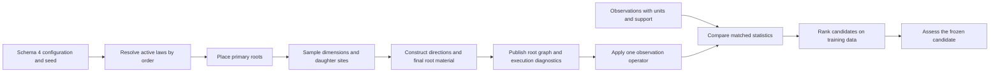

# DeepRootGen handbook

DeepRootGen generates a stochastic three-dimensional root graph. Use it to compare how alternative assumptions about root lengths, branching, orientation and tissue allocation affect the roots that an excavation or soil core would sample. A configuration describes one generation model. An observation model describes which part of the generated graph a measurement would detect. A fitting method chooses among configurations using an explicitly defined discrepancy.

## Generate a first root system

Use Python 3.10 and the repository environment described in [RUNNING](../RUNNING.md). Start from an invented input before working with observations.

```bash
python -m deeprootgen simulate --config examples/synthetic_minimal.json --explain-config
python -m deeprootgen simulate --config examples/synthetic_minimal.json --outdir .runtime/handbook-first-vine
```

Give each run a new output directory. The first command explains the effective model and its controls. Inspect `parameters.json`, `execution.json`, `branching.json`, the node and edge CSVs, and `root_summary.json` in the second command's directory. Save the supplied configuration and seed alongside the result. Repeating a seed with another construction law can change which random draws are consumed. Check the effective-model hash when comparing results.



The crown anchors first-order roots. Each attached daughter has its parent's order plus one. Length runs along each root contour. The engine resolves the enabled laws for each order, tracks eligible and realized daughters, constructs the physical path and assigns diameter along it. A point taper can place more than one material class along one root. Count organs by `organ_id` or use the organ table. Use `node_id` to join node records to edges by `parent_id` and `child_id`. Filter construction-only crown connectors and invalid roots according to the measurement definition. Geometry and model diameters are in cm, integrated dry biomass in g, soil coring diameter bands commonly in mm. In the soil frame, vertical coordinate increases upwards and depth is surface elevation minus the vertical coordinate. The current generator produces a static architecture. Cohort maturity scales inherited properties and is distinct from chronological age. [Architecture](ARCHITECTURE.md) · [Input routes](INPUT_LAYERS_AND_MODEL_FLOW.md)

## Choose construction controls

Put baseline scalar values in `parameters`. Turn a feature on with `enabled: true` and a valid `settings` block. Leaving a feature out uses its disabled default. Use `--explain-config` to confirm active consumers. Use order strings such as `"2"` as configuration map keys. When a replacement law owns a quantity on an order, fitting its inactive baseline counterpart cannot change that order. The resolver rejects incompatible owners.

| Control | Options and fitting use |
|---|---|
| Crown and order | `primary_root_count`, `outer_primary_fraction` and `max_order` control root number and hierarchy. Start with plausible architecture counts. Fit `min_primary_length` and `max_primary_length` for reach when native lengths are active. A 1–3 m *contour* corresponds to 100–300 cm of root length. |
| `primary_origins` | A fixed point, a disk with a depth band, or a vine-origin catalogue with fixed-entry or seeded selection. Use known crown geometry when available. |
| `primary_placement` | Adjust mean horizontal bearing, concentration, reverse-bearing probability, inclination bias or explicit primary design. Use measured orientation or test generic alternatives. |
| `lengths` | Bounded lognormal or discrete CDF per order, with canonical fixed/nominal dimensions where supported. Ordinary lateral length bounds and order reduction apply to orders that still use native lengths. |
| `branching` | Select a first branch interval plus a branch probability and conditional daughter counts, or a length-dependent Poisson process along eligible contour. Compare branch number separately from branch site. |
| `branch_sites` | Native spacing or capped redistribution, explicit count conditioning and primary branch zones/fractions where supported. `min_branching_diameter_cm` applies at the final attachment. Fix the gate from biological evidence or compare it as an explicit treatment. |
| `attachment_relocation` | Relocate existing daughters along the parent in supported configurations. Check retained contour, counts, diameter gates and changed physical occupancy. |
| `sibling_lengths` and `insertion` | Test tertiary length-rank structure or row-axis bias in insertion on supported orders. Sector allocation for siblings belongs to the compatible correlated-curvature law. |
| `direction` and `curvature` | Legacy gravitropism, optional Fichtl directions with order-specific inputs, or correlated curvature. The curved law controls step length, curvature variability, correlation length, downward drift and heading/insertion. Test 1.00, 0.75 and 0.50 of a reference drift as separate treatments when the downward-drift field is active. |
| `taper` and `parent_diameter_cap` | Choose native cylinders or a point taper, including piecewise linear or continuous thick-root exponential with a distal section. Constrain daughter base relative to its parent at the actual site. Use diameter data when fitting shape. |
| `cohort_maturity` | Group primary trees by maturity and optionally scale inherited length, diameter and branching probability. Compare age/cohort proxies using realized order-specific traits. |
| `materialization` | Controls how construction intervals and geometric nodes represent a root, where the selected law supports its settings. Refine resolution for a numerical check before interpreting a fit. |
| Tissue density and allocation | `root_tissue_density` accepts a scalar or diameter bands. `threshold_root_diameter_cm` defines the reporting split for length and mass. Optional `root_ratio_length` and `root_ratio_biomass` use `allocation_controls` to adjust allowed dimensions by order. These are fraction targets. Whole-vine kg and crown inclusion belong to the comparison definition. |
| Top-level `daughter_placement` and `birth_depth_transfer` | Change location probabilities or transfer ordinary daughter births along the parent with the supported gating and reporting rules. Verify eligibility and real attachment after relocation. |
| Top-level `irrigation` | Specify optional wet-zone geometry and response settings for the applicable laws. Confirm the simulated placement response under the actual treatment. |
| `limits` and realized primary length | Choose ceilings for supported resource counts and an optional minimum realized primary length. The engine can reject a candidate when its structural limits fail. |

The core surface, axial turning, mass-matched terminal exchange, proximal thickening and fine-lateral recruitment have experimental entry points and specific comparison protocols. The existing dashboard scalar optimiser uses its own narrower parameter form. See the [schema and advanced examples](NATIVE_EXECUTION.md), [option examples](../examples/design/), and [placement experiments](research/PLACEMENT_EXPERIMENT_OPTIONS.md).

## Measure and compare the result

Read [how candidate architectures are scored](ARCHITECTURE_SCORING.md) for the physical loss, hit and false-hit calculations, and asymmetric sensitivity.

- **Whole-root summaries.** Counts, total and average lengths, volumes, diameters, dry weights, specific root length and convex hulls describe different properties. Specific root length has units of length per dry mass. A hull measures the envelope and can enclose empty space. Agree how to handle zero mass, invalid axes and the crown. Keep units consistent and specify whether averages are by organ, length or vine. [Statistic implementations](../deeprootgen/statistics/summary_statistics.py)
- **Profiles.** A vertical, radial, diameter or branching-order distribution describes allocation, and may be reported in actual length or as a normalized share. A normalized profile can agree even if total length is wrong. For share vectors whose masses sum to one, total variation is half the sum of the absolute differences. Compare shared bins and retain overflow.
- **Density.** Physical core RLD is root contour length intersecting a finite cylinder divided by the sampled soil volume in cm³. Specify radius, clipped interval, coordinate frame, live/vine sorting, diameter band and how neighbouring plants enter the comparison. A gridded average has its own volume and aggregation rule. Missing sections and measured zeroes carry different information. [Finite-cylinder observer](../deeprootgen/research/core_observation.py)
- **Discrepancy.** MAE weights absolute deviations linearly. RMSE increases the influence of larger errors. MAPE divides by observed values and becomes unstable near zero. If fitting several metrics with different units, normalize or predefine weights and report every component. For occupancy, calculate empty fractions after intersecting each complete simulated vine with the core geometry. A predicted mean density can hide disagreement in empty sections.
- **Transfer.** Fit surfaces and select settings only on training tubes. Hold out complete tubes, and use geographic blocks when testing transfer farther away. Use paired simulation seeds to compare rules on matched positions. Assess several new simulated vines after freezing the rule and collect distinct field positions when the claim is spatial transfer. Report the per-vine biomass mean and the numbers below, within and above the target. A lower training cost establishes fit to the chosen training objective.

## Select a fitting or uncertainty method

| Method | Main question | Execution evidence |
|---|---|---|
| Fixed trials or Latin hypercube | Which candidate mechanisms, interactions and plausible parameter ranges are worth pursuing? | Used in the local placement studies. The same draw table and matched seeds make controls comparable. |
| Local Optuna TPE | Which full configuration minimizes a versioned objective with a fixed evaluation budget? | Synthetic construction-step search and separate fresh-seed evaluation executed. Uses seeded proposals, SQLite and per-trial receipts. See the [local research search](research/NOTEBOOK_PARAMETER_SEARCH.md). |
| Dash **Optimisation** | Which set of native scalars best matches numeric whole-root summaries? | Page and preflight are tested locally. Its Optuna task bodies completed synthetic trials. Live Prefect dispatch and downstream artifacts are a separate service check. |
| Sobol sensitivity analysis | Which parameter ranges contribute to output variation, including interactions? | Source implements SALib sampling and analysis. Results depend on ranges, sampling design and run count. No new service-run result. |
| ABC-SMC | Which parameters remain plausible given prior bounds and a discrepancy tolerance? | Source implements sequential acceptance of particles with a decreasing tolerance. No new end-to-end run. |
| SNPE | What conditional distribution over parameters does the neural estimator approximate after simulator training? | Source implements simulation-based posterior estimation. Assess training support and calibration before interpreting the posterior. No new training run. |
| Surrogate | Can a cheaper predictor approximate a simulator output within its training domain? | Source has Gaussian-process training and prediction. Use separate test points to estimate approximation error. No new training run. |

Synthetic verification of an optimizer confirms that it proposes and scores candidates. Empirical fitness needs matched observations, held assessments and uncertainty. A low optimum may still leave different configurations with comparable loss. For TPE, leave some trials after startup so the sampler can learn from earlier costs. Start with a small number of active parameters and verify each affects the objective. [Workflow sources](../app/flows/) · [Web controls and operating procedure](WEB_OPTIMISATION.md)
