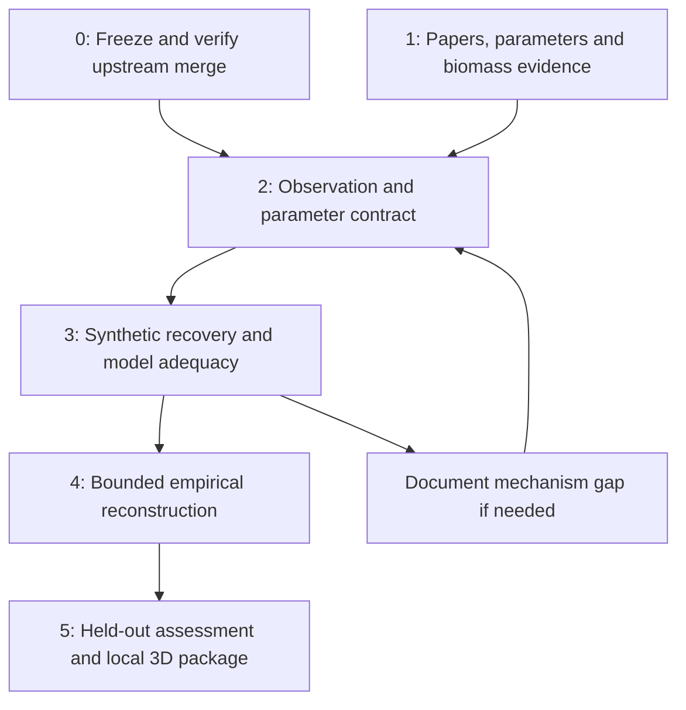

# Grapevine3D architecture reconstruction: goal and staged research plan

**Historical v1 material — superseded for physical soil comparisons.**
Read [the active v2 research state](research/ACTIVE_SO4_RESEARCH.md) first. The recovered soil frame
uses RSML stem point0 as soil, point1 as basal, and explicit canonical horizontal
axes. The original prepared grids, receipts and text below are preserved as
history; earlier calls to increase shallow allocation are superseded.
The coordinate audit is completed locally; current work targets population
representation under the accepted13-trait/3-profile criterion.


Prepared 14 November 2026 (Pacific/Auckland). Status: **SO4/T2 diagnostic generation completed; calibration and independent qualification pending**.

Execution update, 14 November 2026: the first
[evidence package and proposed contract](research/grapevine3d/PILOT_SPECIFICATION.md)
have now been prepared against merge `02b6634`. The planning snapshots below
remain historical provenance. Scientific acceptance and synthetic qualification
were pending at that evidence-only stage; simulation and empirical fitting had
not started then.

The user's subsequent request authorized SO4 generation, primary-root setup and
an optional paper-inspired tropism. The [SO4 diagnostic continuation](research/grapevine3d/SO4_DIAGNOSTIC_PILOT.md)
now records four ten-seed ensembles, local 3D comparisons, the remaining
shallow-root mismatch and a bounded improvement plan. No empirical optimization,
calibration adoption or independent biological validation has been performed.

## Goal

Use DeepRootGen to generate reproducible ensembles of physiologically plausible
grapevine root architectures whose simulated 10 cm root-length-density (RLD)
grids resemble the prepared Grapevine3D observations, and whose architectural
traits agree with measured geometry beyond the quantities used for fitting.
Use defensible published parameters and, where observations can be matched,
root dry biomass to constrain the reconstruction. Deliver aligned local 3D
views, graph data, uncertainty, validation results and reproducible commands.

The intended reference is **Lukas Fichtl's Grapevine3D work**. RLD does not
uniquely determine branching topology: success means a credible ensemble with
comparable architecture, not recovery of the exact excavated root system.
Keep DeepRootGen's root-organ/segment generator as the model. Any necessary
change to its biological mechanisms requires a separate, justified proposal.

This document establishes the research goal and task sequence. This planning
pass did not fit observations, change model equations, run simulations, merge
code, start services or adopt a calibration. The first executable task is
[DRG-G3D-01: evidence and observation contract](tasks/GRAPEVINE3D_01_EVIDENCE_AND_CONTRACT.md).

## Current evidence and integration boundary

The starting checkout was clean on `codex/deeprootgen-runtime-ui`, at
`16309d38dc36030b92ae19e61f5e22a5f4e585e3`. The upstream candidate inspected was
`80315af38f196e7f65452bbb132d4251d8c710e6`, also present in the separate
`/home/jzhu/Workspace/agent-worktrees/deeprootgen-upstream-80315af` worktree.
During planning, concurrent upstream merge changes appeared in this checkout's
index. They belong to the merge task and were preserved. The statements below
describe those frozen revisions, not a qualification of the eventual merge.

| Component | Verified planning evidence | Consequence |
|---|---|---|
| Local execution | Starting HEAD contains an offline CLI, graph/HTML export and `RUNNING.md` | Reuse this route after qualifying the final merged source; October results are historical |
| Observed grids | `scripts/data/grapevine3d_grid.py` and `docs/GRAPEVINE3D_GRID.md` define RSML segment splitting into 10 cm cubes | Reuse the existing preparation; do not create a competing observation definition |
| Upstream voxel operator | `deeprootgen/statistics/root_grid_aggregation.py` clips and splits parent-child segments; `length_source` is selectable | Explicitly select geometric lengths for the RSML comparison; defaults differ between APIs |
| Upstream optimization | `notebooks/grapevine_fichtl_2024/4_fichtl_2024_calibration_sequential.ipynb` has a voxel objective | Extend/audit this work rather than start another optimizer |
| Library calibration | `deeprootgen/calibration/summary_statistics.py` supports scalar grid RLD or cylindrical-core RLD | Neither route automatically supplies the notebook's voxel-vector objective |
| Biomass | Upstream grid/summary code calculates mass from diameter, length and tissue density | Calculated mass is not measured biomass; the notebook has no biomass objective |
| Growth semantics | Upstream `RootSystemSimulation.run()` disables `grow()` and activates a gravity blend | Treat initial work as static architecture reconstruction; `t` cannot be assumed to be age |

The upstream notebook defaults to a 0.60 voxel-RLD, 0.25 per-voxel order-length,
0.15 in-domain total-length objective; six training/two held-out vines; five
simulation seeds. Its five-trial default is smaller than its twenty-trial
startup setting. These are executable design choices, not validated weights,
convergence evidence or an approved scientific objective. Best-fitting seed
selection is an illustration and must not replace ensemble validation.

Important integration checks are already identifiable:

- Upstream gravity is a dimensionless direction blend in `[0,1]`, while old
  forms/fixtures contain `7.5`. Reconcile schema, UI, CLI fixtures and service
  examples without silently selecting a biological replacement value.
- Upstream interbranch distance is active, in centimetres along a parent root.
  Old parameter values need semantic review, not just successful parsing.
- Summary-statistic and aggregation defaults differ between geometric and
  recorded lengths. Freeze one basis across loss, mass and validation.
- `fine`/`structural` diameter classes differ from primary/secondary/etc. order
  labels. `root_ratio` and `mechanical_constraints` are not demonstrated active
  generator controls in the candidate.
- The candidate changes dependencies and statistics. Recheck its final lock and
  runtime; do not carry forward `RUNNING.md`'s old lock hash or test counts.

## Inputs and provenance

Only file inventory, prepared-table headers/counts and hashes were checked
locally in this planning pass. Raw observation rows and private coring data
were not sent to agents or external services.

| Input | Location and current evidence | Use |
|---|---|---|
| Measured architecture | `/home/jzhu/Workspace/Contacts/Australia/Calvin Lam/DATA/RSML_Files/` and `VTP_Files/`; each has 24 files at each of T1–T4 | Geometry reference, observation audit and local visualization |
| Prepared RLD | `/home/jzhu/Workspace/Contacts/Australia/Calvin Lam/Grapevine3D_grid_10cm/voxel_grid.csv`; 63,653 rows | Density targets; actual column is `rld_cm_per_cm3` |
| Vine summary/manifest | Same directory: `vine_summary.csv` (96 rows), `analysis_metadata.json` | Source identity, clipping, support and conservation |
| Existing illustration | Same directory: `architecture_T4_B-11.png` | Starting example only; not a validation criterion or a preselected best case |
| Upstream dataset | `data/grapevine/fichtl_2024_voxel_grid.csv` at candidate `80315af` | Byte-identical to the local prepared grid in this inspection |
| Literature | Fichtl 2024 and 2025 below; local `DATA/mcaf193.pdf` also exists | Parameters, measurement definitions and biomass feasibility |
| Biomass observations | Paper reports them, but a machine-readable table and vine-level join have not been verified locally | Pending evidence, not an assumed calibration input |

Verified SHA-256 values:

```text
voxel_grid.csv and upstream fichtl_2024_voxel_grid.csv
10e5b5332bd9bdf06cf73e1a64fb394c99ab174c822aa4744440fa7cd67fb4bf
vine_summary.csv
e0ce661a1ced0f4f4c762bd9e1479c6693e1b935f3294310461be6d05a0cd715
analysis_metadata.json
4d58cf0b0f152c0ff095f2d4186706b5fa2a970a64f13d3a1756e2d9a0bcae25
```

The upstream filename says `2024`; that does not establish the paper citation,
sampling period or independence of observations. Verify dataset versions and
overlap between papers. Do not treat re-publication of the same vines as new
validation data. The older grid documentation records an unresolved difference
between consecutive-RSML length and published totals; re-evaluate this before
using paper lengths or SRL as absolute constraints. Do not add unmeasured
parent-child connector segments to make totals agree.

Private Calvin coring spreadsheets, management trials and other root datasets
are outside this reconstruction task. Public availability of an archive does
not authorize uploading local copies from the Contacts directory.

## Literature analysis before parameter selection

Two primary papers have different roles:

- [Fichtl et al. 2024, *A Field-to-Parameter Pipeline…*](https://pmc.ncbi.nlm.nih.gov/articles/PMC11633832/): CPlantBox parameterization, static initial roots and probabilistic tropism. Review Table 2, Table 4, methods and Fig. S7. Table 4's angle, rate, angular-variation and radius labels need checking against executable parameter files; matching names alone do not establish a DeepRootGen mapping.
- [Fichtl et al. 2025, *Rootstock genotype shapes whole-plant 3-D architecture and biomass allocation…*](https://juser.fz-juelich.de/record/1049167/files/mcaf193.pdf): dry-mass and SRL methods (p. 1616), biomass Table S2, root traits Table S4, spatial distributions Tables S5–S6. SRL uses digitized total root length divided by root dry mass. The main text was accessible; numerical supplements and per-vine mass linkage remain unverified. The paper links the [Grapevine3D archive](https://doi.org/10.5281/zenodo.15632062).

Produce a parameter evidence matrix before a parameter configuration. For each
entry record source/page/table, genotype, age, root class, sample size,
value/distribution, printed unit, verified unit, uncertainty, equation,
DeepRootGen destination and decision. Allowed decisions: `DIRECT`,
`TRANSFORM_REQUIRED`, `VALIDATION_ONLY`, `MODEL_GAP`, `UNAVAILABLE`.

| Parameter/trait family | Proposed examination | Transfer rule |
|---|---|---|
| Primary/adventitious roots | Number, initial length and planting/root-base geometry | Distinguish measured initialization from parameters inferred from RLD |
| Lateral construction | Order, spacing, insertion angle, length, branching zones | Compare equations and definitions with `utils/branching.py` and `model/root.py` |
| Tropism/orientation | Downward bias, horizontal preference, angular variability, row anisotropy | CPlantBox probabilities are not DeepRootGen's global gravity coefficient |
| Diameter and taper | Root type/order, diameter versus radius, units, age | Check evidence before choosing diameter bounds or deriving mass |
| Biomass and SRL | Dry/fresh basis, recovered fractions, genotype/age and support | Match operational definitions and observation scope |
| Temporal growth | Age, elongation rate and initial root system | Keep as evidence or a later mechanism proposal while `run()` is static |

If the current generator cannot represent a supported trait (for example,
order-specific tropism or row-oriented growth), document the failure and the
smallest proposed mechanism change. Do not force unrelated parameters to
compensate. Preserve stochastic root construction, valid attachment and
defensible dimensions; do not place disconnected segments into high-RLD cubes.

## Observation and biomass contracts

Freeze the following before any measured-data optimization:

1. **Coordinates:** centimetres, soil-surface origin, row/across-row orientation,
   root-base depth and a documented transform. The prepared grid uses positive
   depth; DeepRootGen uses negative z. For depth interval `[d,d+10]`, simulator
   z bounds are `[-d-10,-d]`. Verify horizontal axes per source, including the
   differing figure conventions between the papers. No post-fit rotations to
   improve apparent agreement.
2. **Segments:** consecutive RSML polyline pieces versus simulated parent-child
   edges; geometric length; explicit stem/base/invalid-root and connector policy.
   Split at all cube faces and clip at the soil surface. Require conservation
   and partition agreement on common synthetic geometry.
3. **Support:** 10 × 10 × 10 cm cubes, fixed face convention and explicit bounds.
   A digitized zero is not proof of biological absence. Outside a vine's prism
   is unobserved, not zero. Do not turn these cubes into cylindrical soil cores.
4. **Classes:** preserve observed order labels separately from fine/structural
   diameter classes. Do not infer a fine-root threshold from branching order.
5. **Coverage:** report in-domain, above-surface and outside-domain lengths and
   masses separately. Do not let clipping conceal large simulated roots.
   Any exterior penalty requires evidence about excavation/detection coverage;
   otherwise use explicit overflow diagnostics and sensitivity analyses.
6. **Units/uncertainty:** RLD is cm/cm³, SRL cm/g and dry mass g. Keep detection
   limitations, excavation losses and uncertain tissue parameters explicit.

For cube `v`, the observation operator is:

```text
RLD_v = sum(length of selected root segments intersecting cube v) / volume_v
volume_v = 1000 cm3 for a complete 10 cm cube
```

Use the strongest available biomass route, in this order:

| Evidence available | Permitted proposed constraint | Limitation |
|---|---|---|
| Matched per-vine dry mass | Compare modeled whole-root mass with that vine's measured mass and uncertainty | Reconcile root compartment, clipped length, recovered fractions and root base |
| Only genotype × timepoint dry-mass summaries | Constrain ensemble mass distribution/mean at that level | Do not assign the mean as an exact measurement to every vine |
| Compatible SRL | `M = L / SRL`; propagate uncertainty and definition mismatch | Whole-root SRL does not establish voxel-specific SRL |
| Defensible diameter and dry tissue density | `M = sum(rho_i * pi * d_i^2 / 4 * L_i)` | RLD alone cannot identify both diameter and tissue density |
| No defensible conversion | Fit RLD and architecture; mark biomass unconstrained | Do not invent mass observations |

For a clearly labelled **assumed uniform-SRL scenario**, biomass density would
be `RLD / SRL` in g/cm³. It is derived, not spatial biomass validation. Total
dry mass is the preferred fallback when a spatial conversion is unsupported.
Do not multiply length by tissue density. Do not treat SRL, length and a mass
reconstructed from the same two quantities as three independent constraints.
Use either a justified joint error model or a non-redundant subset.

## Stages, outputs and completion gates



| Stage | Work and deliverables | Gate to proceed |
|---|---|---|
| **0 — Merge readiness** | Merge task completes independently; record final commit/dirty patch, lock, Python environment, migrated fixtures, relevant test receipt and CLI entrypoint | Final source identity and compatible offline runtime verified; no reliance on historical PASS |
| **1 — Evidence** | Deep paper/supplement analysis, data manifest, parameter matrix, biomass feasibility and overlap assessment | Every proposed parameter has provenance and transfer classification; unavailable evidence remains explicit |
| **2 — Scientific contract** | Units/frame/support/class definitions, objective terms and scaling, priors, nuisance parameters, validation split, numeric tolerances and compute budget | Scientist accepts one concrete specification before changing scientific behavior or fitting |
| **3 — Synthetic qualification** | Analytic geometry/mass fixtures, fixed-seed tests, short synthetic inverse-recovery exercise and supported-trait check | Correct observation operator; recover outputs under known truth; report parameter non-identifiability instead of demanding false uniqueness |
| **4 — Empirical pilot** | One rootstock/timepoint, locked targets/seeds, baseline and constrained fits, ablation comparison, parameter-bound and overflow diagnostics | Meets frozen fit/architecture criteria within budget; otherwise report why the pilot fails |
| **5 — Generalization and delivery** | Untouched vines/seeds, other groups only after pilot, uncertainty, aligned 3D ensemble, node/edge data, command recipe and final report | Independent evidence distinguished from fitted diagnostics; reproduction verified from saved configuration |

Stages 0 and 1 can proceed independently. The immediately proposed task executes
Stage 1 and drafts Stage 2, with read-only Stage 0 status checks. It ends before
simulation or fitting. Later stages should each inherit the accepted contract;
routine recovery within its limits does not require repeated approvals.

### Bounded pilot and optimization design

Start with the upstream notebook's `101-14/T1` group as a provisional inexpensive
pilot, subject to the evidence audit. Keep the pictured T4 vine as an illustration,
not a hidden selection criterion. Extend to mature T4 architectures and then
all rootstock/timepoint groups only after the pilot is informative.

Preserve two distinct questions:

- **Conditional reconstruction:** fit a target vine's RLD and compare generated
  structures with that vine. Its RLD is input; the resulting RLD score is a fit
  diagnostic. Unfitted morphology is useful additional evidence, with dependence
  on the density input acknowledged.
- **Population prediction:** fit shared group parameters using training vines,
  then predict untouched vines with new seeds, without their RLD, geometry or
  extents influencing selection. This tests generalization. A held-out vine
  later fitted to its own RLD becomes a reconstruction case instead.

Compare an uncalibrated literature-informed generator, an RLD-only calibration,
RLD plus approved architecture constraints, and the same specification plus
biomass when supported. A training-only depth/radial density baseline tests
whether the detailed spatial fit adds value; it is not a topology generator.
Label the upstream composite objective separately because it already uses
order-resolved length and total length. Those quantities cannot then serve as
independent validation endpoints.

Use dimensionless, uncertainty-scaled losses and avoid domination by numerous
empty cubes. Report occupied/zero-cell errors separately. Total length and RLD
are algebraically related on fixed support, so additional weighting is a
deliberate priority, not new evidence. Estimate group objectives across vines
and seeds; preserve plant/block grouping where available. If six/two splitting
leaves inadequate independence, revise it before fitting. Spatial block holdout
is secondary, not a substitute for whole-vine holdout.

Before execution, freeze a small active parameter subset from sensitivity and
paper evidence; fix unsupported/nuisance quantities or give them explicit
bounded scenarios. In particular, do not freely trade diameter against tissue
density to make total mass match. Record all constraints and their provenance.

Proposed first empirical budget: at most 50 candidate parameter sets, three
fixed training seeds per set, and 150 generator runs for one group; grid scoring
reuses each generated architecture across training observations. Allow at most
20 additional fresh-seed evaluations of the selected parameter setting. These
are planning caps, not an approved run. First measure runtime in the authorized
synthetic stage, then freeze CPU, wall-time, concurrency and storage limits.
No unlimited retry, automatic budget expansion or inference training. Resume
only when source, data, objective, split and parameter-space signatures match.

### Validation and acceptance

**Algorithm checks:** face/corner/diagonal crossings, negative coordinates,
surface and domain clipping, subdivision invariance, length conservation,
analytic cylinder mass, base/invalid-root handling, class partitions,
finite/nonnegative outputs, graph acyclicity and valid attachments, fixed-seed
repeatability. Test operator agreement using the same synthetic segments, not
only separate tests that can conceal differing conventions.

**Architecture checks:** whole-plant and order-specific root counts, organ
length distributions, insertion angles, orientation by order/depth, branch
spacing, rooting depth, along/across-row spread, and diameter/taper where
observed. A plausible plot alone is insufficient. Compare ensemble dispersion
with between-vine variation and inspect missing modes, boundary solutions and
implausible compensation. Select the representative display by a fixed medoid
or typical-seed rule; label best-fit examples separately.

**Independent checks:** holdout membership is frozen before tuning. Use new
simulation seeds and training-only normalization/priors. Check whether the
2024 parameter estimates or pooled published summaries include held-out vines;
if they do, label the test as literature-informed rather than fully independent.
Observed extents may define the evaluation support but must not be supplied to
the predictor as hidden morphology information. Report overflow separately.

Numeric scientific thresholds are **not yet adopted**. Stage 2 must specify
acceptable RLD error relative to measurement uncertainty and baselines,
morphology tolerances, mass bounds, interval coverage and synthetic numerical
tolerances before optimization. With small replicate counts, report plant-level
uncertainty and avoid treating thousands of voxels as independent replicates.
Failing a frozen criterion is a result, not permission to relax it after fitting.

## Final research deliverables and definition of done

The research goal is achieved only after the accepted validation criteria are
met and the reproduction check passes. A failed feasibility result closes a
bounded task with evidence; it does not mean the architecture goal was achieved.

The eventual local package should contain:

- Versioned paper/parameter matrix, observation contract, split, objectives and
  accepted scientific decisions; source/data/configuration hashes and environment.
- Observed and simulated segment views with equal aspect ratio, aligned axes,
  units, soil surface and consistent class colours; selectable ensemble members,
  voxel residual slices and depth/horizontal profiles in a local HTML viewer.
- Node/edge CSVs for each generated architecture, seed and parameter records,
  predicted grids, mass scenarios, fit and held-out metrics, and uncertainty.
- A typical architecture plus ensemble views, not only the lowest-loss seed.
- A reproducible offline command sequence and a report separating technical
  correctness, conditional fit, independent biological evidence and limitations.

Keep measured data and derived research outputs local, outside raw `DATA` and
outside tracked source. Use a new run-specific directory under the existing
Contacts research area; no MLflow/S3/database writes are required. Repository
changes should contain code, non-sensitive contracts, documentation and small
synthetic fixtures only. Preserve unrelated merge work, `CONTRIBUTING.md` and
`CODE_OF_CONDUCT.md`; do not push, deploy or publish as part of this plan.

## Planning verification

Executed here: read-only revision/status and source inspection; public-paper
triage; file inventory; prepared CSV header/row counts; SHA-256 comparison of
the local and upstream grid; review of this plan and task brief. No current
runtime or biological PASS is claimed. The detailed literature extraction,
supplement access, mass joins and all generation/calibration remain future work.
