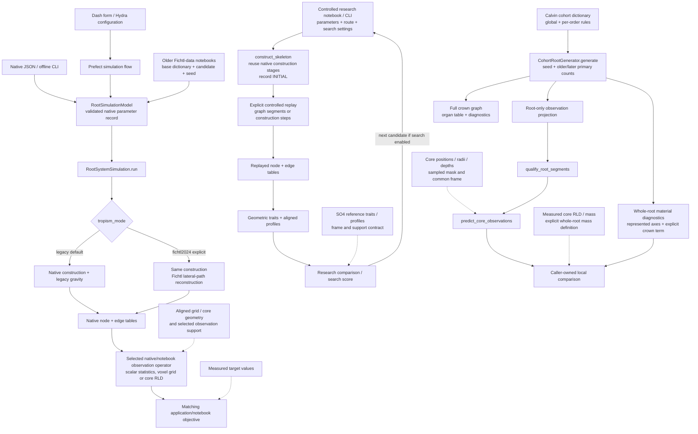
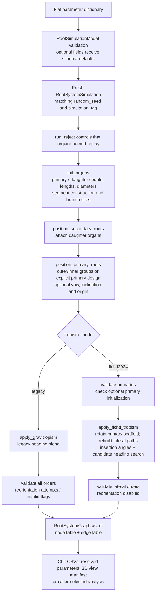
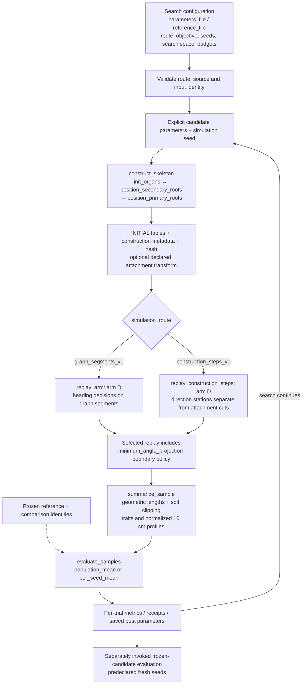
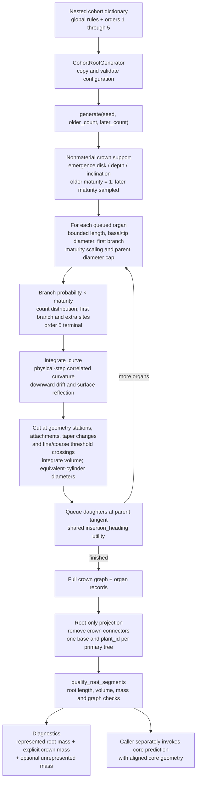

# How the input layers reach the model

Current fresh-generation input is schema 4. Use the [execution and parameter guide](NATIVE_EXECUTION.md).
Earlier interface descriptions below document previous versions.

18 November update: every input (flat, schema 2 native, construction steps,
cohort, schema 3) now runs through one fixed engine lifecycle in
`deeprootgen/model/engine.py`, parsed and resolved by
`deeprootgen/data_model/resolution.py`; the separate construction-step and cohort
runners were removed. Schema 3 switches curvature, taper, origins, maturity,
lengths, branching, capping and relocation independently; see
[native execution](NATIVE_EXECUTION.md). Route diagrams below predate this.

17 November integration update: [native execution and compatibility contracts](NATIVE_EXECUTION.md)
now describe the supported engine. The route diagrams below retain the
pre-consolidation source review; cohort generation and fresh SO4 construction-step
samples now execute through native `RootSystemSimulation.run()`.

Source inspection: **17 November 2026**, local code revision
`ff1a1df17381de3907f9799a56fb8f62008f6b47`. This explains the implementation
at that revision, not a proposed unified interface. The checkout was clean
before this documentation task. No simulations, fitting, service startup or
private observation/configuration inspection were needed.

Here, **Fichtl** means the Lucas Fichtl/Grapevine3D work and **Calvin** means
the Calvin Lam mature-vine work. There are **two constructor families**:
`RootSystemSimulation` and `CohortRootGenerator`. The first also supplies
construction functions to a separate **controlled replay executor**.

Consequently, some input layers are wrappers around the same model, some select
different algorithms within it, and the Calvin cohort interface invokes a
different constructor that shares selected utilities. There is no universal
adapter that translates every dataset into one unchanged default parameter list.

## 1. Five kinds of input

| Layer | What it answers | Examples | Where it goes |
|---|---|---|---|
| User interface | How do I submit a run? | Native JSON/CLI, Dash form, notebook, Python API | An entrypoint or runner |
| Construction parameters | What root architecture should be generated? | Native lengths/counts; Fichtl turning coefficients; cohort order rules | One selected constructor/executor |
| Execution and search settings | Which algorithm, seeds and candidate proposals should run? | `simulation_route`, `search_space`, seed lists, budgets | Research runner or application workflow |
| Observation support | Where and what was measured? | Coordinate frame, voxel boundaries, core radius/depth, diameter cutoff, sampled mask | Geometry-to-observation calculation |
| Targets and comparison | How is a candidate judged? | Observed RLD, trait means, profiles, biomass definition, objective | Comparison after construction |

An observed RLD or biomass value is not automatically a generator parameter.
A search can propose parameters, construct roots, calculate matching predicted
observations and compare them with targets. The observations themselves do not
become roots merely by being uploaded. Conversely, supplying measured counts,
length CDFs or a scaffold as construction inputs **conditions** the architecture;
those supplied properties are not independent predictions.

## 2. Overall flow

Solid arrows show execution/data flow. Dashed arrows show external comparison
inputs. The observation routes stay explicit because their supports differ.



The graph alone does not identify which observation operator or objective is
appropriate. In particular, the older Fichtl voxel objective, the SO4
trait/profile objective and Calvin core/material comparisons are separate.
Prefect additionally logs/persists results; that service wrapper is not needed
by the offline CLI or either research API.

### Which interface actually selects which code?

| Entry interface | Construction input | Execution path | What is different? |
|---|---|---|---|
| Native API / `python -m deeprootgen simulate` | Flat native dictionary, validated as `RootSimulationModel` | `RootSystemSimulation.run()` | Common native model; `tropism_mode` selects the lateral direction path |
| Dash simulation form | Form fields composed from Hydra configuration | Prefect `execute_simulation()` → native `run()` | Service orchestration and persistence around the native engine; the form is not a complete editor for every research field |
| Older Fichtl-data calibration notebooks | Notebook base parameters plus candidate overrides and explicit seed | Native model → notebook voxel/statistic comparison | Dataset-specific preparation and objective; the notebook name does **not** enable `fichtl2024` |
| Optional native Fichtl mode | Native parameters plus eight explicit `fichtl_*` coefficients | Native `run()` → `apply_fichtl_tropism()` | Reconstructs lateral paths; retains native scaffold/count/length construction |
| Controlled SO4 research / notebook 5 | Native parameter schema plus a separate route/search specification | `construct_skeleton()` → named replay | Reuses native construction stages, deliberately bypasses native `run()` and its validation/gravity sequence |
| Calvin mature-vine cohort API | Separate nested dictionary and `generate` arguments | `CohortRootGenerator.generate()` | Own organ sampling, crown emergence, branching, curvature and taper assembly; shared low-level utilities |

The generic application's `RootCalibrationModel` is another **request schema**:
it carries parameter intervals, optimizer settings and observations. Its helper
turns a proposed parameter dictionary into `RootSimulationModel` and calls native
`run()`. It does not provide an automatic cohort adapter or invoke notebook 5.
The current native calibration interval list also does not expose the whole
research parameter namespace.

## 3. Detailed native and optional Fichtl construction



`run()` is static at this revision: `self.grow(...)` is commented out.
`t` is therefore not elapsed time, vine age or a working growth control on this
path. Fichtl mode is an explicit static direction hypothesis, not an exact
temporal CPlantBox replay. Most native dimensional fields are **required**, not
schema defaults; a form, example or notebook may supply its own starting values.

Evidence: [native schema](../deeprootgen/data_model/simulation_data_models.py#L155),
[run sequence](../deeprootgen/model/root.py#L1282),
[Fichtl lateral reconstruction](../deeprootgen/model/root.py#L1308),
[offline CLI](../deeprootgen/cli.py#L11),
[Prefect execution](../app/flows/run_simulation.py#L33),
[calibration adapter](../deeprootgen/calibration/summary_statistics.py#L75).

## 4. Detailed controlled SO4 route



This diagram describes the current **search bridge**. Its two routes require
`tropism_mode="fichtl2024"`, explicit matching seeds, maximum order 3–5,
`soil_surface_z_cm=20` and compatible route controls. They compare arm D.
The lower-level controlled APIs also support explicit experiment arms and other
declared scaffolds; do not generalize the search bridge's constraints to every
research function. The graph-segment and construction-step routes use different
direction discretizations. Both explicitly assign the first step before boundary
projection; native Fichtl performs candidate heading search from its first
segment. Neither controlled route is identical to native Fichtl `run()`.

Every candidate/seed in the search bridge constructs a fresh INITIAL. A changed
configuration cannot be applied silently to an incompatible saved skeleton.
Seed sharing provides repeatability for the same source/configuration, not
guaranteed organ-by-organ pairing after topology changes.

Evidence: [INITIAL construction](../deeprootgen/research/so4_controlled.py#L232),
[route validation and execution](../deeprootgen/research/search_evaluation.py#L293),
[search CLI](../scripts/research/parameter_search.py#L83),
[notebook 5 and search contract](research/NOTEBOOK_PARAMETER_SEARCH.md).

## 5. Detailed Calvin cohort construction



Both cohorts begin at **topological order 1**. `older_count` and `later_count`
count primary roots belonging to one vine; they do not count vines. Maturity is
a latent capacity multiplier, not an age measurement. This route constructs
Pandas tables directly; it does not instantiate native `RootOrgan` or
`RootSystemGraph` objects.

The full graph contains crown-support connectors with no root material. The
observation projection removes those connectors and maps `plant_id` to the
primary-tree ID. Sum the primary trees for one vine. `generate()` automatically
qualifies this root-only support and calculates totals; it does **not** run a
core comparison or optimizer. Core predictions are a separate downstream call.

Evidence: [configuration validation](../deeprootgen/research/cohort_root_generator.py#L151),
[generation](../deeprootgen/research/cohort_root_generator.py#L210),
[projection and totals](../deeprootgen/research/cohort_root_generator.py#L324),
[construction contract](research/COHORT_ROOT_CONSTRUCTION.md).

## 6. What is reused, and what is different?

| Component | Native legacy / native Fichtl | Controlled SO4 | Calvin cohort |
|---|---|---|---|
| Input validator | `RootSimulationModel` | Same model schema plus route/identity checks | Separate dictionary validator |
| Initial organ topology and dimensions | Native `init_organs` | Reuses native `init_organs` and positioning | Own per-order/cohort sampling and breadth-first daughter queue |
| Whole-run executor | Native `run` | Own replay executor; no native `run` call | Own `generate` executor |
| Lateral insertion utility | Fichtl uses `insertion_heading` | Controlled Fichtl insertion uses the same utility | Reuses `insertion_heading` at local parent tangent |
| Continuing direction | Legacy blend or Fichtl candidate search | Controlled heading proposals and explicit discretization/boundary | Own integration using shared OU curvature and spherical-heading utilities |
| Correlated curvature primitives | Not the native Fichtl turning law | Available in separate physical-step/primary-curvature research APIs | Reuses `ou_joint_step`, `spherical_exp_heading`, frame rotation |
| Branch placement | Native spacing/zone controls and qualified research overrides | Reuses construction plus explicitly declared transforms | Per-order first-branch distance, branch probability and daughter-count distribution |
| Taper/material construction | Native segment-cylinder diameter rules | Preserves/replays declared construction material | Point taper integrated into volume-equivalent segment cylinders |
| Graph assembly | `RootSystemGraph` | Saved/replayed tables plus metadata | Direct table assembly; full crown graph and separate root projection |
| Observation utilities | Selected native statistics, grid or core route | Aligned geometric trait/profile route | Shared qualified root-support/core utilities; explicit crown term |
| Search and scoring | App or notebook owns objective | Research bridge owns explicit objective | Constructor has no built-in optimizer or acceptance target |

Shared source: [insertion helpers](../deeprootgen/utils/tropism.py#L29),
[frame rotation](../deeprootgen/utils/primary_orientation.py#L16),
[curvature process](../deeprootgen/research/curvature_process.py#L104),
[cohort imports](../deeprootgen/research/cohort_root_generator.py#L15).
The cohort does not reuse the native Fichtl `sample_heading` candidate-search law.

## 7. Important parameter crosswalk

Names below are actual input keys. Analogous rows do not imply a numerical
conversion or an interchangeable JSON file. Geometry is in **cm** unless noted;
diameter cutoffs in the cohort/core interfaces are explicitly **mm**.

| What you want to control | Native/default parameters | Fichtl / controlled research additions | Calvin cohort parameters and effect |
|---|---|---|---|
| Repeatability | `random_seed`; match simulator constructor seed | Explicit seed per realization; search also has `sampler_seed`, `seeds`, `qualification_seeds` | `generate(seed=...)`; per-organ/purpose streams |
| Number of root orders | `max_order` | Orders 4–5 need explicit higher-order direction assumptions in Fichtl scope | Exactly `orders["1"]` through `orders["5"]`; fifth order terminal |
| Primary-root number | `outer_root_num`, `inner_root_num` | Optional `research_primary_design`; optional `research_root_counts_by_order` conditions exact counts | `older_count`, `later_count` passed to `generate`; both are order-1 roots |
| Primary emergence/orientation | Native outer/inner positioning | `research_base_origin_x_cm`, `research_base_origin_y_cm`, `research_base_depth_cm`; paired yaw controls; optional primary design | `crown_radius_cm`, `crown_depth_cm`, `inclination_*`; emergence is distributed over a disk/depth range |
| Whole-axis length | `min_primary_length`, `max_primary_length`, `min_sec_root_length`, `max_sec_root_length`, `length_reduction` | `research_current_length_cdfs_cm` supplies order-specific current lengths; primary design can supply primary length | Per-order `length_cm={mean,sd,min,max}`; multiplied by `maturity**maturity_length_power` |
| Daughter number | `min_sec_root_num`, `max_sec_root_num`, `growth_sec_root` | Optional supplied order counts and compatible attachment quotas | Per-order `branch_probability` and `daughter_probabilities`; probability also multiplied by maturity |
| First branch / subsequent spacing | `floor_threshold`, `ceiling_threshold`, `interbranch_distance` | Physical branch zones, explicit primary fractions, capped redistribution, optional distal transform | Per-order `first_branch_cm`; later sites sampled uniformly after the first; first draw beyond tip gives no branches |
| Lateral insertion angle | Native placement rules | `fichtl_theta2_deg`, `fichtl_theta3_deg`, `fichtl_theta2_sd_deg`, `fichtl_theta3_sd_deg`; optional row-axial bias | `insertion_mean_deg`, `insertion_sd_deg`, relative to incoming parent tangent |
| Path bending | `root_vary` in degrees; legacy `gravitropism` blend | `fichtl_sigma` in rad/√cm, optional order overrides, trial coefficients and downward probability | Per-order `curvature_sd_rad_cm` in rad/cm, `correlation_cm`, `downward_drift_per_cm` |
| Numerical direction resolution | `segments_per_root`; attachment cuts can add nodes | `research_current_length_grid="construction_steps_v1"` separates direction stations from cuts on its named route | Global `step_cm`; material/attachment cuts add no direction draws |
| Diameter and taper | `base_diameter`, `apex_diameter`, `diameter_reduction` | Optional explicit primary cylinder diameter endpoints | Per-order `base_diameter_cm`, `tip_diameter_cm`, `midpoint_fraction`; global child/parent diameter cap |
| Root material mass | `root_tissue_density` in g/cm³ | Same native material assumption; a mass observation is separate | `dry_density_g_cm3`, explicit `crown_mass_g`; optional separate `unrepresented_fine_mass_g` |
| Fine/coarse classification | `fine_root_threshold` in cm; native daughter-organ mean diameter classification | Explicit cutoff/support in the selected observation operator | `fine_cutoff_mm`; taper split at crossings, separate fine/coarse material |
| Age / development | `t` currently inactive in native `run` | Current-length inputs describe a static state; they do not activate growth | `later_maturity`, length/diameter powers; hypothetical maturity, not years |
| Soil surface / sampling | Native `soil_surface_z_cm`, display soil dimensions | Search bridge requires surface z=20; depth=20−z; qualified SO4 frame | Constructor soil z=0, depth=−z; actual core coordinates supplied separately |

### Native controls worth reading carefully

| Fields | Current meaning and caution |
|---|---|
| `min_sec_root_num`, `max_sec_root_num` | Base count draw has an exclusive upper bound, except equal endpoints give the fixed count. Branch-site capacity can reduce the realized count. |
| `growth_sec_root` | Static count multiplier: at parent order k, requested count is `ceil(n*(1-growth_sec_root)**(-(k-1)))`; it is not time evolution. |
| `floor_threshold`, `ceiling_threshold` | Fractions of parent contour length bounding the branch zone; schema defaults 0.4 and 0.9. `interbranch_distance` is a physical mean lognormal spacing in cm. |
| `segments_per_root` | Initial number of direction/length pieces. Extra graph nodes from attachment subdivision are not extra biological roots. |
| `root_ratio`, `mechanical_constraints`, `origin_min`, `origin_max` | Retained schema fields with no current native construction consumer found. They do not impose root/shoot balance, soil mechanics or emergence positions. |
| `enable_soil`, `soil_layer_height`, `soil_layer_width`, `soil_n_layers`, `soil_n_cols` | Visual soil grid in native simulation; grid dimensions also matter to selected downstream RLD calculations. No soil water/nutrient growth response follows from enabling it. |
| `max_val_attempts`, `no_root_zone` | Native geometric-validation controls; default attempts 50 and legacy z threshold 0.0001 cm. Fichtl uses the explicit surface convention. |
| `simulation_tag` | Metadata label, not a biological control. |

The full native field inventory, synthetic example values and schema defaults
are in the [model review guide](MODEL_REVIEW_GUIDE.md#native-parameter-dictionary).
Example values are not an adopted biological default set.

### Fichtl and controlled-only settings

| Group | Keys | Meaning / activation |
|---|---|---|
| Mode | `tropism_mode` | Defaults to `legacy`. Explicit `fichtl2024` requires `gravitropism=0` and all eight coefficients below. |
| Downward objective | `fichtl_probability_down` | Probability of a downward rather than horizontal objective for order 2; not a continuous gravity strength. |
| Turning | `fichtl_sigma`; optional `research_fichtl_sigma_by_order` | Turning scale rad/√cm; proposal scale uses `sigma*sqrt(segment_length_cm)`. |
| Search effort | `fichtl_trials_type2`, `fichtl_trials_type3` | Coefficients for length-dependent additional candidates, using stochastic rounding; not fixed trial counts. |
| Insertion | `fichtl_theta2_deg`, `fichtl_theta3_deg`, `fichtl_theta2_sd_deg`, `fichtl_theta3_sd_deg` | Mean/SD before truncated angle sampling relative to parent direction, in degrees. |
| Length law | `research_current_length_cdfs_cm` | Order-keyed `lengths_cm` and `cumulative_probabilities`; replaces the ordinary length law for supported orders. |
| Branch layout | `research_branch_placement`, `research_primary_branch_zone_cm`, `research_primary_branch_fractions` | Choose spacing behavior, explicit primary physical zone or normalized attachment sites subject to compatibility checks. |
| Orientation | `research_insertion_row_axial_kappa`; `research_primary_yaw_mean_deg`, `research_primary_yaw_kappa`, `research_primary_yaw_reverse_probability`; `research_primary_inclination_bias` | Distinct insertion azimuth, primary yaw and rigid subtree inclination hypotheses. Inclination bias is dimensionless, not degrees. |
| Primary scaffold | `research_primary_design` | Explicit IDs/category, length, initial chord inclination/azimuth and first/last incoming-cylinder diameters. Not a cohort age or taper rule. |
| Higher-order conditioning | `research_higher_order_tropism`, `research_root_counts_by_order` | Explicit higher-order direction assumptions and supplied topology counts. |
| Named replay only | `research_current_length_grid`, `research_parent2_branch_zone_cm`, nonzero `research_tertiary_length_rank_strength`, nonzero `research_primary_attachment_distal_fraction` | Native `run()` rejects these active controls. Use the compatible controlled construction/replay path. |

These controls are not freely composable. Schema acceptance and executor
compatibility are separate checks. See the [complete research input table](MODEL_REVIEW_GUIDE.md#optional-fichtl-and-construction-controls)
and each linked method contract before composing them.

### Calvin globals and per-order distributions

| Group | Keys | How they work |
|---|---|---|
| Run arguments | `seed`, `older_count`, `later_count` | Passed to `generate`, outside the dictionary; at least one older primary required. |
| Geometry and budget | `step_cm`, `max_organs` | Physical integration spacing; organ cap raises an error rather than silently truncating architecture. |
| Crown and orientation | `crown_radius_cm`, `crown_depth_cm`; `inclination_mean_deg`, `inclination_sd_deg`, `inclination_bounds_deg` | Disk radius, positive-down emergence depth interval and truncated primary inclination from horizontal. |
| Maturity | `later_maturity`, `maturity_length_power`, `maturity_diameter_power` | Later-origin maturity interval; scales whole length and basal diameter and multiplies branching probability. First-branch and tip-diameter draws are not directly maturity-scaled. |
| Attachment | `insertion_mean_deg`, `insertion_sd_deg`, `child_diameter_fraction_max` | Daughter orientation and basal diameter limit relative to parent point diameter at the attachment. |
| Material | `dry_density_g_cm3`, `fine_cutoff_mm`, `crown_mass_g` | Explicit density, diameter cutoff and separate crown mass. |
| Optional fields | `unrepresented_fine_mass_g=0`, `reconcile_length_metadata=False` | Diagnostic mass with no spatial roots; bounded numerical length-metadata reconciliation with no moved coordinates/sites. |
| Per-order positive distributions | `orders[k].length_cm`, `.base_diameter_cm`, `.tip_diameter_cm`, `.first_branch_cm` | Each uses `{mean, sd, min, max}` in cm. Mean/SD refer to the untruncated lognormal; truncation, maturity, caps and branch censoring change realized summaries. |
| Per-order branching | `orders[k].branch_probability`, `.daughter_probabilities` | Daughter probabilities correspond to counts **1…N**. Zero branching is controlled separately. Order 5 is terminal. |
| Per-order curvature | `orders[k].curvature_sd_rad_cm`, `.correlation_cm`, `.downward_drift_per_cm` | OU curvature SD rad/cm, correlation length cm and downward drift 1/cm. Requires `step_cm*drift < 1`. |
| Per-order taper | `orders[k].midpoint_fraction=0.5` | `d_mid=d_tip+fraction*(d_base-d_tip)`; piecewise-linear point taper, not a fine-mass fraction. |

There is no adopted default mature-vine parameter set. For a complete invented
configuration see [the cohort fixture](../tests/test_cohort_root_generator.py).
For dimensional interpretation see the [review guide](MODEL_REVIEW_GUIDE.md#cohort-research-configuration-dictionary).
Fichtl `sigma` and cohort curvature SD have different units and stochastic laws;
copying the same numeric value between them has no defined equivalence.

## 8. Observation inputs and targets are downstream interfaces

| Comparison route | Additional inputs | Operator and result |
|---|---|---|
| Generic native calibration | `parameter_intervals`, `calibration_parameters`, `summary_statistics`, `statistics_comparison`; relevant soil/core fields | Proposed parameters → native simulation → selected scalar statistics / RLD → discrepancy |
| Older Fichtl-data notebooks | Dataset/grid support and notebook-specific objective settings | `aggregate_root_grid` and notebook processing produce voxel comparisons; objective is not automatically SO4 trait/profile scoring |
| Controlled SO4 search | `reference_file`, frame/operator/root-support identities, matching `root_orders`, positive trait means and normalized profiles | `summarize_sample` / `evaluate_samples`: order-3/4/5 contracts have 13/15/17 traits plus three profiles |
| Cohort core predictions | `coordinate_frame`, `fine_diameter_max_mm`, `dry_density_g_cm3`; core table fields below | `qualify_root_segments` then `predict_core_observations`: geometric fine/coarse/total RLD and represented root mass in each finite cylinder |
| Whole-vine material comparison | Explicit observed mass compartment and target; density and crown assumptions | Sum represented root-axis mass and crown exactly once; optional unrepresented mass stays separate from spatial predictions |

The research core table contains `core_id`, `x_cm`, `y_cm`, `z_lower_cm`,
`z_upper_cm`, `radius_cm`, `sampled`, and optional `known_volume_cm3`.
The frame label declares that roots and cores are **already aligned**; it does
not perform a coordinate transformation. `sampled=false` is missing observation,
not observed zero. RLD is intersected centreline length divided by core volume,
in cm/cm³. This is separate from the native application's
`calculate_core_rld` API and its defaults.

For a cohort taper interval of length h and endpoint diameters a,b, all in cm:

```text
volume_cm3 = pi*h*(a*a + a*b + b*b)/12
exported_segment_diameter_cm = sqrt((a*a + a*b + b*b)/3)
represented_root_mass_g = sum(volume_cm3)*dry_density_g_cm3
whole_mass_g = represented_root_mass_g + crown_mass_g + unrepresented_fine_mass_g
```

Use the `organs` table for point basal/mid-axis diameters and biological counts.
The exported equivalent-cylinder diameter is a different quantity. Full crown
connectors must not contribute root length or mass. The generic research
`audit_cylindrical_mass` requires a single base/plant, so a cohort forest needs
tree-by-tree use and summation; `qualify_root_segments` already supports the
whole root-only forest.

Evidence: [native calibration](../deeprootgen/calibration/summary_statistics.py#L102),
[grid aggregation](../deeprootgen/statistics/root_grid_aggregation.py#L14),
[native core API](../deeprootgen/statistics/spatial_rld.py#L7),
[qualified research segments](../deeprootgen/research/core_observation.py#L141),
[research core prediction](../deeprootgen/research/core_observation.py#L309).

## 9. Reading and verification boundary

This guide verifies call structure and parameter meaning from source. It does
not requalify biology, repeat any historical test count, validate empirical
fits or certify every combination of research controls. No model source,
defaults, lockfile or data were changed. Mermaid diagrams describe the inspected
code; arrows do not imply that all outputs are interchangeable.

Use [MODEL_REVIEW_GUIDE](MODEL_REVIEW_GUIDE.md) for the field dictionary,
[ACTIVE_SO4_RESEARCH](research/ACTIVE_SO4_RESEARCH.md) and
[ACTIVE_CALVIN_RESEARCH](research/ACTIVE_CALVIN_RESEARCH.md) for current research
status, and [ARCHITECTURE](ARCHITECTURE.md) for the wider application map.
Empirical settings, observations and comparisons remain local.
