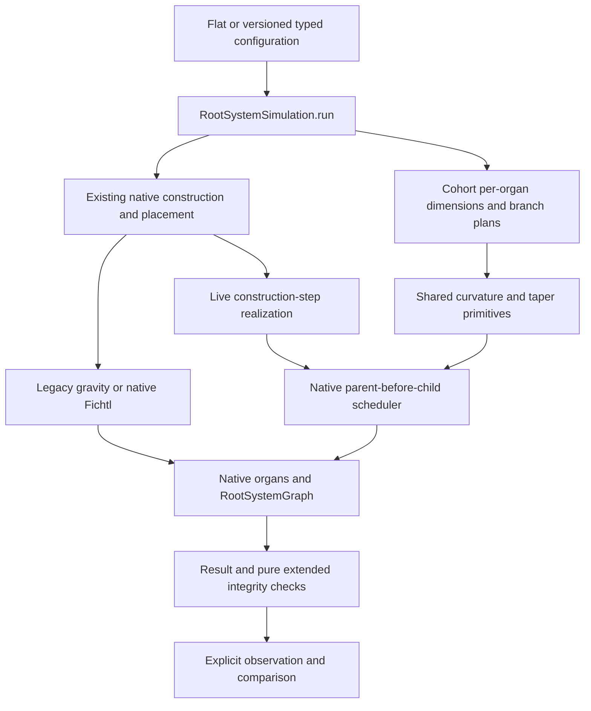

# Native execution with research construction options

> Current code has one public entrypoint but still dispatches complete internal
> execution bundles. Independent feature switches are **not implemented**. See
> the [single-engine revision plan](research/NATIVE_FEATURE_COMPOSITION_REVIEW_AND_PLAN.md)
> for the proposed shared phases and same-JSON options. The examples below describe
> the currently implemented version-2 interface.

17 November 2026. Code integration uses one public entrypoint:
`RootSystemSimulation.run()`. The legacy flat schema and its defaults remain
available. Version 2 explicitly selects extended construction and trajectory
contracts. Example inputs below are invented; they are not calibration settings.

## Execute locally

Use the existing Python 3.10 environment and unchanged lock described in
[RUNNING.md](../RUNNING.md). Run with a fresh simulator and an explicit seed:

```python
import json
from pathlib import Path
from deeprootgen.data_model import RootSimulationConfig
from deeprootgen.model import RootSystemSimulation

config = RootSimulationConfig.model_validate(json.loads(
    Path('examples/research/native_steps_synthetic.json').read_text()
))
simulation = RootSystemSimulation(random_seed=config.random_seed)
simulation.run(config)
nodes, edges = simulation.G.as_df()
metadata = simulation.result.metadata
organs = simulation.result.organ_table
```

The same offline CLI accepts old or version-2 inputs:

```bash
python -m deeprootgen simulate \
  --config examples/research/native_steps_synthetic.json \
  --outdir .runtime/my-new-native-step-run
python -m deeprootgen simulate \
  --config examples/research/native_cohort_synthetic.json \
  --outdir .runtime/my-new-native-cohort-run
```

Use a new output directory. Extended output adds `organs.csv`, `execution.json`,
`crown_support.json` and, where applicable, `node_metadata.csv`. Node/edge CSVs
retain native table columns. `run()` still returns `None`; inspect the simulator
and its result. A failed extended run has no successful result. Do not reuse
its partial graph or attempt another run on the same simulator.

## Native execution ownership



## Supported construction and direction contracts

| Input | Construction | Direction and boundary semantics |
|---|---|---|
| Flat `RootSimulationModel`, legacy mode | Existing native constructor | Existing gravity and validation draw/call order |
| Flat `RootSimulationModel`, `fichtl2024` | Existing native constructor | Native heading search from first graph segment, with candidate surface filtering |
| Version 2, native construction, `native` trajectory | Same native methods | Mode selected by nested native parameters |
| Version 2, native construction, `construction_steps_v1` | Native constructor plus the declared supported research controls | Original construction intervals, assigned first chord, transported frame and minimum-angle surface projection |
| Version 2, cohort construction, `cohort_v5` | Native scheduling, organ objects and graph assembly using bounded cohort rules | Physical stations, correlated curvature and downward surface reflection/reset |

Version 2 rejects unknown fields and unsupported construction/trajectory
combinations. Cohort inputs require no unused native dimensions. Native legacy
requests preserve their historical parsing behaviour. Nested native dimensions
retain their existing schema; old required fields such as `t` remain for
compatibility and do not activate elapsed-time growth.

SO4 first-step, boundary and frame semantics remain distinct from native Fichtl.
Cohort maturity remains a hypothetical dimension/branching modifier. Root order,
diameter class and cohort maturity are different quantities. The migration does
not fit new parameters or establish biological accuracy.

## Shared ownership and compatibility adapters

`model/root.py` owns execution and parent-before-child queue scheduling.
`model/execution.py` realizes live native construction intervals and synchronizes
native graph/organ relationships. `model/cohort.py` supplies per-organ cohort
sampling, curve and material construction within the same native scheduler.
`RootSystemGraph` is the sole node/edge writer. Shared controlled direction,
attachment subdivision, OU curvature and taper functions have one implementation
under `model/`; historical imports forward to those implementations.

The old `CohortRootGenerator.generate()` is now a native configuration/export
adapter. It reconstructs the historical full-support tables for compatibility;
it no longer owns a separate generator. Fresh construction-step samples in the
notebook/search bridge call native `run()`. Saved INITIAL replay and graph-segment
arms remain explicitly historical experiment tools for reproduction.

For exact INITIAL receipt recording, `run(config, initial_recorder=callback)`
accepts a read-only callback for construction-step preparation. The search bridge
uses the existing `capture_initial` snapshot serializer. The recorder is not an
executor and final geometry is produced from live native organs.

## Root material and crown support

For extended cohort execution, `simulation.G` contains a root-only forest with
one zero-material base at each primary origin. `plant_id` identifies the actual
vine. `simulation.result.node_metadata` carries `primary_tree_id` and cohort.
The optional `crown_support` describes nonmaterial crown connections and the
separately assumed crown mass. Those links do not contribute root length,
volume or core RLD.

Existing finite-core utilities require one base per observer plant ID. Use:

```python
root_nodes, root_edges = simulation.result.observation_tables(simulation.G)
```

This explicitly projects primary trees onto temporary observer IDs, retaining
`vine_id`. Sum primary-tree contributions back to the vine before averaging
populations or adding crown mass. The compatibility full-support view is
`simulation.result.cohort_tables(simulation.G)`; do not pass it to root-only
statistics.

Root geometry uses cm and z upward. SO4 uses x across-row, y along-row and
`depth=20-z`; cohort uses its declared local crown/soil frame. Read metadata
before comparing outputs. Cohort exported segment diameters conserve integrated
taper volume and differ from point basal/midpoint diameters. Old organ-average
root labels retain their historical meaning. Diameter-class observations use an
explicit cutoff and density rather than inferring them from labels.

## Consumer capabilities and verification

| Consumer | Extended support |
|---|---|
| Direct native API and offline CLI | Supported by the integration tests and invented examples |
| Controlled construction-step notebook/search bridge | Native execution with existing comparison and INITIAL identities |
| Historical cohort API | Native adapter with exact historical export parity on frozen invented cases |
| Finite-core utility | Explicit root-only projection, with mandatory tree-to-vine aggregation |
| NetworkX | Root forest, including isolated bases; sidecars remain separate |
| Dash/Prefect persistence, BentoML, native calibration/legacy statistics | Flat native requests only; Prefect rejects extended requests before side effects; other extended consumer integration is unqualified |

The unchanged historical reference commit is recorded in
`tests/fixtures/native_execution_contracts.json`. Its expected hashes were
computed from isolated reference source, not regenerated from the candidate.
Tests check all four contracts, RNG/interval receipts, graph-object consistency,
root material, projections, invalid requests and direct native ownership.
See [the design](research/NATIVE_EXECUTION_CONSOLIDATION_DESIGN.md) and the
[implementation report](research/NATIVE_EXECUTION_INTEGRATION_REPORT.md) for
source-bound results and remaining limitations.
