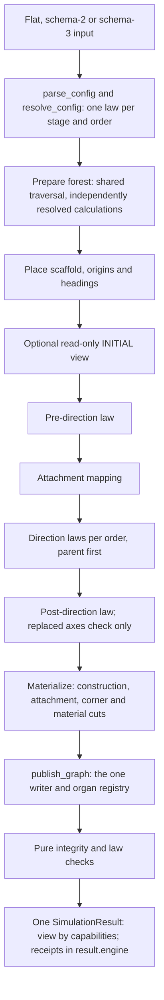

# Historical execution contracts for schema versions 1–3

Fresh generation uses the schema-4 API and CLI in the
[canonical execution guide](NATIVE_EXECUTION.md). This page records the earlier
formats and study protocols. The [archive entrypoint](../deeprootgen/archive/simulation.py)
accepts those formats for recorded studies. Use the
[offline converter](research/SINGLE_INPUT_MIGRATION.md) to prepare an older
document for fresh generation.

> **18 November 2026 status.** Every input — legacy flat, schema 2 (native,
> `construction_steps_v1`, `cohort_v5`) and schema 3 — is parsed and resolved by
> one resolver and runs through one fixed engine lifecycle with one graph writer
> and one random-stream owner. The separate native, construction-step and cohort
> runners are gone; old inputs are adapters that declare their historical laws.
> Schema 3 switches curvature, taper, origins, maturity, lengths, branching,
> parent capping and attachment relocation on and off in the same file. See the
> [plan](research/NATIVE_FEATURE_COMPOSITION_REVIEW_AND_PLAN.md) and the
> [implementation report](research/NATIVE_ENGINE_IMPLEMENTATION_REPORT.md).

> **Review repairs, 18 November.** Schema 3 now keeps native traversal and
> placement when dimensions/material/directions are replaced; no last-feature
> toggle selects a whole-forest planned regime. See the
> [repair report](research/NATIVE_ENGINE_REPAIR_REPORT.md) for verification,
> migration differences and the retained historical adapter policies.

All example inputs are invented; they are not calibration settings, and no
result here is a biological validation.

## Schema 3: one JSON, independently enabled features

The [schema-3 example](../examples/design/native_feature_options.json)
keeps one native parameter set and a `features` block. Change only a block's
`enabled` flag to switch that calculation on or off; every other value keeps its
single owner. Disabled blocks keep their settings, are type-checked and never
affect the model, its draws or its effective-model identity. Unknown keys,
misspelled booleans, duplicate JSON keys, old `research_*` aliases inside
`parameters`, incomplete settings and unsupported combinations fail before any
simulator state or random draw.

```python
from pathlib import Path
from deeprootgen.data_model import explain_config
from deeprootgen.model import RootSystemSimulation

source = Path('examples/design/native_feature_options.json')
print(explain_config(source)['laws']['by_order']['1'])   # active laws per order
simulation = RootSystemSimulation(random_seed=42, simulation_tag='proposed-invented-feature-toggle-example')
simulation.run(source)                                  # raw JSON text, Path or dict
resolved = simulation.result.resolved                   # saved description and hashes
```

```bash
python -m deeprootgen simulate --config my_features.json --explain-config
python -m deeprootgen simulate --config my_features.json --outdir .runtime/my-new-run
```

`--explain-config` prints the active law per stage and order, inactive values,
replaced native fallbacks, units, stream policy and hashes, or a
`{"valid": false, "error": ...}` verdict. Pass raw input (dict, JSON text or
path) so the supplied-input hash matches across API, CLI and notebooks. Each
result records three identities: supplied input (includes dormant settings),
effective model (active laws and the native values they consume; labels,
resource limits and inactive fallbacks excluded) and run identity (effective
model, initial RNG state, seed, run-start source/lock and package environment).
Legacy unseeded runs record distinct initial states and explicitly declare
`unseeded_non_replayable`; the hash does not promise seed-only reproduction.
Restart Python after source edits: the model import checkpoint is checked before
execution, since a new disk hash cannot authenticate already imported code.

### What each feature replaces

| Feature | Stage | Replaces | Semantics |
|---|---|---|---|
| `curvature` (per order) | direction | native scaffold / Fichtl / legacy law of that order | Correlated (OU) curvature on physical arclength: `step_cm`, stationary `curvature_sd_rad_cm`, `correlation_length_cm`, `downward_drift_per_cm`; reflected downward at `soil_surface_z_cm`. Primary heading `scaffold_chord` or `origin_heading`; daughters use a keyed `insertion_angle` about the realized parent tangent. |
| `taper` (per order) | material | cylinder per construction interval | Point diameter on arclength (base, mid = tip + fraction·(base − tip), tip); each segment carries the volume-conserving equivalent diameter and is classified fine/structural by it. Geometry is unchanged. |
| `lengths` (per order) | dimensions | native uniform lengths | `bounded_lognormal` (native segment proportions kept) or `discrete_cdf` (the keyed current-length CDF law). |
| `branching` (per order) | branch plan | native count and spacing | First-branch draw, probability, daughter count and uniform sites; terminal order is `max_order`. |
| `primary_origins` | placement | common base at the origin | `point`: translated common base; `disk`: one zero-material base per primary, optional `radial_inclination` heading and optional `azimuth_groups`. Each group is a von Mises polar angle for its listed zero-based primary birth indices: `primary_indices`, `mean_deg` anticlockwise from +x, `concentration` κ ≥ 0, and optional `half_plane` (redraw until within 90° of the mean). Groups must not overlap; unlisted primaries, or no groups, keep a uniform angle. |
| `cohort_maturity` | dimensions | maturity 1 | Dimensionless value per primary group (never age); scales whole length, point-taper base and optionally branch probability. |
| `parent_diameter_cap` | material | none | Daughter base ≤ fraction × parent point diameter at the birth site. |
| `attachment_relocation` | attachments | birth site | Order-2 sites move to `fraction·L + (1 − fraction)·old`; sampled daughter dimensions are kept. |

Order of constraints: sampling → maturity scaling → parent cap → tip limit →
branch censoring. Supported combinations are declared and checked before
execution, for example: maturity diameter scaling and parent capping require
taper on every order; branch-probability scaling requires the branching law;
with the legacy fallback, curvature must cover a prefix of orders 1..k (native
repairs of an ancestor would otherwise rotate a curved descendant); relocation
requires daughters realized from the final attachment and cannot be combined
with capping. Schema 3 always retains the shared native birth-order traversal
and independently selected placement/corrections. Replaced native bounds need
not be supplied. Compatibility draws retain native segment proportions and draw
counts, using bounds independent of dormant values. A native descendant still
requires its ancestors' immutable native birth cylinders. The
[replaced-dimensions example](../examples/design/native_features_fully_replaced.json)
uses keyed length/material/direction laws and retains native placement; it no
longer promises an untouched native RNG. Only the historical cohort adapter
retains its explicitly declared planned sampling schedule.

### Crown origins along a buried trunk

The [buried-trunk example](../examples/design/native_crown_0_20cm.json) uses:

```json
"primary_origins": {
  "enabled": true,
  "settings": {"layout": "disk", "radius_cm": 0.0, "depth_range_cm": [0.0, 20.0]}
}
```

Each first-order root samples its own depth below the declared soil surface,
from the surface to 20 cm down. `radius_cm: 0` places origins along the buried
trunk; a positive radius allows lateral crown spread. Depth is measured below
`soil_surface_z_cm`, with z positive upward. This emergence interval describes
the buried crown/trunk, not maximum root-system depth. Disabling the option
recovers the default common origin.

### Additional native/SO4 options

| Feature | Settings / consumer |
|---|---|
| `primary_placement` | `yaw_mean_deg`, `yaw_kappa`, `yaw_reverse_probability`, `inclination_bias`, or `explicit_design`; existing primary rotation/design kernels. Explicit design owns primary dimensions and conflicts with order-1 length/taper replacements. |
| `branch_sites` | `placement`, `counts_by_order`, `primary_zone_cm`, `primary_fractions`, `parent2_zone_cm`; native supplied-count/site kernels. Conflicting probability/count/site owners are rejected. |
| `sibling_lengths` | `tertiary_rank_strength`; existing stable-ID sibling-family transform, with its declared v1 scope. |
| `insertion` | `row_axial_kappa_by_order`; native Fichtl/construction-step insertion, using final parent tangent. Curvature insertion is a different owner and conflicts. |
| `direction` | `sigma_by_order`, `higher_order_tropism`, `stationing: "construction_steps_v1"`, `boundary: "minimum_angle_projection"`, `first_interval: "assigned_insertion"`; construction steps retain the original length-sampling partition independently of later material cuts. |
| `direction` corrections | `primary_correction: "frozen_surface_check"`, `post_correction: "pure_surface_check"` explicitly select historical check-only policies. Omitted/`native` retains native corrections; stationing alone does not change correction policy. |
| `materialization` | `reconcile_length_metadata`: explicit bounded binary64 reconciliation on tapered axes; integrated material remains conserved. |

All are ordinary enabled/settings blocks. Order maps use canonical string keys.
The v1 SO4 controls retain their established Fichtl/order/CDF/seed restrictions;
these are declared compatibility constraints, not a claim that every possible
Boolean combination is meaningful. Construction-step directions and taper now
compose through the common materializer. Canonical tangents come from realized
parent geometry and can differ from historical carried unit vectors by binary64
roundoff; matched synthetic tests use 1e-12 comparison tolerance. Historical
adapter outputs and their exact references retain their old schedules/views.

`run(..., initial_recorder=callback)` passes a read-only view of the placed
scaffold to `callback(sim_view, parameters_view)` at the INITIAL phase. The
views contain detached data, reject attribute assignment, and expose no RNG or
execution methods; returned tables/dictionaries are copies. It is accepted for construction-step
input and for schema-3 native construction.

A replaced direction law draws only from its keyed stream; native corrections
visiting a replaced axis take their usual draw but only check. Biology and
placement draws are therefore unchanged by a direction replacement, while later
correction draws can differ when validity outcomes differ.

## Run from a notebook with tracking

Use [`notebooks/grapevine_fichtl_2024/6_native_engine_tracked_runs.ipynb`](../notebooks/grapevine_fichtl_2024/6_native_engine_tracked_runs.ipynb)
for traceable notebook runs. Select the qualified Python 3.10 environment; the
notebook finds the repository root itself. It explains the resolved
configuration before running, runs primary curvature off → on → off from the
same file, checks exact baseline recovery, then shows the same tracked toggle
for another feature. It uses only the invented example by default.

Each run goes through `deeprootgen.run_records.tracked_run`, which uses the
same parser, engine and exporter as the CLI. It never overwrites a folder and
writes, under `.runtime/notebook-native-engine/<session>/<label>/`:

* `parameters.json`: the exact input after any notebook edit; rerun it with
  `python -m deeprootgen simulate --config <folder>/parameters.json --outdir <new>`;
* `resolved_config.json`: active laws by stage and order, inactive settings,
  units, RNG streams and hashes;
* `run_record.json`: label, UTC time, input file and its hash, the three model
  identities, active features, seed, counts, output hashes, generator source
  hash, git commit and dirty state, and package versions;
* `run_manifest.json`, `nodes.csv`, `edges.csv` and `organs.csv`.

Every record is also appended to `.runtime/notebook-native-engine/ledger.jsonl`;
`read_ledger` loads it for comparison across sessions. To check a
reproduction, compare `effective_model_sha256` (same model) and
`run_identity_sha256` (also same seed, code and numeric environment). Keep
private inputs and their run folders local.

```python
from deeprootgen.run_records import read_ledger, tracked_run

record = tracked_run("my_features.json", ".runtime/my-runs/first", label="first",
                     ledger=".runtime/my-runs/ledger.jsonl")
```

## Old inputs

Use the existing Python 3.10 environment and unchanged lock described in
[RUNNING.md](../RUNNING.md). Run with a fresh simulator and an explicit seed:

```python
import json
from pathlib import Path
from deeprootgen.model import RootSystemSimulation

source = Path('examples/research/native_steps_synthetic.json')
simulation = RootSystemSimulation(random_seed=json.loads(source.read_text())['random_seed'])
simulation.run(source)
nodes, edges = simulation.G.as_df()
metadata, organs = simulation.result.metadata, simulation.result.organ_table
```

```bash
python -m deeprootgen simulate --config examples/research/native_steps_synthetic.json \
  --outdir .runtime/my-new-native-step-run
python -m deeprootgen simulate --config examples/research/native_cohort_synthetic.json \
  --outdir .runtime/my-new-native-cohort-run
```

The archived adapters preserve the recorded parsing and declare the historical
laws for the shared phases, including random-stream and node-ID conventions.

| Input | Declared laws in the shared engine |
|---|---|
| Flat `RootSimulationModel` / schema-2 native | Native construction, placement, corrections and Fichtl or legacy direction laws, in the historical draw order |
| Schema-2 `construction_steps_v1` | Native construction and placement, read-only INITIAL view, frozen-scaffold surface check, distal relocation, construction-step interval direction law with minimum-angle surface projection, pure checks, record-based identity allocation |
| Schema-2 `cohort_v5` | Planned construction with bounded lengths, point taper, first-branch branching, maturity groups, parent cap, disk origins with radial inclination and OU curvature on every order; historical `SeedSequence([seed, organ, purpose])` streams, bases from node ID 1, cohort result serialization |

Use a new output directory. Extended output adds `organs.csv`, `execution.json`,
`crown_support.json`, `resolved_config.json` and, where applicable,
`node_metadata.csv`. Node/edge CSVs retain native table columns. `run()` returns
`None`; inspect the simulator and its result. A failed run publishes no result.
Every run needs a fresh simulator.

## Execution ownership



| Module | Responsibility |
|---|---|
| `data_model/resolution.py`, `features.py`, `inventory.py` | Parser, schema 3, law tables, supported combinations, identities, field inventory |
| `model/engine.py`, `axis_state.py` | Fixed lifecycle, shared axis facade and immutable birth context; historical cohort sampling schedule remains explicit |
| `model/root.py` | Native kernels (construction, placement, validation, Fichtl and legacy laws) |
| `model/laws.py`, `axis_laws.py`, `native_features.py` | Leaf laws: planned sampling, origins, headings, maturity, branching, curvature, taper |
| `model/execution.py`, `attachment.py`, `interval_geometry.py` | Construction-step kernels: the one distal-relocation law and the interval direction law |
| `model/materialize.py`, `cohort_geometry.py` | Cut union, taper integration, classification |
| `model/hgraph.py` (`publish_graph`) | Sole writer: identity allocation, nodes, edges, organ rebinding |
| `model/views.py`, `execution.py` (`SimulationResult`) | Result contents by capability and declared historical serialization |
| `model/streams.py`, `provenance.py`, `budget.py` | RNG ownership, run-start fingerprints and pre-allocation budgets |

The historical `CohortRootGenerator.generate()` remains a configuration/export
adapter over `run()`. Saved INITIAL replay and graph-segment arms remain
explicitly historical experiment tools; they are not fresh generators.

## Root material and crown support

Forests with distributed origins (cohort adapter, schema-3 `disk` origins)
contain one zero-material base per primary. `plant_id` identifies the actual
vine; `simulation.result.node_metadata` carries `primary_tree_id` and the group
label. The cohort adapter's optional `crown_support` describes nonmaterial crown
connections and the separately assumed crown mass; those links do not contribute
root length, volume or core RLD.

Existing finite-core utilities require one base per observer plant ID. Use:

```python
root_nodes, root_edges = simulation.result.observation_tables(simulation.G)
```

This projects primary trees onto temporary observer IDs, retaining `vine_id`,
whenever the result declares the `tree_to_vine_map` capability. Sum
primary-tree contributions back to the vine before averaging populations or
adding crown mass. The full-support view `simulation.result.cohort_tables(...)`
requires the `crown_support_view` capability; do not pass it to root-only
statistics.

Root geometry uses cm and z upward. The construction-step contract uses x
across-row, y along-row and `depth=20-z`; the cohort contract uses its declared
local crown/soil frame. Read metadata before comparing outputs. Tapered segment
diameters conserve integrated volume and differ from point basal/midpoint
diameters. Native organ-average labels retain their meaning on untapered axes.

## Consumer capabilities and verification

| Consumer | Support |
|---|---|
| Direct API, offline CLI, tracked notebook runs | All inputs above; tested with invented examples |
| Controlled construction-step notebook/search bridge | Schema-2 adapter with existing comparison and INITIAL identities |
| Historical cohort API | Schema-2 archive entrypoint for recorded cohort experiments |
| Finite-core utility | Explicit root-only projection, with mandatory tree-to-vine aggregation |
| NetworkX | Root forest, including isolated bases; sidecars remain separate |
| Dash/Prefect persistence, BentoML, native calibration/legacy statistics | Flat native requests only; Prefect rejects other requests before side effects |

The [synthetic contract fixture](../tests/fixtures/native_execution_contracts.json)
records the pre-consolidation source commit and its original output hashes.
The active tests use the captured inputs to check shared-engine ownership,
graph integrity, material and the INITIAL callback. To rerun the historical
implementation, use the recorded revision in a separate checkout with its
matching dependencies.

`limits.max_organs`, `max_nodes` and `max_stations` fail explicitly before the
corresponding allocation; successful-run model identity excludes these limits.
Historical cohort error timing remains part of its adapter contract. The
`.proposed.json` example is retained as a compatibility copy; new callers should
use `native_feature_options.json`.
