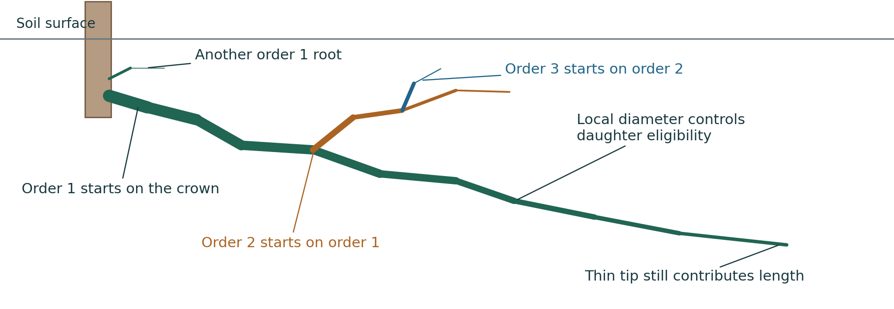
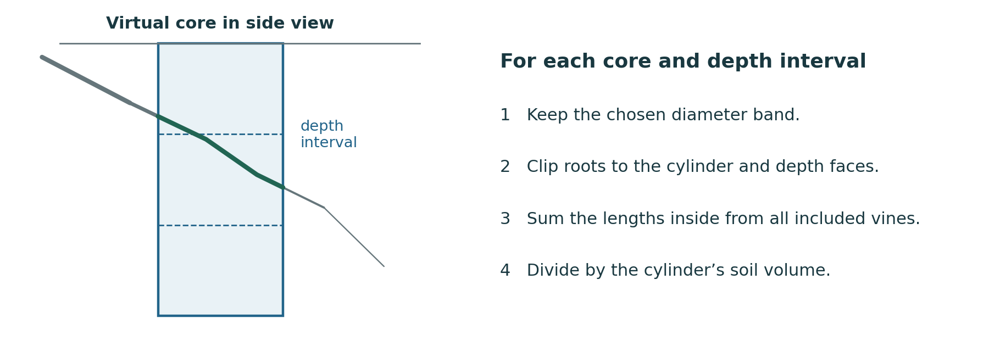
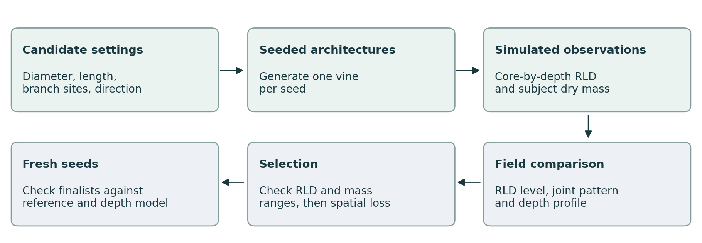

# How DeepRootGen builds and fits grapevine root systems

DeepRootGen reconstructs a possible three-dimensional vine from a set of biological rules. The Site 1 study asks whether repeated vines from those rules put enough root length at the **measured positions and depths**, while producing a plausible underground dry mass. Two vines can have the same total length and mass yet give different predictions at every soil core. That is why the fitting procedure simulates the measurement itself.

## From crown to branching tree

A fresh simulation takes one schema-4 configuration and a random seed. The configuration combines global values such as maximum root order and tissue density with optional rules selected by order. During construction each axis has an identity, a parent attachment, a length and a material profile. All selected rules contribute to the same forest. A seed selects one realization of the configured distributions. In this reconstruction there is no elapsed growth time attached to an axis.

1. **Place the first-order roots.** A first-order root starts on the rootstock, at any diameter. Set the number of primaries and the fraction assigned to the outer group. A disk can sample emergence locations across a radius and burial-depth interval. A vine catalogue can instead select one coherent set of origins and headings. For a measured vine this preserves the association between each supplied position and direction.
2. **Draw dimensions.** For each order, draw or specify contour length, the distance along the curved root. Draw basal and tip diameters when point taper is active. Optional maturity groups assign a shared size factor to a primary and its descendants. The factor can scale length, basal diameter and branching probability separately according to the chosen settings. The factor carries no measured chronological age.
3. **Propose daughters.** A daughter’s order is its parent’s order plus one. In the first-site/count law, a parent must pass its branch-probability draw and its first site must fit before the tip. The model draws a conditional daughter count and places remaining sites along the available contour. An alternative law draws a Poisson count from usable length divided by mean spacing, after basal and apical exclusions and a parent activation draw. The maximum order ends recursion.

See the [configuration guide](NATIVE_EXECUTION.md), [crown and axis calculations](../deeprootgen/model/native_features.py) and [branch-site laws](../deeprootgen/model/laws.py).

## From a branch site to physical root material

**A branch requires an eligible parent.** The engine tests the parent diameter at the proposed attachment, accounting for configured relocation. With a 0.93 mm minimum, a 1.2 mm parent can start a daughter if the other branch conditions pass. A 0.8 mm site cannot. This rule concerns daughter initiation. A 0.8 mm primary can emerge from the crown, and an existing axis can taper below 0.93 mm. An optional daughter cap limits the daughter’s basal diameter to a fraction of the local parent diameter. For example, a cap of 0.95 on a 2 mm parent allows a daughter up to 1.9 mm at its base.

**Direction determines which soil a root explores.** A daughter begins at its parent attachment. Depending on the selected law, its heading can use a parent-relative insertion angle. With correlated curvature, successive short steps retain a tendency to bend in a similar direction over a specified distance. Downward drift changes depth allocation. Persistent row alignment biases continuation along either row direction. A vine can consequently reach more within-row cores or deeper layers without increasing its assigned contour length.

**Taper changes both biomass and later branching.** With thick-root exponential taper, diameter at distance $s$ along the root is $d_0\exp(-ks)$ while the thick rule applies. The thin continuation uses the configured tip and midpoint, and axes starting below the thick limit use the thin rule throughout. A larger basal diameter can keep more branch sites eligible and change how much of the axis lies inside a measured diameter band. The engine therefore regenerates the architecture when fitting diameter or taper.

**Publication conserves material.** The engine places the scaffold and attachments, realizes directions, materializes the resulting curves, writes the graph and checks geometry and connectivity. For a tapered interval, volume is the integral of $\pi d(s)^2/4$ along its length. The graph stores an equivalent cylinder diameter preserving that volume. Dry mass equals volume times tissue dry density. The summary reports counts and length by order, and length and mass above and at-or-below the reporting diameter. Crown support anchors carry zero root material. Optional fine-length and fine-mass ratio targets can request changes to allowed axis dimensions. Site 1 uses the external spatial fit described below.

See the [engine lifecycle](../deeprootgen/model/engine.py), [attachment diameter checks](../deeprootgen/model/branch_eligibility.py), [curve materialization](../deeprootgen/model/materialize.py) and [material summaries](../deeprootgen/model/material_summary.py).

## From a simulated vine to a soil core

**Prepare like-for-like targets.** The Site 1 workbook supplies scanned root length by diameter bin and the sampled soil volume. The primary comparison uses scanned length from 0.93 to 2.5 mm. For the bin crossed by 0.93 mm, the point estimate assumes length is uniformly distributed over the bin’s diameter range. Including none or all of that bin gives bounds. A separate 0.50 mm analysis cuts at a bin boundary. A measured zero is a comparison value. Unusable rows and documented measurement inconsistencies have explicit quality flags. An unexpectedly large model residual alone does not exclude a row.

**Sample the simulated geometry.** Transform field centres and neighbour offsets to the same soil frame as the model. Split axes where point diameter crosses a class boundary. Within each depth increment, clip each eligible centreline to the finite cylinder and add its intercepted length. Site 1 sums the contributions of a subject vine and eight translated placements of the same realization. These placements represent a vineyard neighbourhood assumption. Only the subject counts toward per-vine biomass.

**Use the volume of the cylinder actually evaluated.** Predicted root length density (RLD, cm/cm³) is intercepted root length divided by cylinder volume. At fixed depth, doubling the diameter quadruples the volume. A wider virtual core can reduce chance misses. Its comparison with field RLD assumes the physical sample represents that wider local mean. The measured value, field sample count and depth interval retain their original meaning.

**Keep three diameter decisions explicit.** The parent gate controls birth of a daughter. The reporting split partitions all valid root material. The observation band identifies the material a particular field protocol measured. A 3 mm root can branch and add to total dry mass while its 3 mm portion contributes zero to a 0.93–2.5 mm RLD observation.

**SO4/T4 uses different observations.** For digitized excavations, align polylines in the soil frame, split below-ground segments at voxel faces and compare spatial length shares, giving each vine equal weight. Evaluate spans and order traits alongside the joint voxel distribution. A match to separate depth and horizontal profiles can conceal incorrect combinations of depth and position. Excavated mature-vine contours can inform parameter ranges, with allowance for broken or missing roots. Calvin’s core observations test those hypotheses on his sampling layout.

See the [measured and virtual core definitions](research/AREA_MEAN_CORE_METHOD.md).

## How the search compares candidate architectures

The search changes a candidate’s architecture settings, generates a panel of vines on matched seeds and averages their predictions for **each core-depth cell**. Each core receives equal total weight. Within a core, each increment receives its fraction of that core’s included soil volume. Entire development cores stay together in validation folds.

| Component | What it measures |
|---|---|
| RLD magnitude, 50% | Core-weighted absolute error divided by mean observed RLD on the training cores. Multiplying all predicted RLD values changes this component. |
| Joint location and depth, 25% | Convert weighted RLD values to shares of the total. Total variation (TV) is half the sum of the absolute differences between predicted and observed shares across all core-depth cells. Moving length between two cores at the same depth changes this term. |
| Depth profile, 25% | Sum the shares within each depth layer before calculating TV. A vine putting too much length near the soil surface receives a depth penalty even if its total RLD is correct. |

Lower loss indicates closer agreement. Where observed RLD is positive and the prediction is zero everywhere, both shape errors receive their maximum penalty. A depth-only reference estimates a profile from training cores and provides a benchmark for the additional architecture parameters. Site 1 also evaluates a 7.6 cm virtual core with a small discount on slight overprediction to reflect possible loss during coring. The recovery fraction is unknown.

**Selection uses two additional measurements of performance.** The mean predicted/observed RLD ratio must approach one, and total underground dry mass per subject must fall in the specified range. Compare feasible candidates first. If all miss a range, the search ranks their distance to those ranges before spatial loss. Dry mass in individual cores remains a diagnostic. The search progresses from diameter/taper screening to broader changes in branching, lengths and direction, followed by shortlist and fresh-seed comparisons. New seeds measure simulation variability. Independent field vines would supply evidence about transfer to other vines.

See the [scoring guide](ARCHITECTURE_SCORING.md) and [notebook examples](../notebooks/grapevine_root_architecture/README.md).
