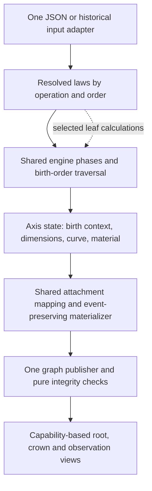

# Native engine merge: review and improvement plan

> **Schema-4 cutover, 18 November 2026.** The [simplification plan](SINGLE_INPUT_AND_PARAMETER_SIMPLIFICATION_PLAN.md) and [verified implementation](SINGLE_INPUT_IMPLEMENTATION_REPORT.md) cover one current format, one order ceiling, explicit per-parent counts and an optional shared primary-tree factor. The original review follows.

Implementation follow-up: [native engine repair report](NATIVE_ENGINE_REPAIR_REPORT.md).
This review below retains its original finding/proposal wording; consult the
follow-up for current implementation and fresh verification.

Reviewed 18 November 2026 against the implementation merged at
`0d5746aad834c0a166ab61f32206e4e884eb9786`, including the local public-fixture
rebind subsequently recorded at `57f6782cba05491c256766cce574548e1683d7e5`.
This is a source review and proposed implementation sequence, not a
claim that the fixes below have been implemented or biologically validated.
It follows the [feature-composition contract](NATIVE_FEATURE_COMPOSITION_REVIEW_AND_PLAN.md)
and reviews the [implementation report](NATIVE_ENGINE_IMPLEMENTATION_REPORT.md).

## Verdict

Keep this implementation and improve it incrementally. It has made real progress
toward the requested infrastructure: one parser, a fixed engine lifecycle, one
final graph publisher, genuine schema-3 feature switches, and removal of the
previous complete native/construction-step/cohort runner bodies. The native
calculation kernels and historical adapters remain useful assets.

The broader requirement is **partly met**. A global `construction="native"` versus
`"planned"` choice still bundles several operations, and some SO4 functionality
has no schema-3 option. More urgently, small accepted inputs reveal violations
of material independence, geometry conservation and run provenance. Passing the
existing suite does not resolve those findings. Do correctness work before
adding further options or optimizing throughput.

## Findings, ordered by consequence

Source paths below refer to this reviewed revision; use function names if lines
move. All runtime probes use invented inputs, not empirical observations.

### F1 — P1: parent taper changes daughters whose taper is disabled

`NativeFeatureLaws.after_construction` overwrites construction-node diameters
before daughters are sampled
([native_features.py](../../deeprootgen/model/native_features.py), lines 110–136).
`RootOrgan.construct_root_from_parent` subsequently adds
`parent_data.diameter * 0.1**parent_order`
([root.py](../../deeprootgen/model/root.py), lines 464–479).

With seed 42, Fichtl fallback, taper enabled only for order 1 and parent capping
disabled, order-2 daughter diameters changed by up to **0.0030214 cm**; untapered
order-3 descendants changed too. Their lengths stayed identical. This changes
descendant material/mass outside the selected taper orders.

The implementation report explicitly records this choice, so it is not hidden.
It nevertheless contradicts the earlier contract to retain original birth
material independently of later taper/cuts. Preserve an immutable native birth
context and put active taper in a separate material profile. If inheritance from
the new material is desired scientifically, represent that as an explicit law
with its own semantics and validation, rather than an incidental mutation.

### F2 — P1: cut merging can remove real corners and material breakpoints

`curved_axis` drops a real direction corner within `1e-9 cm` of a construction
cut; `merge_cuts` also drops nearby material events
([materialize.py](../../deeprootgen/model/materialize.py), lines 69–99 and 147–163).
Two nearby physical events need not be the same event.

An accepted invented axis of length `0.002 cm`, curvature step `0.001 cm`,
correlation length `0.001 cm` and curvature SD `100 rad/cm` demonstrates the
failure. A branch at `0.001 cm` succeeds; a branch at `0.001 + 5e-10 cm` fails
with `edge lengths disagree with its geometry`; a branch at `0.001 + 2e-9 cm`
succeeds. The dropped corner makes one emitted chord span a bend while its
stored length remains an arc length. Eight tested seeds fail at the near site.

A separate extreme, representable near-origin axis of length `1e-10 cm` loses
its taper midpoint under the same absolute merge policy and underestimates the
analytic piecewise-taper mass by about **39.46%** without an error. This is an
algorithmic boundary case, not a claim about typical root dimensions.

Keep every real direction corner in the exported centerline and integrate across
every material breakpoint. A graph chord must never bridge a bend. Coalesce a
material event only when exact piecewise volume and the declared fine/coarse
classification are preserved; retain separate class-boundary cuts where the
output contract requires them. Coalesce only events proven equivalent,
preserving attachment identity and the documented tangent side.
Reject genuinely unrepresentable intervals with the established scale-aware
rule. Do not fix this by relaxing geometry/volume tolerances.

### F3 — P1: the INITIAL observer can change execution without changing its receipt

`record_initial` documents a read-only view but passes the live simulator and
mutable parameters to the callback
([engine.py](../../deeprootgen/model/engine.py), lines 289–292).

An INITIAL callback setting `parameters.gravitropism = 0.9` changes the output
of an all-off seed-42 configuration. Both runs complete with 31 nodes and no
invalid nodes. Both receipts still declare `gravitropism=0.1` and have identical
effective-model and run hashes. Graph and RNG access create similar exposure.

Give recorders a detached, immutable snapshot of INITIAL data and configuration,
without a live RNG or mutable simulation. Keep a narrow signature adapter for
existing recorder callers. Reject mutation or ensure it affects only detached
data; a recorder must not modify subsequent execution or its identity.

### F4 — P1: unseeded executions can have the same run identity but different results

`ResolvedConfig.run_identity` hashes the provided seed, including `None`
([resolution.py](../../deeprootgen/data_model/resolution.py), lines 276–285).
Two successful flat-input runs with `random_seed=None` produced different
node/edge tables but identical run identities. This does not invalidate seeded
parity, but unseeded receipts cannot identify or reproduce the realized run.

Keep legacy unseeded execution where compatibility requires it; capture the
initial RNG state/realized entropy for an execution identity and replay record.
As an immediate bounded alternative, require an explicit seed for tracked runs
and mark unseeded execution as non-replayable. Do not claim its existing hash is
a unique realized-run identity. Changing only the tracked helper is insufficient
if direct unseeded results keep advertising the same guarantee.

### F5 — P2: accepted active settings can have no consumer

`_check_headings` requires primary curvature when a disk-origin heading is
specified, but does not require that curvature to use `origin_heading`
([resolution.py](../../deeprootgen/data_model/resolution.py), lines 955–960).
`place_origins` samples the heading, while `_realize_native_curve` consumes it
only for `initial_heading="origin_heading"`.

Changing enabled inclination from 10 to 80 degrees with the default
`scaffold_chord` heading produced identical tables but a different effective
hash. Point-origin rules also accept disk-only fields that are subsequently
dropped. Validate law-specific fields and their consumers. An enabled setting
must be applied, rejected as conflicting/inapplicable, or explicitly reported
as inactive; it must not silently disappear or be described as an applied law.

### F6 — P2: fallback requirements and effective hashes are resolved too coarsely

`_effective_native_parameters` mostly prunes by broad construction/direction
mode; `_check_native_parameters` requires the whole native construction field
set ([resolution.py](../../deeprootgen/data_model/resolution.py), lines 366–378
and 944–952).

With branching replaced on every nonterminal order, changing native count,
growth and spacing fields leaves tables **and final native RNG** identical but
changes the effective hash. Omitting those unused fields fails validation.
Separately, changing only schema-2 cohort `max_organs` changes its effective
hash because the full construction payload is included in the contract
(lines 628–630), contrary to the documented resource-limit exclusion.

Build requirements, inactive/replaced descriptions and effective identity from
the same per-operation/per-order consumer map. Retain historical fields in
supplied-input provenance and legacy adapters. Remove canonical requirements
only when no active numerical consumer or compatibility draw needs them.

### F7 — P2: the last enabled feature can switch the whole construction regime

`_fully_replaced` infers a global planned mode from all-order curvature, taper,
bounded lengths and nonterminal branching. `_configure_planned` then requires
disk origins plus a radial heading and clears native pre/post laws
([resolution.py](../../deeprootgen/data_model/resolution.py), lines 917–941).

A one-order input with curvature and taper enabled accepts common origins while
length replacement is disabled. Enabling just its bounded-length option makes
it fail the disk-origin requirement. The origins option did not change. This
is remaining bundle coupling, not merely a choice of a local numerical law.

Resolve origins, dimensions, material, branching and directions independently.
Preserve native placement/default headings where requested; a fully replaced
set of dimensions must not implicitly replace the origin or correction policy.
Document genuine mathematical dependencies explicitly rather than promising
that every Boolean combination is meaningful.

### F8 — P2: limits currently check some allocations after they happen

Source inspection, not an exhaustion experiment: native `prepare_forest` checks
`max_organs` after `init_organs` builds the hierarchy; `check` checks `max_nodes`
after materialization/publication
([engine.py](../../deeprootgen/model/engine.py), lines 116–133 and 634–642).
The planned queue already checks its organ growth earlier.

Reserve organ, station and output-node budgets before allocating them. Test with
small limits and instrumented allocation counts. Keep failure explicit with no
silent truncation; retain historical adapter error timing only where it is an
explicit compatibility requirement. No large stress job is needed to verify this.

## Fixture diagnosis and fresh validation

The stale binding explains the reported cascade. Replaying the earlier fixture
bytes reproduced the preimage-hash failure before the primary-design test reached
its diagnostics-writing block. The diagnostics fault test caught the generic
assertion, then failed again because the expected folder did not exist. That
second failure was not evidence of a separate simulation discrepancy.

During this review the working tree was merged and the fixture rebind completed
outside this review. The source merge is `0d5746a`; final HEAD `57f6782` records
that merge as the manifest default and baseline for six commit-backed entries.
The two additional epochs use retained
source hashes rather than independent reference commits. All eight references
materialize with final fixture bytes. Existing historical module postimages and
comparison tolerances were preserved; restoring the historical package
`data_model/__init__.py` also repairs imports against the old schema.

Do not rebind again merely to change labels. Add a standalone fixture preflight
and make diagnostic fault tests assert the intended failure cause, rather than
catch any assertion. These are selected-module, same-runtime comparisons; they
do not recreate an entire historical dependency environment.

Fresh execution used Python 3.10.20, the existing qualification environment and
locked overlay, CPU-only settings, no installs or service/flow execution:

| Check | Fresh result |
|---|---|
| Focused parser, inventory, engine, features, execution and run-record tests | 272 passed, 0 failed/errors/skipped |
| Full suite with `--run-integration` | 1,918 passed, 0 failed/errors/skipped; 103.834 seconds |
| Reviewer-selected historical parity, tamper and diagnostic tests | 17 passed, 0 failed/errors/skipped |
| Final fixture materialization preflight | All 8 reconstructed |
| Additional invented counterexamples | F1–F7 reproduced; F8 is source-inspection evidence |

The full command was:

```bash
CUDA_VISIBLE_DEVICES= OMP_NUM_THREADS=2 MKL_NUM_THREADS=2 \
PYTHONDONTWRITEBYTECODE=1 \
PYTHONPATH="$PWD/.runtime/native-integration-20261117/locked-overlay:$PWD" \
DRG_SYNTHETIC_FAILURE_DIR="$PWD/.runtime/claude-merge-review-20261118/synthetic-diagnostics" \
.runtime/envs/py310-qualification/bin/python -m pytest \
  -p no:cacheprovider --run-integration -q \
  --junitxml=.runtime/claude-merge-review-20261118/full-tests.xml
```

Local receipts, counterexample inputs/scripts and source hashes are under
`.runtime/claude-merge-review-20261118/`; they are ignored artifacts, not portable
checked-in regression coverage. Promote the small counterexamples to tests in
the corresponding fix. Package/source bytes did not change during this review;
fixture bytes and Git HEAD did. No generator, test or fixture edits were made by
this review. Existing suite success is algorithm evidence, not a ranking of
native Fichtl, SO4 or Calvin against observations.

## Improvement sequence

### 1. Repair numerical and observer contracts before extending coverage

Fix F1–F3 in separate changes: immutable birth context, event-preserving
materialization, and detached INITIAL observation. Preserve the established
default native draw order and sealed historical adapter behavior. Where a new
schema-3 behavior differs from the accepted design, identify it explicitly in
the migration notes; do not rewrite frozen reference outputs to bless it.

Acceptance: parent-only taper leaves untapered daughter birth dimensions intact
with cap disabled; analytic mass and geometry hold at exact/nearby cuts;
attachments keep identity and incoming tangent; recorder attempts cannot change
parameters, geometry, RNG or identities. Existing all-off and adapter parity
continue to pass. This package should precede structural rewrites.

### 2. Make configuration and provenance truthful

Fix F4–F6 with a single resolved consumer table. Each setting records its owning
operation/order, active/replaced/inactive status, units and RNG contract. Use the
table for validation, execution plans, explanation and effective hashing.
Discriminate alternative law schemas rather than accepting fields from every law.

For tracked runs, freeze input bytes before execution, record resolved laws and
initial RNG provenance, and bind outputs to that snapshot. Address the currently
process-cached source hash and Python/NumPy-only environment identity separately:
record a run-start source/package/lock fingerprint, distinguish loaded-code
identity from mutable files on disk, and require restart after source changes
if loaded modules cannot be authenticated. Do not assume removing the cache
alone authenticates the code already imported into a notebook.

Acceptance: relevant active edits affect their consumer; dormant and truly
replaced edits do not affect output/draws/effective identity; supplied-input
identity still changes. Resource-limit changes leave successful-run model identity
unchanged. Unseeded records are either replayable or explicitly non-replayable.

### 3. Remove global construction coupling while retaining the common lifecycle

Do not create another engine. Evolve the existing workspace into a shared
`AxisState` with stable biological ID/parent, immutable birth context, sampled
dimensions, final attachment arc, physical curve and material profile. Introduce
it incrementally, making old native kernels operate through a narrow facade
until their graph-shaped workspace can be removed. Avoid two mutable copies of
the same biological state.



Replace `construction="native"/"planned"` as the control for an entire forest
with operation-level laws. Share traversal, identity allocation, attachments,
material integration and publication; retain distinct, well-tested formulas when
they represent different biology. Compatibility scheduling is explicit for old
adapters, not inferred by counting enabled feature blocks. Add early budget
reservations from F8 at the common allocation boundaries.

Acceptance: the F7 toggle works with unchanged common origins; native dimensions
plus selected curved/tapered axes and replaced dimensions plus native placement
run through the same phases. Pairwise and representative three-feature tests
check biology, geometry, material, attachment context, RNG and resolved laws,
not just whether execution succeeds or a phase trace matches.

### 4. Expose remaining SO4 capabilities as options in the same schema

The implementation's `adapter_law` inventory explicitly means “old input only;
no schema-3 key.” Treat these as unfinished user functionality, while preserving
the working legacy adapters. Add one owner per operation, with explicit conflict
checks where two features replace the same calculation.

| Existing research capability | Canonical owner and composition requirement |
|---|---|
| Primary yaw/reversal, inclination bias, explicit primary design | Primary placement/initial-heading laws; no implicit disk-origin requirement |
| Primary branch zones/fractions, parent-2 zone, supplied counts/sites | Topology/count and attachment-site laws; separate sampled biology from final attachment location |
| Tertiary sibling-length rank, current-length CDF | Length law plus sibling-group transform; preserve stable biological IDs and purpose streams |
| Row-axial insertion | Insertion-heading law using final parent tangent and declared coordinate frame |
| Per-order Fichtl sigma and higher-order tropism | Direction laws by order with explicit fallback/correction scheduling |
| Construction-step stationing and first-chord/boundary rules | Direction-grid/boundary laws independent of export/material cuts |
| Cohort length-metadata reconciliation | Explicit geometry/metadata policy; never silently substitute a different scientific length definition |

Extract and reuse each existing kernel; do not copy its complete historical
runner. For each option, test the old adapter against the canonical selection on
a small matched invented input. If exact compatibility requires a different RNG
schedule or output view, declare that policy rather than hiding it under a name
such as “SO4 mode.” Keep crown support nonmaterial; root-only projection remains
a result view, and primary-tree IDs must not be presented as independent vines.

### 5. Close migration with evidence and accurate documentation

Run fixture preflight, focused changed-behavior tests, then the full suite once
the fixes settle. Execute a small offline tracked-run notebook/script matrix:
all-off native; native plus primary curvature; parent-only taper; a mixed-order
case; and a common-origin case with dimensions replaced. Verify export reload,
run identity and law receipts as well as finite tables and graph/material checks.
Do not rerun fitting or sealed empirical evaluations to qualify software plumbing.

Update the implementation report, user examples and AI guides to distinguish
implemented, unsupported and research-only functionality. Rename the executable
`*.proposed.json` example with a compatibility pointer when appropriate. Keep old
parameter aliases at the input boundary until their callers and compatibility
tests are migrated; then remove only proven-unused internal state/parameters.
Audit CLI, notebook and research callers explicitly: the archived
`graph_segments_v1` experiment in `research/search_evaluation.py` still constructs
and replays INITIAL outside `run()`. Keep archived evidence clearly archived;
migrate any caller still presented as supported onto the common executor without
rewriting sealed scientific results.
Measure overhead only after correctness, using the same small fixtures and
source-bound receipts.

Completion means one stable JSON can express supported native/research
combinations, each setting has one verified consumer, common state/phases are
shared, historical defaults remain reproducible, and no public option selects a
complete parallel generator. It does not mean that all biological laws become
one formula or that a software test proves biological superiority.
