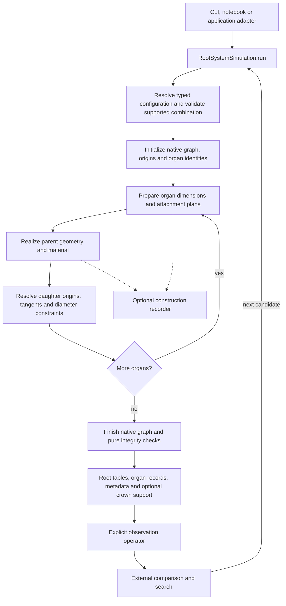

# Native execution consolidation design

> Historical 17 November plan. The authoritative next implementation plan is
> [Native feature composition, revision 2](NATIVE_FEATURE_COMPOSITION_REVIEW_AND_PLAN.md).
> It requires one fixed engine with independent options and supersedes the
> sequence below. Historical status statements below describe that planning epoch.

17 November 2026. **Proposed design; implementation and scientific adoption have
not occurred.** Prepared against `ff1a1df17381de3907f9799a56fb8f62008f6b47`
and the inspected working tree. Existing documentation work is preserved.

## 1. Decision and intended outcome

Make `RootSystemSimulation.run()` the single supported owner of root generation.
Integrate the useful SO4 and cohort mechanisms as typed construction, trajectory
and material options inside that lifecycle. Reuse `RootOrgan`,
`RootSystemGraph`, the native constructor and existing numerical helpers wherever
their meanings agree. Move shared mathematics to one implementation.

This must be more than calling `replay_construction_steps()` or
`CohortRootGenerator.generate()` from a new dispatch statement. The destination
is one simulator state, one organ registry, one graph writer, one output contract
and one validation lifecycle. Different scientific rules remain explicit choices
within those stages. A wrapper around independent complete generators would
leave the present maintenance problem intact.

The first useful delivery is SO4 construction-step execution through native
`run()`. Most of its construction controls already reside in native code. Cohort
integration follows through extracted per-organ planning, curvature and taper
operations; it is the larger change.

No performance ranking is assumed. SO4 population-profile agreement and Calvin
core/material experiments use different conditioning and observation support.
Code consolidation should first reproduce established behaviour, then make fair
scientific comparisons possible.

## 2. What the source actually permits

| Current component | Verified behaviour | Consequence for the design |
|---|---|---|
| [Native run](../../deeprootgen/model/root.py), `run`, line 1282 | Calls organ initialization and positioning, then legacy gravity or native Fichtl and geometric validation; `grow()` is commented out. | Keep this entrypoint and default behaviour. Integration remains static; maturity and numerical steps do not become time. |
| Same file, `init_organs`, line 847; `RootOrgan`, line 51 | Already contains CDF lengths, supplied counts, primary design, branch-zone and sibling length-rank controls. | Integrate these existing functions; do not create another SO4 sampler. |
| Same file, lines 1283–1287 | Rejects construction-step grid, parent2 branch zone, tertiary rank and distal attachment controls. | Replace these guards only when the corresponding native stages are implemented and tested. Removing guards alone is incorrect. |
| [SO4 construction](../../deeprootgen/research/so4_controlled.py), line 232 | Directly calls native construction/positioning, snapshots INITIAL and optionally relocates attachments. | Snapshotting becomes an optional recorder; execution consumes live organ state. |
| [Construction-step replay](../../deeprootgen/research/construction_step_replay.py), lines 269 and 334 | Preserves the first insertion chord, turns on retained construction intervals, then interpolates graph fragments. | Extract a trajectory kernel and retain interval-to-fragment mapping. |
| [Cohort constructor](../../deeprootgen/research/cohort_root_generator.py), lines 210–339 | Own queue, organ sampling, emergence, geometry, taper, graph rows and projection. | Extract its per-organ rules; replace its queue and row writer with native owners. |
| [Node allocation](../../deeprootgen/model/hgraph.py), line 42 | `add_child_node` derives organ/order/rank from the immediate parent. | Root bases and crown supports need explicit allocation, not ordinary daughter allocation. |
| [Input model](../../deeprootgen/data_model/simulation_data_models.py), line 155 | Many native dimensions are mandatory; research controls have coupled scope validators. | Cohort inputs must not require dummy native dimensions. Preserve the flat schema through an adapter. |
| [Core observation](../../deeprootgen/research/core_observation.py), `_graph_order`, line 80 | Requires one order-0 base per `plant_id`. | A distributed-crown forest needs a named projection adapter until the observer understands vine and primary-tree IDs separately. |

Two particularly important compatibility traps:

1. Native `RootOrgan.validate()` draws from the shared RNG even when reorientation
   is disabled. Moving it, or inserting it before a new direction stage, changes
   trajectories. Preserve the legacy call/draw sequence. New final checks are pure.
2. Native daughter dimensions inherit parent-segment contributions. The SO4
   distal-attachment transform deliberately occurs after dimension/topology
   construction and preserves those dimensions. Sampling the relocated site
   earlier is a different model, not an equivalent refactor.

## 3. One lifecycle with explicit scientific options



The diagram is the target lifecycle, not a claim that legacy initialization can
be reordered today. The implementation must accommodate these dependencies:

* **Native preparation:** keep `init_organs → position_secondary_roots →
  position_primary_roots` and their draw order. They prepare the complete scaffold
  before direction realization. Existing compatibility modes retain their exact
  global correction/validation schedule.
* **SO4 realization:** read plans and original interval metadata from those live
  organs, apply the declared attachment transform, then realize lateral paths
  parent before child. Primaries stay fixed unless an explicit primary option
  was selected. FINAL follows from this state without a DataFrame replay.
* **Cohort preparation:** plan each queued organ using its already realized
  parent's point diameter and attachment tangent. Realize its curve and cuts
  before constructing daughters. Pre-sampling the entire tree would break those
  dependencies and the existing random-stream sequence.

A common parent-before-child executor can accept either prepared native plans
or lazily supplied cohort plans. Native legacy placement/correction remains a
versioned preparation/finalization policy where required. Do not force every
policy into an identical stochastic call order. During migration, the existing
native body remains the compatibility implementation until its extracted stages
match the reference fixtures; it is not immediately rewritten into the new loop.

There is no dynamic plugin framework. A small, explicit set of typed options
and ordinary functions is sufficient. Unsupported combinations fail before
construction, with a message naming the conflicting fields.

## 4. Configuration: a common schema without dummy parameters

Keep existing `RootSimulationModel` requests valid and unchanged by default.
Introduce a versioned `RootSimulationConfig` for extended construction, accepted
by the same `run()` method. Both normalize into a private resolved configuration.
Two accepted input schemas are a migration boundary, not two generators.

The new schema groups fields by responsibility:

| Group | Content and ownership |
|---|---|
| `schema_version`, `random_seed`, `simulation_tag` | Input version and explicit simulation identity. Constructor seed and request seed must agree for extended modes. |
| `frame` | Length unit cm, z upward, soil-surface height, axis meanings and origin convention. |
| `construction` | Discriminated `native` or `cohort` dimensional/branching specification. Native contains the current relevant dimensions/options; cohort contains bounded distributions and maturity rules. |
| `origins` | Native outer/inner placement, explicit primary design, or distributed emergence. Cohort membership and counts are explicit. |
| `trajectory` | Direction law, station definition, first-step rule and boundary contract, with explicit order coverage. |
| `material` | Native segment diameters or point taper; density and diameter cutoff with units; optional explicit crown mass. |
| `recording` | None, compact diagnostics, or full construction state. Recording must not draw randomness or change results. |
| `limits` | Explicit organ/node limits and failure behaviour. Limits cause an error, never silent truncation. |

The resolver owns mappings from old `research_*` fields. A field has one
authoritative location in the new schema. Supplying both its old and new forms
is an error, even if numerically equal. Unknown fields and irrelevant fields are
rejected in the new schema; old schema coercion/unknown-field behaviour stays a
documented compatibility concern rather than silently changing all old callers.
Extended cohort parameters have no implicit empirical defaults. Biological
dimensions, density, cohort assumptions and any crown mass are caller-supplied;
missing required inputs fail validation.

Illustrative proposed use, **not an implemented API**:

```python
# Existing callers remain valid.
simulation = RootSystemSimulation(random_seed=parameters.random_seed)
simulation.run(parameters)  # existing RootSimulationModel
nodes, edges = simulation.G.as_df()

# Extended callers use the same simulator and execution method.
config = RootSimulationConfig.model_validate(configuration_dict)
simulation = RootSystemSimulation(random_seed=config.random_seed)
simulation.run(config)
nodes, edges = simulation.G.as_df()
organs = simulation.result.organ_table
metadata = simulation.result.metadata
```

Retain `run()`'s existing return convention; add `simulation.result` instead of
requiring all callers to consume a new return value. A new run must not append to
an existing graph: extended mode should reject a used simulator instance unless
a separately explicit reset is invoked. Existing use should continue creating
one simulator per seed.

The CLI stays `python -m deeprootgen simulate --config ... --outdir ...`.
Schema detection is explicit through `schema_version`; it never guesses a
dataset or algorithm from a filename. No experiment-specific CLI is required
for new generation. Search supplies configurations to this same API.

## 5. Supported combinations and trajectory semantics

Initially qualify only these coherent combinations. Labels below describe
compatibility contracts; they are not four independent executable engines.

| Contract | Construction | Direction stations and law | First step / surface | Material |
|---|---|---|---|---|
| Existing native legacy | Existing native methods | Existing graph geometry and gravity blend | Existing reorientation/invalid-root schedule | Existing segment diameters |
| Existing native Fichtl | Existing native methods | Graph segments; existing `sample_heading` | Candidate search begins at segment 1; surface filtering in candidate search | Existing segment diameters |
| SO4 construction-step compatibility | Native methods plus existing supported research controls | Retained construction intervals; controlled Fichtl proposals | Assigned first chord; minimum-angle projection after proposal | Existing frozen segment diameters |
| Cohort v5 compatibility | Extracted cohort dimensions, emergence and branching | Physical-distance stations; correlated curvature | Current cohort first-step integration; downward reflection and curvature reset | Point taper integrated into volume-equivalent cylinders |

Frame construction is also part of the trajectory contract. Native Fichtl
rebuilds its basis from the previous heading at each segment; controlled SO4
transports the moving frame. Sharing candidate arithmetic must preserve each
convention and its mapping from random draws to world directions.

The resolver emits a versioned execution-contract identity containing the
selected component versions, random-stream contract and stage ordering. Users
select mechanisms; the identity records their actual semantics. Do not expose
unconstrained combinations of every first-step, boundary and direction option.

Legacy graph-segment controlled arms A–D stay available for recorded experiments.
They are not the default interface for new SO4 work. Physical-step Fichtl and
SO4 OU replay variants remain experimental until separately qualified in the
native lifecycle. In particular, SO4 OU retains/transport curvature at boundary
events differently from cohort OU, and its first-chord handling differs. Sharing
OU arithmetic does not make those complete trajectory models interchangeable.

Future combinations, such as cohort dimensions with Fichtl directions, require
a named hypothesis and a focused comparison before joining the supported table.
They must not be enabled merely because both functions accept arrays.

## 6. Biological axes, numerical stations and graph cuts

Use a small internal `OrganPlan`, not a second graph model. Its essential fields:

* biological organ ID, parent organ ID, root order and true vine ID;
* primary-tree ID, optional cohort and maturity;
* intended contour length and construction provenance;
* attachment arc on the parent and ordered daughter sites;
* direction station arcs, distinct from material/attachment cuts;
* native segment diameter data or an explicit point-diameter law;
* policy versions and random-stream identity.

A realized `OrganGeometry` contains the original direction stations/points and
incoming/outgoing tangent conventions. Its derived cuts feed the native graph
writer. Keep this state transient or recorder-owned; do not maintain a second
mutable copy of the final graph.

**One biological branch does not imply one numerical direction decision.**
Insertion nodes can subdivide an interval without changing its curve. Merge
only endpoints already equivalent under the existing numerical contracts;
near-coincident biological sites must not be silently moved to make an export
pass. Preserve original direction corners when subdividing material.

At a corner, retain the existing incoming-tangent choice for compatibility.
Define exact attachment-arc ownership explicitly; switching to an outgoing or
smoothed tangent changes the daughter's construction.

Native `RootOrgan` needs an explicit factory for already planned dimensions and
geometry, alongside its existing parameter-sampling constructor. This factory
populates the same `segments`, `child_organs`, parent association and organ
registry. Split identity/state initialization from legacy sampler setup: every
organ must have valid configuration/context access, classifications, transforms,
mass, diagnostics and parent relationships. Do not bypass initialization to
create a partially populated object or invent unused legacy parameter values.
The factory must not invoke native parent-length offsets, uniform diameter
sampling, native transforms or extra draws after a cohort plan was supplied.
Native allocation remains unchanged for existing paths; an explicit plan-ID
allocation interface provides deterministic extended organ identities.
Keep `RootOrgan.base_node` as its first segment node, distinct from the graph's
order-0 origin base. Do not silently reuse that attribute for a crown anchor.

Cohort biological IDs are reserved when daughters are queued, before their
geometry is emitted. The native registry must separate reservation from node
allocation and reuse that ID at emission. Keep legacy allocation order unchanged.
After material finalization, cached organ mass and classifications must agree
with the selected material contract and graph, without resampling dimensions.

The live SO4 attachment operation must update `RootOrgan.parent_node`, segment
membership, attachment-node lists, child relations and `G` edge/parent references
consistently, including each `RootNode.organ` association and the interval-to-
fragment map. Stage changes before committing them, then check all these views
against each other. Editing coordinates or DataFrames alone leaves stale native
objects. Original construction-step IDs/provenance survive new geometric cuts.

## 7. Feature migration map

| Research capability | Native owner after migration | Compatibility obligation |
|---|---|---|
| Current-length CDFs and original segment weights | Existing native dimension preparation | Keep keyed sampling and compatibility draw counts; distinguish supplied marginal distributions from predictions. |
| Supplied order counts, sibling length ranking, parent2 zones | Existing native family/branch preparation | Plan sibling families before consuming daughters; retain eligibility constraints and original IDs. |
| Primary yaw, reversal, inclination, explicit designs, buried origins | Existing native primary positioning | Keep angle definitions, frame and operation order; do not apply positioning twice. |
| Distal primary attachment transform | Post-preparation attachment operation | Preserve original primary vertices and daughter dimensions; retain source-to-final cut/ID mapping. Do not resample daughter dimensions. |
| Controlled first insertion, row bias and order-specific sigma | Shared direction helpers plus SO4 trajectory contract | Preserve first chord, per-order scope and random-stream purposes. |
| Construction-step replay | Native live-organ trajectory executor | Same interval proposals/boundaries and fragment interpolation; recorder can emit INITIAL for diagnostics. |
| Cohort origin disk, depth and maturity | Native origin planning and per-organ context | Both crown-origin cohorts start at order 1; maturity is latent, not age in years. |
| Bounded lengths, first branches and daughter distributions | Cohort per-organ planning functions used by native executor | Keep rejection order, first-branch censoring, conditional count law and maturity scaling. |
| Parent diameter cap | Plan daughter dimensions after parent material is known | Evaluate actual point diameter at attachment, not equivalent segment diameter or an order mean. |
| Curved primaries and higher orders | Shared curvature primitives and cohort trajectory contract | Preserve per-organ curvature reset, transported frame, drift and reflection semantics. |
| Piecewise linear taper and diameter-class crossings | Native material finalization | Integrate exact interval volume and split at crossings/corners; preserve native diameter semantics in legacy output. |
| Optional length roundoff reconciliation | Explicit numerical material adapter | Keep existing absolute/relative guards and receipts; do not move coordinates or relax tolerances. |
| Crown support and root-only projection | Native result views and observer adapter | Exclude nonmaterial links from length, volume and root mass. |
| Core/voxel observations and population search | External services over the native result | They do not choose a hidden generator or modify its geometry. |

Existing helper modules can move to neutral locations with forwarding imports
to preserve tests and consumers. Move implementations once; do not leave copied
algorithms in native and research trees.

## 8. Graph and material contract

For extended modes, `simulation.G` is the **root-only graph**, including zero-
material root bases. A native single-base system remains a tree. Distributed
origins form a forest with one base per primary tree. Every material node still
describes its incoming root segment and existing `node_id/parent_id` plus
`parent_id/child_id` table conventions remain available.

Keep `plant_id` as biological vine identity. Store `primary_tree_id`, cohort,
maturity and point-diameter provenance in versioned sidecar tables keyed by
node/organ IDs, rather than changing historical `as_df()` columns by default.
The result contains a separate optional `crown_support` table for visualization.
It connects the emergence anchors without becoming root material. Crown mass
is one explicit scalar contribution per vine; its spatial allocation is unknown
unless separately supplied. Unrepresented mass stays a separate diagnostic and
creates no invented root length or core prediction.

This is a deliberate change from the cohort API's full-support main graph.
Migration must publish an ID mapping and preserve actual coordinates, biological
parent relationships, organ properties and root material. Historical cohort IDs
can be reconstructed by its compatibility exporter; bitwise equality of raw
canonical tables with a different base-node convention is not required.
The mapping must be deterministic, complete and one-to-one for retained entities.
Keep biological organ IDs used for RNG distinct from exported graph node IDs.

`RootSystemGraph` must support explicit root-base allocation and multiple bases
for extended mode. Its automatically created origin base must be reused where
valid or explicitly omitted at construction, never left as a phantom extra root.
`base_node` remains valid for legacy callers; extended callers use a bases
collection and may not assume a unique crown origin.

Until the finite-core observer is upgraded, a named adapter creates its required
one-base-per-plant projection with temporary tree IDs, plus a tree-to-vine map.
Sum contributions back to the vine before population weighting or crown addition.
Never treat primary trees as independent sampled vines.

Existing geometric/statistical/database consumers must declare supported graph
and material semantics. Extended CLI exports are enabled first. Generic native
statistics, Plotly views, NetworkX/PyG conversion, Dash, Prefect persistence and
calibration adapters require tests or an explicit unsupported-mode error before
receiving forest/taper outputs. Calling native `run()` does not by itself qualify
every downstream consumer. Do not import/start services during this migration.

For taper, retain both point diameters and exported equivalent-cylinder diameter:

`V = pi * h * (d0*d0 + d0*d1 + d1*d1) / 12`

`d_equivalent = sqrt((d0*d0 + d0*d1 + d1*d1) / 3)`

Material cuts include taper breakpoints, fine/coarse threshold crossings,
attachments and all direction corners. Density units are dry g/cm³. The native
`fine_root_threshold` and cohort `fine_cutoff_mm` must be converted explicitly at
the adapter; the same number cannot silently change units or class definition.
Native organ-average classification and cohort segment classification remain
labelled. New observation calculations use explicit diameter classes.

## 9. Randomness, validation and reproducibility

Preserve random-stream contracts separately from physical rules:

* Native legacy/Fichtl: shared generator and original draw/call order.
* Controlled SO4: original construction stream plus purpose-keyed replay streams
  and original interval indices, including versioned key strings.
* Cohort v5: original organ/purpose streams, within-organ rejection and branch
  draw order, and breadth-first organ allocation.

A future independently keyed per-property scheme may improve experimental
pairing, but it is a new version and not part of the compatibility refactor.
Matching a seed does not guarantee paired organs after topology changes.
Preserve original namespaces when moving functions; module renaming must not
silently change random keys. Recording, new pure validation and export draw no
randomness; native compatibility correction/validation retains its existing draws.

SO4 INITIAL construction currently replaces the internal node tag with
`SO4-T2-controlled-INITIAL`. Preserve that tag in its compatibility output and
record the caller's requested tag separately, as the search bridge already does.
Changing this metadata requires a declared export mapping, not an unexplained
failure of graph equivalence.

New pure validation checks graph identity/acyclicity, base semantics, finite
coordinates, attachment continuity, geometric lengths, material conservation
and recorded exclusions. Legacy reorientation is an explicit transformation
stage with its old draw order, not hidden inside a newly shared checker. Invalid
descendants and failure status retain policy-specific semantics. A failed run
must not expose a partial graph as a successful `result`.

Compatibility has three distinct levels:

1. **Exact old behaviour:** native defaults and native Fichtl retain numeric
   tables, IDs, classifications, invalid flags and RNG state for frozen fixtures
   in the same environment. Changing the call sequence is not accepted because
   summary statistics happen to match.
2. **Mapped equivalent behaviour:** cohort canonical root graph may change
   presentation IDs/bases. After the declared mapping, biological records,
   coordinates, material and observations match. SO4 direct execution also needs
   explicit cut/ID comparison if native allocation changes.
3. **New scientific behaviour:** changed direction law, boundary, timestep,
   dimension conditioning or random-stream design gets a new identity and a new
   evaluation. It cannot inherit the previous experiment's pass.

Do not promise byte-equivalent compressed output across arbitrary library
versions. Record environment and serialization separately. For unchanged kernels
in the pinned environment, require exact numeric equivalence; tolerances for
reordered arithmetic need an explicit analytic justification, never a broad
default `allclose`. Existing strict geometric and mass checks remain binding.

All empirical observations, fitted arrays and sealed comparison artifacts remain
local. Initial migration tests use existing invented fixtures. A later local
receipt replay can verify frozen empirical results without optimization, with
its exact scope recorded before execution.

## 10. Observation, fitting and evidence boundaries

Generation returns geometry and construction provenance. It does not read
reference observations, optimize an objective, select a lucky seed or adjust
mass to meet a target. Supplied length distributions, primary scaffolds, counts
and cohort rules are marked as conditioning inputs in result metadata.

The observer is separately configured for geometric profiles, voxel RLD, finite
cores or material diagnostics. Frame, support, missingness, diameter class and
normalization are explicit. Preserve current SO4 soil-frame-v2 convention and
the cohort frame through named adapters; avoid a silent global coordinate
conversion during numerical compatibility work. Root-world coordinates are cm
and z-up; observation metadata identifies across/along and soil origin.

Search can vary validated fields and call `run()` repeatedly. It owns attempts,
budgets, objective versions and qualification seeds. A proposed per-realization
mass-conditioning procedure belongs in a separately named external controller
with recorded attempts, until its scientific scope is agreed. It must not become
an undocumented automatic repair inside root construction.

For model comparison, distinguish supplied anatomy from predicted anatomy.
Use identical observation support and selection rules, a fixed search budget
and comparable information available to each model. Report unavailable input
capabilities instead of fabricating parameters to force every model onto every
task. Fresh RNG seeds assess simulation variability; held-out complete vines
or cores assess predictive claims under their declared dependence assumptions.

## 11. Small module changes with clear owners

Proposed module names are illustrative; keep an existing owner when practical.

| Owner | Proposed responsibility |
|---|---|
| `model/root.py` | Native public execution, stage ordering, organ registry and legacy methods; no observations or optimization. |
| `data_model/construction.py` | Typed extended configuration, component compatibility and normalization. No empirical presets. |
| `model/construction.py` | Small plan records, native/cohort per-organ preparation and the shared realization executor. |
| `model/trajectory.py` | Native and controlled Fichtl contracts and cohort curve integration, calling shared numerical primitives. |
| `model/material.py` | Taper laws, exact material cuts, equivalent diameters and guarded metadata reconciliation. |
| `model/hgraph.py` | Sole node/edge writer, explicit base allocation and versioned graph views. |
| `model/result.py` | Result metadata, organ sidecars, crown support and projection mappings. |
| Existing `utils/*` | Shared geometry, insertion, orientation and stochastic primitives. |
| Existing observation/research evaluation modules | Pure observation and scoring; consume results through declared adapters. |

Dependencies point from native orchestration to core helpers. Promoted core
modules do not import experiment runners or notebook code. Compatibility wrappers
import the native API/core helpers, not the reverse. Avoid circular imports
between trajectory, skeleton and replay modules by moving common types and pure
functions first. No new dependency or lockfile change is needed for this design.

## 12. Staged implementation and stop criteria

Each stage is a separate reviewable change. Do not combine consolidation with
new fitting or new biological assumptions.

| Stage | Concrete delivery | Acceptance / stop criterion |
|---|---|---|
| 0. Freeze behaviour | Source-bound invented fixtures for native legacy/Fichtl, SO4 steps and small cohort; inventory consumer assumptions and random streams. | Reference outputs and hashes exist before moving code. Historical results alone are not fresh test passes. |
| 1. Extract shared kernels | Move controlled proposal/boundary math, cohort curve/material primitives and their tests to neutral owners with forwarding imports. | Existing APIs preserve outputs; no duplicated implementations, RNG draws or numerical changes. |
| 2. Native SO4 | Extended typed config; native live-organ construction-step realization and attachment operation; optional recorder. | Native legacy/Fichtl exact fixtures pass; native SO4 matches replay for intervals, graph, invariants and observation summaries. Remove only the now-supported run guards. |
| 3. Material and origins | Native plan factory, explicit root bases, taper writer, sidecars and core projection adapter. | Analytic length/volume/mass and forest tests pass; legacy schemas/tables unchanged; consumers reject unsupported extended semantics. |
| 4. Native cohort | Extract bounded sampling/branching as per-organ policy; run through native queue, RootOrgan records and graph writer. | Small cohort v5 fixtures match through ID mapping, including RNG, censoring, caps, curvature/reflection and diagnostics. Old generator delegates only after equivalence is established. |
| 5. Migrate callers | Unified offline CLI and notebook calls; search bridge uses native `run`; explicit result-aware observation adapters. | Recorded round trips and equivalent scores; no hidden direct calls to old complete generators on the supported path. Application/service adoption is separately checked without launching deployments. |
| 6. Retire redundant execution | Old APIs become documented adapters or frozen archival replay tools; remove duplicate mutable production paths. | One source owner per active mechanism; reproduction instructions and source archives remain usable. Any behaviour mismatch leaves the old source pinned rather than silently relabelled equivalent. |

The first implementation package should stop after **stage 2**. It tests whether
native consolidation works on the smaller SO4 change before committing to the
larger cohort migration. Cohort integration is then stages 3–4, not another
standalone generator. No arbitrary completion date is asserted before the
compatibility work is measured.

## 13. Focused verification matrix

Use Python 3.10 with the repository's existing lock. Current CI runs full
integration tests with `--run-integration`; omitting that flag can skip native
simulation coverage. Tests below are implementation acceptance requirements,
not tests executed for this design document.

| Verification | Existing evidence to extend | Required new assertion |
|---|---|---|
| Legacy compatibility | `tests/test_fichtl_tropism.py`, legacy golden fixture | Exact native output and RNG state before/after extraction, including validation draws. |
| Native SO4 equivalence | `tests/test_construction_step_replay.py`, attachment/rank/zone tests | Direct native execution versus recorded replay with invented inputs, first-step and boundary receipts included. |
| Cut independence | Construction-step and cohort attachment-cut fixtures | Extra observation/material cuts do not create heading draws or change original stations. Legacy graph-dependent modes remain explicitly exempt. |
| Cohort sampling | `tests/test_cohort_root_generator.py` | Same bounded draws, censoring, parent caps, breadth-first identity allocation, maturity and child contexts. |
| Curvature | Existing curvature/physical replay fixtures | Frame transport, zero/short-axis transient, first step and boundary-state handling for each contract. |
| Taper/material | Existing analytic taper and finite-core fixtures | Exact frustum integral, threshold splits, root/crown separation and point versus equivalent diameter. |
| Graph/export | Existing graph/core fixtures | Multiple anchors, no phantom base, parent agreement, no cycles, deterministic ID map and vine aggregation; isolated-base/empty-material forest conversion must retain bases. |
| Validation | Existing negative and roundoff fixtures | Unsupported combinations fail before generation; checks/recording do not change RNG or geometry. |
| Callers | CLI plus pure API tests | Schema round trip, explicit frame and source receipt; no services/import side effects needed to compare outputs. |
| Scientific comparison | Separate later protocol | Identical support/conditioning disclosure, fixed search budgets, retained failed seeds and explicit held-out units. |

After affected tests pass, run the established full suite once at the release
candidate and lint the changed code. A dummy scaffold test or a skipped runtime
test is not simulator qualification. Preserve original tolerances and failed
fixtures; investigate mismatches before broadening the supported combination set.

## 14. Decisions this design makes, and questions it leaves scientific

**Decided:** native `run` owns execution; SO4 integrates first; no full-generator
dispatch masquerading as consolidation; cohort plans use native graph/organ
owners; graph cuts and direction stations are distinct; root-only canonical
output with separate crown support; true vine identity survives every projection;
new schemas reject unused/conflicting options; old numerical semantics have
explicit compatibility contracts.

**Requires later scientific specification:** which trajectory law predicts each
population better; joint diameter/taper distributions; biological evidence for
cohort maturity and crown mass; new cross-combinations of samplers and directions;
per-realization material conditioning; acceptance thresholds and held-out-data
design. Moving code does not settle those questions.

The design is complete when a maintainer can implement stage 0–2 without
inventing a new scientific mechanism, and can see precisely which graph/schema
changes stages 3–4 require. Implementation is complete only after the supported
paths share native ownership and their stated compatibility checks pass.

## 15. Review and provenance

Source inspection and two parallel public-code design reviews informed this
proposal. No simulation, optimization, dependency installation or service was
run for it. No empirical configuration or field observation is included here.
The draft review corrections are incorporated: frame conventions, internal SO4
tags, validation RNG, complete organ initialization, queued-ID reservation and
atomic live attachment updates. These reviews assess the design; they are not
implementation verification or independent biological qualification.

Inspected source SHA-256:

| File | SHA-256 |
|---|---|
| `deeprootgen/model/root.py` | `1df0d00a4b26bddf831ac3af6f496560b409e692d3854492e9be7e47f5535206` |
| `deeprootgen/research/cohort_root_generator.py` | `2972a756b5c87e64f1631ec5819ce662540f762743b2adbc3b9998438376ada0` |
| `deeprootgen/data_model/simulation_data_models.py` | `d5b88553ea938322962f20e5d084b12a9462c20b1f23842206c1ddf379b49941` |

Related current contracts: [input layers](../INPUT_LAYERS_AND_MODEL_FLOW.md),
[cohort construction](COHORT_ROOT_CONSTRUCTION.md),
[construction-step replay](SO4_CONSTRUCTION_STEP_REPLAY_HYPOTHESIS.md),
[optimization guidance](OPTIMIZATION_GUIDE.md),
[active SO4 state](ACTIVE_SO4_RESEARCH.md), and
[active Calvin state](ACTIVE_CALVIN_RESEARCH.md).
