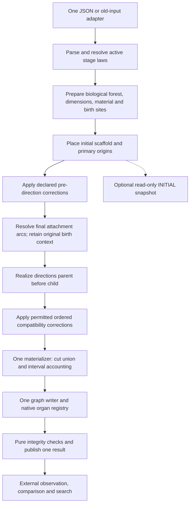

# Native feature composition: code review and further merge plan

> **Next input-design plan, 18 November 2026:** [one format and parameter simplification](SINGLE_INPUT_AND_PARAMETER_SIMPLIFICATION_PLAN.md). The owner now prefers full conversion of active inputs rather than permanent legacy loading, one scalar maximum order, explicit count scopes and cohort only if it adds a distinct useful mechanism. This is a documentation-only planning update; the implementation history below is preserved.

18 November 2026, revision 2. **Authoritative implementation plan.
Implementation status: deliveries 0–5 are implemented and synthetically
verified (see the [implementation report](NATIVE_ENGINE_IMPLEMENTATION_REPORT.md)).
Every input runs through one engine; the separate native, construction-step and
cohort runners are removed.** The text below is the plan as revised before
implementation; the report records where implementation decided open points.
This review follows the owner's requirement: the same native
parameter JSON should turn individual capabilities on/off, without selecting a
complete SO4 or cohort execution route.

Current reference HEAD is `ff1a1df17381de3907f9799a56fb8f62008f6b47`, with the
uncommitted integration inspected in place. HEAD alone does not identify these
bytes. Source hashes and schema probes are retained locally under
`.runtime/native-capability-review-20261118/`. Existing implementation and sealed
research evidence were preserved. This revision supersedes the implementation
sequence in the earlier consolidation design and goal plan; those documents
remain historical records. Its review artifacts are under
`.runtime/native-infrastructure-plan-20261118/`.

## 1. Verdict

The previous integration achieved shared entrypoint, native graph/organ ownership,
substantial reuse of mathematical helpers and compatibility checks. It did
**not** finish functional composition. Ordinary native construction still cannot
independently select cohort curvature, physical-arclength point taper,
distributed crown emergence or maturity scaling. The earlier description of the
merge was too broad if interpreted as that capability.

Some research controls genuinely are native options already. The next change
must extend those native construction stages, rather than add more complete
workers behind `run()`.

## 2. Findings, with current source evidence

### High: the schema and native entrypoint still select fixed bundles

[The configuration](../../deeprootgen/data_model/execution.py) at lines 102–139
uses `construction.kind` and `trajectory`, requires cohort construction to use
`cohort_v5`, and rejects that trajectory for native construction.
[Native run](../../deeprootgen/model/root.py) at lines 1303–1335 selects
`run_cohort`, `run_construction_steps` or `_run_native`. A common method name does
not make those mechanisms individually selectable.

The six current-schema probes confirm that existing native-step and cohort inputs
are accepted, while native dimensions plus cohort geometry, a curvature
coefficient, a taper toggle, or cohort dimensions plus native geometry are
rejected. These were validation-only probes; no root systems were generated.

### High: adding an option block to an old flat JSON can silently discard it

[CLI parsing](../../deeprootgen/cli.py) at lines 25–31 selects the old flat
`RootSimulationModel` if no `schema_version` is present. That model's default
extra-field behaviour does not reject unknown keys. A probe adding
`features.curvature.enabled=true` to an ordinary native example is accepted, but
`features` disappears from the resolved model.

This is especially important for the requested workflow. A visible switch must
never appear to work while doing nothing. The first implementation step must
reserve and recognize `features` before falling back to old flat parsing. Until
then, do not append the proposed flags to an existing executable configuration.

### High: a shared queue has not merged axis construction and materialization

`_realize_organs` in [root.py](../../deeprootgen/model/root.py), lines 694–702,
only drains a deque. `_run_native` does not use it. Cohort has its own nested node
emitter at [cohort.py](../../deeprootgen/model/cohort.py):194 and wraps emitted
nodes in `RootOrgan` at :331–353. Native construction uses
`RootOrgan._construct_segment_nodes` at [root.py](../../deeprootgen/model/root.py):339.
SO4 constructs native graph state, copies row records, realizes coordinates,
then commits changes at [execution.py](../../deeprootgen/model/execution.py):178.

These are useful intermediate seams, but the destination is one physical-axis
planner/materializer/emitter used by all enabled features.

### Medium: research qualification restrictions are mixed with real dependencies

The construction-step contract requires Fichtl, surface z=20 and maximum order
3–5. Distal attachment and sibling ranking additionally require specific CDF,
order and branching settings. Buried origin initialization requires Fichtl.
See [execution schema](../../deeprootgen/data_model/execution.py):123,
[origin validator](../../deeprootgen/data_model/simulation_data_models.py):386,
[attachment scope](../../deeprootgen/utils/primary_attachment.py):29 and
[rank scope](../../deeprootgen/utils/tertiary_length_rank.py):37.

Some requirements describe the historical qualified experiment, rather than a
mathematical necessity of the operation. Keep those exact historical restrictions
for old inputs; do not automatically impose them on a newly specified generic
origin or curve operation. New combinations still need algorithm tests and a
new effective-model identity. Removing a guard alone does not qualify them.

### Medium: the physical axis and material interfaces remain inconsistent

`planned=True` returns early in [RootOrgan initialization](../../deeprootgen/model/root.py):74;
cohort supplies a two-field `SimpleNamespace`. Current getters/mass checks work,
but native sampling methods cannot operate on that context. Separate complete
biological/physical state from sampler configuration explicitly.

Native daughter lengths/diameters also depend on the incoming parent **graph
segment** at [root.py](../../deeprootgen/model/root.py):457–459. New curvature or
taper cuts must not silently change those inherited dimensions. Preserve the
original construction/material context at biological birth, independently of
later export subdivisions.

### Medium: material and result behaviour still depends on cohort identity

The cohort path always generates five orders, samples origin/maturity and uses
`order < 5` for branching. Origin layout cannot currently be used without those
other choices. `cohort_tables` and `observation_tables` in
[result handling](../../deeprootgen/model/execution.py):26–65 check an execution
label to decide whether primary-tree metadata is present. Results should use
actual graph capabilities, such as multiple bases and a tree-to-vine map.

Do not equate the two existing taper definitions. Native explicit primaries use
segment-rank cylinder diameters at [primary_design.py](../../deeprootgen/utils/primary_design.py):85;
cohort uses point diameters on physical arclength and integrated volume. Both can
implement a common material interface while retaining distinct laws.

### Medium: the current tests prove preservation, not independent feature use

The current frozen tests forbid old public generator calls at
[test_native_execution.py](../../tests/test_native_execution.py):66. They do not
forbid the three internal full schedules and have no accepted native-plus-OU or
native-plus-point-taper hybrid. The recorded 1,660-test pass is useful historical
compatibility evidence; it is not proof of the new requested composition and was
not rerun for this review.

## 3. What can be selected today?

| Capability | Ordinary native construction today | Main limitation |
|---|---|---|
| Native legacy / native Fichtl direction law | Yes | These are native mathematical choices, with distinct numerical contracts. |
| Current-length CDF sampling | Yes, in its allowed scope | Some combinations require construction-step execution. |
| Supplied counts/sites, redistributed branches, primary yaw/inclination/design | Yes, with scope constraints | Some combinations are intentionally excluded by existing validators. |
| Parent2 zone, sibling rank and distal relocation | Through the native construction-step bundle | Not freely composable with other direction/material choices. |
| Physical correlated curvature, including primaries | Cohort bundle only | Cannot retain ordinary native dimensions and enable curvature alone. |
| General point taper with exact material integration | Cohort bundle only | Native primary rank taper is a different law. |
| Distributed primary origins | Cohort bundle only | Native buried origin shifts a common origin; it is not a crown disk. |
| Maturity scaling and per-order first-branch/count laws | Cohort bundle only | Currently coupled to cohort construction and five orders. |

## 4. Decision: one engine, replaceable calculations

**One configuration, one fixed execution lifecycle, one authoritative forest,
one graph materializer/writer, and one result contract.** Native algorithms are
the defaults. SO4 and cohort research contribute optional calculations inside
those same stages. Dataset names do not select execution code.

“One route” does not mean one equation for every root. A native Fichtl direction
law and a correlated-curvature law remain different mathematical functions.
Neither may own a simulation loop, graph writer, result builder or downstream
observation pipeline. Enabling curvature replaces the selected axes' direction
calculation; it does not switch generators.

This is the completion boundary:

* Every supported fresh-generation input reaches the same executor, including
  legacy flat and version-2 compatibility inputs.
* Feature functions receive the specific axis/family state they need. They cannot
  instantiate a simulator, generate a whole forest, allocate graph nodes, write
  files or call observation/search services.
* Sampling, identities, parent-child relationships, placement, geometric cuts,
  material accounting, graph emission, checks and result handling each have one
  owner. Different laws share those owners.
* Old entrypoints become input/output adapters. `_run_native`, `run_cohort` and
  `run_construction_steps` cease to be alternative complete execution bodies.
* Search varies the same configuration and calls the same engine. Observation
  and scoring remain explicit consumers of results.

No generic plugin system, dynamically registered pipeline or new framework is
needed. Use ordinary functions and a small number of typed state records.

## 5. One JSON and one configuration resolver

[The proposed complete example](../../tests/fixtures/migration_inputs/design/native_feature_options.proposed.json)
is an invented **schema-version-3 input** and is executable. Each feature can
be enabled within the declared supported combinations; unsupported combinations
fail before execution.
Its shape stays the same when features are enabled or disabled:

```json
{
  "schema_version": 3,
  "random_seed": 42,
  "parameters": {"max_order": 3, "tropism_mode": "legacy"},
  "features": {
    "curvature": {"enabled": false, "settings": {"by_order": {}}},
    "taper": {"enabled": false, "settings": {"by_order": {}}},
    "primary_origins": {"enabled": false, "settings": {}},
    "cohort_maturity": {"enabled": false, "settings": {}},
    "lengths": {"enabled": false, "settings": {"by_order": {}}},
    "branching": {"enabled": false, "settings": {"by_order": {}}},
    "parent_diameter_cap": {"enabled": false, "settings": {}},
    "attachment_relocation": {"enabled": false, "settings": {}}
  }
}
```

This excerpt illustrates structure only; enabled blocks need complete settings.
There is no `construction.kind`, complete-generator `trajectory` or dataset
selector. A named mathematical law inside an option is permitted.

For example, change only `features.curvature.enabled` to use the retained OU
settings for primary roots. Native length/count sampling remains active. Change
it back to recover the native baseline. `parameters.tropism_mode` chooses the
native fallback direction law; an enabled per-order curvature override replaces
that fallback on its selected orders. Native Fichtl plus OU primaries is a valid
design target, not a conflict between two whole routes.

With the example's retained settings, curvature, taper and primary origins are
each intended to work alone. Its nonzero basal-diameter maturity scaling and
parent cap require compatible taper on the affected orders. Enabling every flag
is intentionally invalid because parent capping and attachment relocation
overlap. Each dependency must be explained by the resolver before execution.

### A single owner for every value

* `random_seed`, `max_order`, primary counts, soil frame, tissue density and fine
  diameter cutoff each have one canonical location. Do not copy them into each
  feature. Units remain explicit: cm, g, degrees or named radian-based units.
* Keep meaningful native parameters as fallbacks. Do not require dummy native
  values when all consumers of those values have been replaced. The resolver
  identifies which baseline values each active stage still needs.
* One `lengths` block selects `discrete_cdf` or `bounded_lognormal` per order.
  This replaces the previous proposal's competing CDF and order-length switches.
* `by_order` keys define targeted orders; do not repeat them in an `orders` array.
  Curvature, taper and branching can each retain different per-order settings.
* Existing `research_*` aliases are accepted by old-input adapters only. New
  canonical inputs express each control once in its owning feature. The migration
  inventory below must account for every old field.
* Primary indices refer to stable biological primaries: zero-based, outer then
  inner, each in birth order. They are never graph-node IDs. Enabled maturity
  groups cover these primaries exactly once; descendants inherit membership.
* Origin layout changes positions, not primary count. Disabling maturity sets
  maturity to 1 without drawing latent ages or changing origin layout. Maturity
  is a dimensionless research state, not chronological age.

The canonical static interface can omit `root_ratio`, `mechanical_constraints`,
`origin_min` and `origin_max` after confirming their lack of consumers. Keep their
old parsing/serialization in adapters. Omit `t` only from the new static-run
interface: legacy `grow()` and explicit-primary scope validation still use it.
Do not delete those historical meanings or silently repurpose their values.

### Resolution and validation

All public callers use one `parse_config → resolve_config` implementation:
CLI, direct API, notebooks and any supported application adapter. Reserve
`features` and versioned keys before legacy parsing, so a new option cannot be
silently discarded by `RootSimulationModel`. Already-parsed legacy objects cannot
recover previously discarded keys; callers must pass raw input through this parser.
The raw JSON reader also rejects duplicate keys at every nesting level; a later
duplicate seed or feature must not replace an earlier value before validation.

Disabled blocks retain their settings. Always validate known keys, types, shapes
and finite numbers; enforce completeness, ranges and cross-feature dependencies
for active settings. Reject misspelled booleans, unknown fields, conflicting
active overrides and unsupported combinations before allocating any simulation
state or consuming randomness. Never silently turn a requested feature off.

Resolve a stage/order table with one active law per operation. Defaults are
fallbacks, not conflicts. Two independently active replacements for the same
operation are conflicts unless their explicit composition is defined.

A proposed `--explain-config` exposes active laws, inactive values, replaced
fallbacks, units, numerical/RNG versions and dependency errors. Save that same
resolved description in every result. Record the full-input hash, effective-model
hash and run identity separately. Dormant settings affect the first but not the
second; the run identity also binds seed, source and environment. Display labels
and output locations must not change model identity or random draws.

## 6. A fixed shared lifecycle

The earlier per-axis diagram was incomplete: native code samples the hierarchy
before global placement and has ordered correction passes. It also overstated
the need for a separate lazy cohort schedule. In
[`_sample_organ`](../../deeprootgen/model/cohort.py), daughter dimensions need
parent **point material**, which is available from the sampled arclength profile.
Only insertion heading requires the realized parent tangent. Existing cohort
purpose-keyed streams separate these operations. Thus current capabilities can
prepare one complete biological/material forest before world geometry.



These phases always occur in this order; an unused operation is a no-op. The
executor owns traversal and phase transitions. Configuration selects leaf
calculations, never an alternative list of phases or a full runner callback.

| Shared phase | Ownership and required behaviour |
|---|---|
| Resolve | Detach caller input, validate supported combinations, choose laws and initialize the shared random-stream owner. |
| Prepare forest | One deterministic parent-before-child traversal samples dimensions, original construction intervals, material laws and branch plans. Retain native local-coordinate draws at their original positions in its sequential RNG schedule. Cohort bounded samples query already planned parent material. |
| Place scaffold | Shared transforms place provisional axes. Preserve native secondary-then-primary placement arithmetic/order; origins and primary heading options supply inputs to this stage. No graph-table reconstruction. |
| Pre-direction correction | Preserve native Fichtl primary correction where that law owns the axis. It is an explicit numerical operation, not the final integrity checker. |
| Attachment mapping | Resolve final emergence arcs after birth dimensions have been recorded. Preserve SO4 original sampling context and construction intervals. No implicit daughter resampling. |
| Direction realization | One parent-first traversal queries the parent's realized tangent at this phase and applies the chosen axis law. Stationing, insertion frames and boundary rules are explicit inputs to that law. Permitted later rigid repairs must preserve the declared relative insertion relationship. |
| Post-direction correction | Preserve required native legacy repairs and Fichtl validation draw order. Apply only where the resolved numerical contract permits them; see the interaction limit below. |
| Materialize | Compute the union of physical corners, attachment arcs, material discontinuities and diameter-class crossings. Integrate interval volume and classify material under the resolved classification law. |
| Emit and check | Sole writer allocates node/edge records, registers complete `RootOrgan` objects, links daughters and creates sidecars. Final checks draw no randomness and repair nothing. Publish only after they pass. |

**Correction interaction that must not be hidden:** legacy post-direction repair
can rotate a complete descendant subtree. Applying it above an OU descendant
can invalidate that descendant's world-frame drift or surface boundary contract.
Initially reject that combination before execution. Primary-only OU with native
lateral laws is the first target; it does not require an OU descendant beneath a
legacy-repaired ancestor. Broader support needs an explicit dependency-preserving
correction rule and its own tests, not a second execution schedule. Native Fichtl
post-validation also consumes RNG after all direction draws; do not move it into
each axis iteration merely because that looks cleaner.

The extraction gate must demonstrate that this phase structure reproduces each
old contract. If it cannot, retain the documented migration as incomplete and
resolve the ordering problem. Do not hide an old full runner behind a phase or
weaken a frozen reference to obtain a pass.

### Minimal state and module ownership

| Location / object | Single responsibility |
|---|---|
| `data_model/execution.py`: canonical config and resolved config | Strict parsing, per-stage/order laws, dependencies and receipts. Old schema conversion is at this boundary. |
| `model/root.py`: `RootSystemSimulation` | Public lifecycle, fixed executor, fresh-run state, native organ ownership. No generator dispatch. |
| Shared `ForestState` containing `AxisState` and material profiles | Biological IDs/parents, original birth intervals, local/world coordinates, final attachment arcs, dimension samples, material, correction diagnostics. No DataFrames as mutable execution state. |
| Existing geometry/sampling modules | Focused numerical kernels operating on axis/family state. Reuse current mathematics; move duplicated ownership out of `cohort.py` and complete replay workers. |
| One materializer plus `model/hgraph.py` writer | Materializer owns cuts and integration; writer owns graph IDs and node/edge emission. Neither resamples biology. |
| `model/execution.py`: `SimulationResult` and views | Uniform tables, metadata, diagnostics and explicit observation/support projections. No hidden generator. |

Do not create a hierarchy of strategy classes for these roles. Extract native
sampling/placement functions first; adapt their data access to the shared state.
A state record may contain pending geometry during construction, but the published
`RootOrgan` has a complete physical interface, not the present `planned=True`
shortcut with a partial `SimpleNamespace`.

`ForestState` is authoritative during construction. Graph emission happens only
after geometry/material state is stable; publish the graph and organ registry
together. Avoid independently mutable copies of the same axes. The historical
INITIAL recorder uses a read-only view of this state and shared serialization;
it must not construct a second simulator or mutate the actual graph.

## 7. Numerical contracts that must remain explicit

### Dimensions, material and attachments

Keep biological organ IDs, construction intervals and exported graph fragments
separate. Native inherited daughter dimensions use the original parent birth
interval's length/cylinder metadata. New curve or taper cuts must never replace
that context with a shorter exported fragment. A single allocation ledger maps
stable biological identities to graph IDs and historical serialized IDs.

Native cylinder/rank taper and cohort point taper are distinct material laws
behind one interface: interval volume, breakpoints and, where defined, point
diameter. A point query at a cylinder discontinuity needs a declared side
convention; parent capping must not guess one. Initially require compatible point
taper on the affected parent and daughter for that option.

Share the classification implementation while retaining its declared rule.
Native code classifies lateral organs using their mean cylinder diameter and
labels primaries structural; cohort code classifies each exported segment using
equivalent diameter and its threshold convention. Compatibility adapters must
preserve those distinctions and strings. Record the classification law in the
resolved contract; uniform infrastructure does not authorize silently changing
the meaning of `root_type` or downstream statistics.

Rename the proposed ambiguous `midpoint_fraction` to
`midpoint_diameter_fraction`. Its compatibility meaning is
`d(L/2) = d_tip + fraction * (d_base - d_tip)`, with linear diameter on each half.
It is not a variable midpoint arclength. Bounded-distribution mean/SD describe the
pre-truncation distribution, as in the existing sampler.

Maturity semantics must name their targets. The retained cohort law scales whole
length and basal diameter; the tip draw is unscaled, then limited to the scaled
base. The proposed example declares `diameter_target="base_anchor"`. Do not
silently scale every native cylinder or every taper anchor under that label.
Initial maturity support requires compatible point-anchor material for diameter
scaling. Dimension-only maturity does not require disk origins. Scaling branch
probability additionally requires a probability-based branching law; it cannot
silently thin exact quotas or native counts.

Apply sampling → maturity scaling → parent basal cap → tip constraint → branch
censoring in the declared compatibility order. Record every active constraint.
Initially reject parent capping with preserved-dimension attachment relocation on
overlapping trees: a cap at the original site may fail at the final site. Future
support can explicitly check the final site and fail, without silent resampling.

### Geometry, frames and randomness

Every real direction corner survives materialization. Extra material or
attachment cuts may change node counts, but cannot change the underlying curve,
contour length, integrated material or original direction innovations. A changed
geometry law intentionally changes coordinates and can change boundary outcomes.
OU enabled with zero noise is not equivalent to disabling OU on a kinked native
axis; all-off is the parity case.

Use one declared soil frame and surface height. Native Fichtl candidate rejection,
controlled minimum-angle projection, and OU reflection/reset remain distinct
boundary laws. Preserve first-chord/first-interval, moving-frame, drift and units
with their numerical versions. Fichtl sigma in rad/sqrt(cm) and OU stationary
curvature SD in rad/cm must never share an ambiguous coefficient.

One random-stream service owns the native sequential RNG and existing SO4/cohort
streams without changing their namespaces. New features use deterministic keys
from seed, numerical version, feature/purpose and stable biological ID, never
exported node IDs or Python `hash()`. Disabled features draw nothing. Recording,
cutting, validation of config and final integrity checks also draw nothing.
Native compatibility correction draws remain part of its numerical law.

Preserve exact all-off and old-input draw schedules. Changing inactive settings
or merely adding export cuts cannot alter any biological draw. Active topology
changes can change later identities, and active geometry can change required
correction draws; do not promise universal paired descendants or identical final
RNG state across those different models. Keep feature streams isolated from the
native sampler and report their versions.

## 8. Complete migration inventory

No existing research field may be omitted merely because it is absent from the
small example. During implementation, produce a checked field inventory from
both current schemas: canonical destination, historical alias, units, activation,
consumer and disposition. The following groups cover the current mechanisms.

| Existing controls / implementation | Destination in shared infrastructure |
|---|---|
| Native primary/secondary dimensions, reduction and segment weights | Default dimension/material/interval planning kernels. |
| `research_current_length_cdfs_cm` | `lengths.by_order` discrete-CDF law. |
| Cohort bounded per-order lengths | Same `lengths.by_order` stage with bounded-lognormal law. |
| `research_root_counts_by_order` | Branch count conditioning; one authoritative primary count, validate agreement with supplied totals. |
| `research_branch_placement`, `research_parent2_branch_zone_cm`, `research_primary_branch_zone_cm`, `research_primary_branch_fractions` | Branch site planning, separate from count choice; reject conflicting site rules. |
| Cohort first-branch, probability and daughter count distributions | Optional branch count/site law; terminal order is `max_order`, not 5. |
| `research_tertiary_length_rank_strength` | Family association after its candidate length pool is sampled, before child material/geometry is finalized; preserve destination weights and covariance implications. |
| `research_primary_yaw_mean_deg`, `research_primary_yaw_kappa`, reversal probability and inclination bias | Primary initial-heading inputs and transforms. |
| `research_primary_design` | Explicit axis dimensions, native rank-cylinder material and initial-heading inputs; no separate builder. |
| `research_base_origin_x_cm`, `research_base_origin_y_cm`, `research_base_depth_cm`, cohort disk/range | Common origin placement, with deterministic origin or optional sampled layout. |
| `research_insertion_row_axial_kappa`, cohort insertion mean/SD | Daughter insertion-frame calculation. |
| `tropism_mode`, Fichtl coefficients, `research_fichtl_sigma_by_order`, `research_higher_order_tropism` | Default/overridden per-order direction laws. |
| `research_current_length_grid`, controlled first chord/projection | Direction stationing and boundary contract, independent of export cuts. |
| Cohort curvature SD, correlation, physical step and drift | Optional per-order curvature kernel. |
| Cohort base/tip distributions and midpoint fraction | Optional point-material law; unit-explicit renamed midpoint coefficient. |
| Cohort membership/maturity and diameter fraction cap | Separate maturity and parent-cap operations with explicit dependencies. |
| `research_primary_attachment_distal_fraction` | Final attachment mapping preserving original birth dimensions. |
| Density, fine cutoff, reconciliation and execution limits | Shared material/precision/resource settings; no duplicated cohort values. Limits fail explicitly rather than truncate organs. |
| Crown/support connectors, crown mass, unrepresented mass | Separate result/support accounting, never extra root edges or fabricated root material. |
| Search objectives, comparison files, seeds across candidates, core geometry | External search/observation request around the same engine; no private data in generation code. |

Historical `graph_segments_v1` replay of saved tables remains an explicitly
labelled artifact-replay operation. It is not an alternative fresh generator and
cannot be a hidden fallback for a new feature request. Preserve archived source
and receipts; no need to force an archival reader into live construction.

## 9. Common outputs and callers

Every fresh run produces the same result interface: native nodes/edges, biological
organ records, identity/frame mapping, resolved settings, diagnostics and source/
seed identities. Features change contents, not the result class or route label.
Keep native node/edge columns and string classifications. Extra identity and
material metadata belong in declared sidecars until consumers are migrated.

The canonical graph contains root material and real root bases. Nonmaterial
crown connectors are an optional support view. Distributed primary trees still
belong to their real vine; an observer requiring one base per `plant_id` receives
an explicit projection and preserved tree-to-vine map. Select views from available
metadata/capabilities, not `execution == "cohort_v5"`. Crown dry mass and any
unrepresented mass remain separate, traceable diagnostics.

CLI and notebook code only parse input, call the engine and consume results.
Search calls it once per candidate/seed. Existing service guards stay in place
until the service's input/output support is separately qualified; sharing an
engine does not start services or enable every option in inference flows.

## 10. Implementation sequence and evidence gates

Each delivery has a bounded diff, frozen source/config identity, reproducible
commands and a receipt. This revision changes the design only.

| Delivery | Work | Exit condition |
|---|---|---|
| 0. Input and baseline audit | Freeze current uncommitted sources/fixtures; inventory fields and consumers; introduce common parser protection against ignored option blocks. | Reserved/unknown features cannot disappear at any supported raw-input boundary. Existing valid input behaviour preserved. |
| 1. Common state and lifecycle | Extract native planning/placement/correction arithmetic into the fixed phases; introduce shared materialization/emission and a single RNG owner. | Exact native legacy and native Fichtl outputs, IDs and RNG traces; emitter/phase ownership verified. This is the hardest refactor and must pass before feature expansion. |
| 2. Canonical JSON and first independent option | Implement same-shape resolver and native dimensions/counts plus primary-only OU curvature. | Same engine/phase trace with flag off/on/off; all-off exact; changed curves with stable sampled biology/material; dormant edits invariant. No full bundle worker can be called. |
| 3. Independent material and origins | Point taper, disk origins and their supported combinations; cap as a separate constrained option. | Analytic volume/cutoff conservation; unchanged geometry under taper; origin-only tests without boundary events; interaction failures before construction. |
| 4. Remaining research calculations | Per-order lengths, branching, membership/maturity, SO4 interval direction, family rank, attachment and heading controls from the inventory. | Every migrated control has a named stage/consumer, targeted tests and supported-combination declaration. Cohort reference rules run through shared phases. |
| 5. Complete caller/adapter migration | Normalize old flat/v2 inputs to stage settings, preserve historical RNG and output identities, remove full bundle runners, capability-based results. | All supported fresh inputs use the same engine; old reference fixtures still pass exactly; no route dispatch or duplicate writers remain. |

**Status, 18 November 2026:** deliveries 0–5 are implemented and verified with
invented inputs and the frozen references. The forest state is the workspace
(provisional construction points plus `RootOrgan` axis records), not a new
array-backed `AxisState`; the published graph is written once by
`publish_graph`. The engine executes the remaining historical research controls
(inventory disposition `adapter_law`) for old inputs; giving them schema-3 keys
is the main remaining extension. Details, decisions and deviations are in the
[implementation report](NATIVE_ENGINE_IMPLEMENTATION_REPORT.md).

Temporary old code may remain callable during intermediate deliveries for
comparison, clearly marked migration-in-progress. It is not allowed in the final
supported execution path. Removing it from new v3 execution alone does not finish
the task. Compatibility adapters normalize input and serialize output; they do
not own a generator or invent arbitrary phase callback sequences.

Preserve exact historical serialized outputs and draw schedules in their original
contracts; an internal ID mapping is not permission to relax those checks. New
hybrids may need additional graph fragments and IDs, with stable biological
identity and explicit mapping. Never update expected outputs to hide a mismatch.

## 11. Tests that demonstrate the infrastructure

Use small invented fixtures and the existing frozen references first. Add tests
for behaviour and architectural boundaries, not assertions mirroring every helper.

1. **Same engine:** flat/v2 adapters, v3 all-off and hybrid inputs call the same
   executor/materializer/writer. Forbid old public generators and internal full
   runners; assert that no feature owns another queue or node allocator.
2. **Exact off baseline:** native legacy and Fichtl tables, IDs, material and RNG
   match frozen references. One-flag off/on/off returns exactly to that baseline.
3. **Dormant invariance:** edit disabled finite settings; same effective model,
   output and RNG, different supplied-input hash. Misspelled switches fail.
   Duplicate raw JSON keys also fail before their values can be discarded.
4. **Independent options:** primary-only curvature with native dimensions;
   taper with unchanged centerlines; disk origins with maturity disabled; native
   Fichtl fallback with selected OU orders. Assert biological and physical
   invariants, allowing extra graph subdivisions.
5. **Cut independence:** extra attachment/material cuts do not change axis
   length, material integral, native inherited daughter dimensions or direction
   innovations. Keep all curve corners and test an attachment at a breakpoint.
6. **Material and dependencies:** analytic cylinder/frustum volumes and fine
   threshold crossings; midpoint meaning; basal-only maturity/tip constraint;
   parent cap; explicit rejection of cap+relocation and unsafe ancestor repairs.
7. **Representative combinations:** curvature+taper, origins+curvature,
   taper+cap, maturity+taper, maturity+probability branching with compatible
   material. Test per-order replacement and intended descendant effects, not
   all possible Boolean combinations indiscriminately.
8. **Preservation and errors:** current frozen native/SO4/cohort fixtures through
   adapters; strict finite/graph checks; resource-limit failure; no successful
   result after failure; seed mismatch and unsupported combinations before state
   allocation; metadata-driven root/crown observation projections.
9. **Caller parity:** same JSON/seed through direct API, CLI and notebook helper
   gives identical canonical results; explanation receipts match executed laws.

After affected checks pass, run the established Python-3.10 full suite with
`--run-integration`, then a few direct/CLI synthetic runs. Record time/node counts
against the same fixtures to catch accidental duplicate generation; this is a
regression check, not a separate optimization campaign. No service startup,
fitting or empirical requalification is needed for this software refactor.

The historical 1,660-test result does not establish this design or its hybrids.
Algorithmic composition also does not rank SO4, native Fichtl and Calvin biological
performance: their observation supports and fitted contexts remain different.

## 12. Review status

This revision incorporates two new independent public-source audits. It corrects
the previous lazy-cohort assumption, fixes duplicate length/order authorities,
clarifies midpoint/maturity semantics, gives every capability a stage, and makes
retirement of all complete runners part of completion. The previous plan/example
bytes are retained in the local review directory.

The earlier Fable attempt returned “Fable 5.2 requires usage credits”; its retained
receipt was checked. No Fable review was returned, and no new provider request
or credit purchase was made for this revision. These audits are not described
as a Claude review.

This task edits the maintained plan, proposed example and navigation/status notes
in earlier documentation. Simulator source, dependencies, private inputs and
sealed results remain unchanged. Document/schema-structure checks are recorded
locally; simulator tests are not claimed as fresh runs for a design-only revision.
