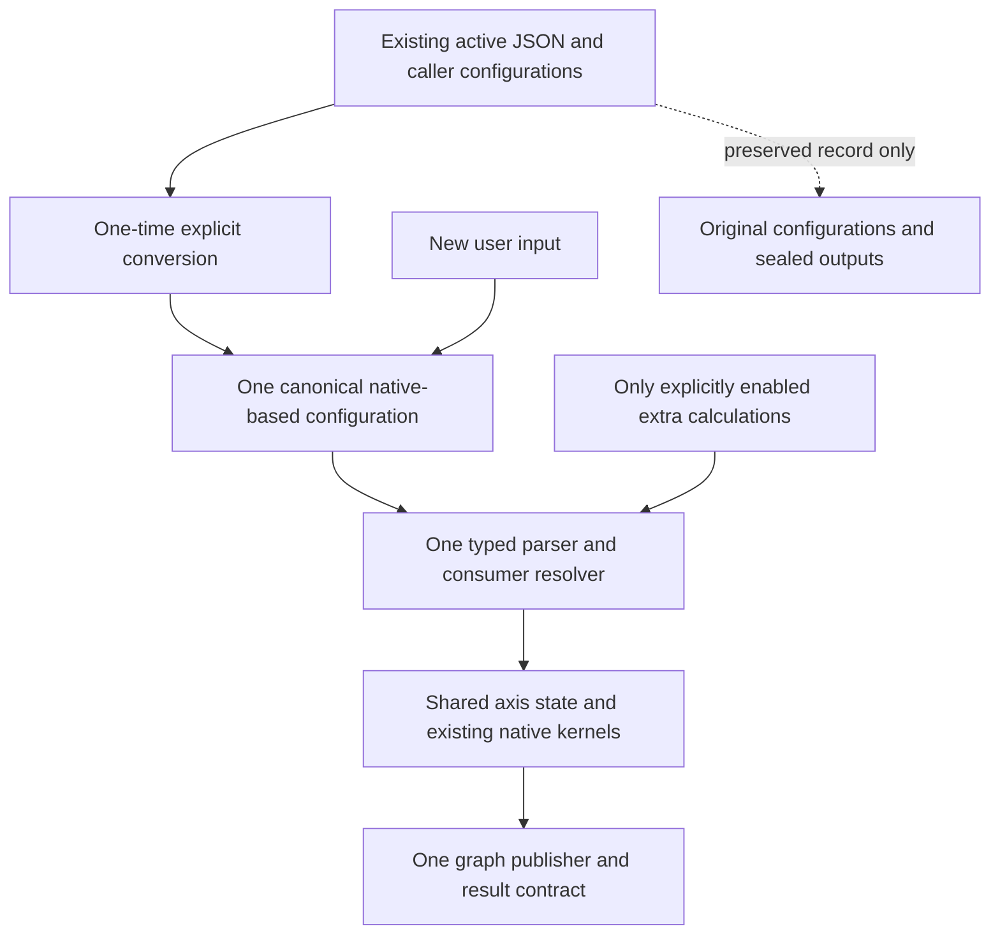

# One input format and simpler root-system settings

18 November 2026. **P0–P6 have been implemented and verified.** The
[implementation report](SINGLE_INPUT_IMPLEMENTATION_REPORT.md) gives the
source identity, integration result and seeded replay checks. Current API and
examples are in the [schema-4 guide](../NATIVE_EXECUTION.md). This document
records the design agreed after the
[native-engine repairs](NATIVE_ENGINE_REPAIR_REPORT.md). It supersedes earlier
requirements to keep several live input adapters and reproduce every historical
execution schedule indefinitely. Baseline HEAD is
`57f6782cba05491c256766cce574548e1683d7e5`, with the existing uncommitted repairs
preserved. Source observations below refer to those working-tree bytes, not HEAD
alone. Local planning/preservation receipts are in
`.runtime/single-input-plan-20261118/`.

## 1. Revised owner direction and deliverables

Convert active inputs completely to one new format. Historical simulation volume
is small; permanent automatic legacy loading is not a design requirement. Keep
original scientific records intact, but do not make their old interface the
ongoing runtime architecture. The owner also requests:

1. Reuse useful native parameters and numerical kernels; enable extra mechanisms
   only when they serve a stated purpose.
2. Remove cohort as a required construction family. Prefer ordinary variation in
   first-order diameter if that adequately represents the intended variability.
   Retain cohort-like behavior only as an optional, justified feature.
3. Keep maximum root order as one global integer, without a probability
   distribution or duplicated per-feature maximum.
4. Resolve the meaning and scale of secondary-root counts before choosing new
   count inputs or increasing their values.
5. Keep the normal summary concise: counts and total length by numeric order,
   plus root length and dry biomass in diameter classes at/below and above 2.5 mm.
   No special order-2 total-count interface or mandatory non-primary total.
6. The default minimum local parent diameter for structural-root branching
   is 0.093 cm (0.93 mm), independent of the reporting cutoff.
7. Replace the unused `root_ratio` with two optional architecture input targets:
   `root_ratio_biomass` and `root_ratio_length`. Report achieved values separately.
   The owner's latest clarification supersedes an earlier selection of
   calculated-results-only: these inputs must influence architecture.
8. Present the detailed design and implementation sequence before changing code.

Deliver one canonical schema specification, a setting-by-setting disposition
matrix, converted active configurations/callers, one resolver/lifecycle and a
small source-bound validation package. This document delivers the planning part.
It does not authorize or report fitting, empirical-data inspection, new model
qualification, worker/deployment changes or modification of sealed research runs.

## 2. Findings from the current code

### 2.1 Maximum order is already a scalar

[`RootSimulationModel.max_order`](../../deeprootgen/data_model/simulation_data_models.py:213)
is an integer. [`init_organs`](../../deeprootgen/model/root.py:907) allocates order
slots through that value, and
[`_draw_lateral_count`](../../deeprootgen/model/root.py:200) returns zero daughters
at the terminal order. No generative distribution for maximum order is needed.
The application already presents an integer slider
([simulation form](../../app/conf/simulation_form/common.yaml:6)). Some calibration
forms can expose parameter-search intervals; those are experiment settings,
not evidence that each root system must sample a random maximum order.

Use a **centrifugal branching order** convention in this model: roots emerging
from the crown/base are order 1; their daughters are order 2; the next daughters
are order 3. It is the model's own topology convention, not an assertion that
all biological root-order conventions use the same numbering.

### 2.2 “Secondary” currently has two meanings

| Current location or setting | Actual meaning | Consequence |
|---|---|---|
| Numeric node `order == 2` | Second-order roots, daughters of first-order roots | Use this for an order-2 count. |
| `order_type="secondary"` | Every non-primary organ, including orders 2, 3, 4, etc. | It is a broad classification, not the numeric order. |
| `min_sec_root_num`, `max_sec_root_num` | A requested daughter count **per parent**, reused at every nonterminal parent order | They are neither a total count of all non-primary roots nor an order-2-only total. |
| `min_sec_root_length`, `max_sec_root_length` | Shared higher-order length bounds, reduced by parent order | They are also broader than order 2. |
| Order-specific research labels such as `secondary_count` | Explicitly labeled order-2 count | Do not equate them to all nodes with `order_type="secondary"`. |

Evidence: every higher-order root receives the `SECONDARY` classification in
[`construct_root_from_parent`](../../deeprootgen/model/root.py:486), while the
construction traversal iterates numeric orders 2 through `max_order` in
[`init_organs`](../../deeprootgen/model/root.py:936). Order-specific research
presentation explicitly distinguishes primary/order 1, secondary/order 2 and
tertiary/order 3
([pilot labels](../../scripts/research/grapevine3d_so4_pilot.py:303)). The current
UI count labels omit the per-parent scope
([simulation form](../../app/conf/simulation_form/common.yaml:124)); they need revision.

For parent order k below the maximum, the current native rule is:

```text
u_k ~ integer_uniform(min_sec_root_num, max_sec_root_num), upper bound exclusive
requested daughters = ceil(u_k * (1 - growth_sec_root)^(-(k - 1)))
```

Equal bounds are handled specially to produce that fixed integer. Spacing,
branch windows and parent length can reduce the number of retained insertion
sites; the requested count is not always the realized count. The replacement
probability/count law also has explicit branch-probability and first-site
censoring; it is a different declared law, not another interpretation of the
same count value. See
[`_prepare_branch_nodes`](../../deeprootgen/model/root.py:228) and
[`first_branch_sites`](../../deeprootgen/model/laws.py:43).

**Therefore, do not simply increase `min_sec_root_num`/`max_sec_root_num` to
represent every root above order 1.** That can multiply daughter counts at every
branching level. With six primaries and realized daughter counts of 10, 8 and 4
at successive parent orders, the order counts would be 6, 60, 480 and 1,920.
Order-2 count is 60; all non-primary roots total 2,460. This is an arithmetic
example, not a recommended vine configuration or a new simulation.

### 2.3 Cohort maturity is more than diameter variation

The current maturity value is a **dimensionless, primary-subtree-level latent
factor**, not chronological age. It is sampled per primary and inherited by its
descendants
([assignment/inheritance](../../deeprootgen/model/native_features.py:70)). Its
unconstrained effects are approximately described by:

```text
axis length       = independently sampled length * maturity^length_power
basal diameter    = independently sampled diameter * maturity^diameter_power
branch probability = base probability * maturity, when explicitly enabled
```

Caps, tip constraints and branch censoring then modify the realized values.
The implementations are
[`scale_lengths`](../../deeprootgen/model/native_features.py:102),
[`point_taper_dimensions`](../../deeprootgen/model/laws.py:60) and
[`first_branch_sites`](../../deeprootgen/model/laws.py:43). The factor induces
shared variation across traits and related axes. A distribution applied only
to first-order diameter does not generally reproduce the length/probability
scaling or subtree correlations.

Current positive dimension draws are **bounded lognormal**, not normal
([`bounded_draw`](../../deeprootgen/model/cohort_geometry.py:10)). Native
cylinder diameters are sampled from uniform bounds and sorted by segment rank
([`init_diameters`](../../deeprootgen/model/root.py:88)); `base_diameter` is not
already a normal distribution of whole-root basal diameters. These meanings
must not be changed by a field rename.

### 2.4 Existing thresholds and ratios do not yet provide the requested behavior

The current UI describes `root_ratio` only as a ratio between structural and fine
roots ([form](../../app/conf/simulation_form/common.yaml:17)); neither numerator
nor biomass/length weighting is defined. It has **no static-generation consumer**
([inventory](../../deeprootgen/data_model/inventory.py:83)). Do not translate its
old value into either new target without an explicit mapping decision.

`fine_root_threshold` already exists in **cm**. Native daughters are classified
using their mean construction-cylinder diameter
([classification](../../deeprootgen/model/root.py:512)), whereas replaced taper
material is split at cutoff crossings and classified per emitted interval
([materialization](../../deeprootgen/model/native_features.py:193)). Thus the
threshold concept exists, but a common physical-diameter summary and two active
architecture targets still need implementation. The current UI default is
0.06 cm, not the newly requested reporting default of 0.25 cm (2.5 mm).

Current branch generation checks maximum order, requested count, probability,
first-site/length feasibility and spacing/windows; it does not apply a minimum
parent material diameter at an attachment site. See
[`_prepare_branch_nodes`](../../deeprootgen/model/root.py:228) and
[`first_branch_sites`](../../deeprootgen/model/laws.py:43). Parent-diameter capping
limits daughter size; it is not a branching eligibility rule.

### 2.5 What the apex diameter controls today

The native sampler draws one diameter per construction cylinder from the interval
between `apex_diameter` and the order-adjusted base, then sorts the draws from
largest to smallest. The last cylinder therefore gets the smallest draw. Either
input can be the upper sampling bound because the code sorts the bounds first.
Daughters also receive a diameter contribution from their attachment cylinder.
The UI calls this parameter the diameter of the apex. On conversion, describe it
as a **native cylinder sampling endpoint (cm)** and retain its value for the
native material law. The optional taper law already provides a true point-tip
parameter, `tip_cm`. [Native sampler](../../deeprootgen/model/root.py#L88) ·
[Daughter inheritance](../../deeprootgen/model/root.py#L494) ·
[Current UI wording](../../app/conf/simulation_form/common.yaml#L101) ·
[Point taper](../../deeprootgen/model/laws.py#L60)

**Paired run on the current engine.** Start with the public buried-crown example
(seed 42), set `base_diameter=0.10` cm and `diameter_reduction=0.90`, then vary
only `apex_diameter`. Each row is a fresh direct simulation. Attachment diameter
is the incoming parent cylinder at each realized daughter birth, before rounding.
[Input example](../../examples/design/native_crown_0_20cm.json)

| Apex parameter (cm) | Valid roots at orders 1 / 2 / 3 | Daughter births on sites below 0.05 cm | Invalid roots |
|---:|---:|---:|---:|
| 0.050 | 2 / 2 / 4 | 3 of 6 | 0 |
| 0.005 | 2 / 2 / 4 | 5 of 6 | 0 |

In the first run, two daughters attached at 0.046615 cm and one at 0.049408 cm.
The engine checks each prepared insertion site and creates a daughter. The apex
parameter influenced cylinder sizes, while branching continued at those sites.
These counts establish the behavior of this synthetic case. The local recipe,
unrounded results and source hashes are in `.runtime/apex-branch-plan-20261118/`.
[Daughter creation](../../deeprootgen/model/root.py#L950)

**Design decision.** Keep the native sampling endpoint, the optional minimum
diameter for branching, and the reporting cutoff independently configurable.
Giving the branch minimum the apex value implicitly would often allow every
site when the reduced base exceeds the apex, yet reject sites at other orders
as the base gets smaller. It would also force a native material setting on an
all-taper setup that can already omit it. Migration copies the native endpoint
only when needed. Historical baseline comparisons explicitly select zero. Newly authored inputs use the 0.093 cm structural branch minimum.
[Native material consumers](../../deeprootgen/data_model/consumers.py#L11)

## 3. Intended single-format architecture

Use one public schema, one parser, one normalized model and the existing engine.
Propose `schema_version: 4` for the deliberate breaking rewrite; do not silently
change schema-3 meanings under the same version. This is a plan, not support for
version 4 in the current parser.



No `construction.kind`, complete-generator `trajectory`, “SO4 mode” or “cohort
mode” selects a whole runner. Nested parameter/distribution types are legitimate
parts of one schema; they are not independent input adapters.

An explicit conversion utility can be used during migration. It is separate
from the supported runtime parser, never runs automatically, never overwrites
originals and need not become a permanently supported old-input API. Old formats
should fail clearly after cutover, rather than being guessed or silently
partially interpreted. The migration inventory is bounded to actual active
callers/configurations; archived records remain archival.

## 4. Parameter simplification rules

### 4.1 One structural control per concept

- `parameters.max_order`: one strict positive integer. No Boolean/coerced float,
  distribution, redundant per-order copy, or cohort-specific hardcoded maximum.
- Primary population: one `primary_root_count` integer. If the native inner/outer
  placement split is needed, make it an explicit optional placement fraction.
  Derive integer group counts from the one total with a documented rounding
  rule; do not also ask for independent total and subgroup totals. Migration
  must preserve the existing split explicitly where it affects geometry.
- Seed, tissue density, diameter classification threshold and soil reference
  each have one owner and declared units. Retain existing native names/units
  where their meanings remain correct.
- `max_order` is an upper bound, not a promise that a stochastic root system
  reaches every order. A result may end earlier through diameter eligibility,
  probability or site limits; reported counts describe the realized system.
- Check the chosen laws' supported orders. The native form offers up to 10,
  while some current Fichtl/research helpers only support orders through 5.
  A global scalar must not promise that every existing law supports arbitrary
  orders. Reject unsupported combinations before constructing anything.

### 4.2 Scalars first, variability only where requested

For a physical quantity whose meaning is settled, allow a scalar for a fixed
value and an explicitly tagged distribution only when variability is desired.
Do not demand mean, SD, minimum and maximum to express one constant. Keep
integer population/count settings as integers; do not model root order with a
continuous normal distribution.

Illustrative **proposed value specifications**, not executable current JSON:

```json
{"basal_diameter_cm": 0.3}
```

```json
{
  "basal_diameter_cm": {
    "law": "truncated_normal",
    "mean_cm": 0.3,
    "sd_cm": 0.05,
    "min_cm": 0.1,
    "max_cm": 0.6
  }
}
```

The first describes a whole-axis basal point diameter, not the old native
segment-cylinder bound. A new whole-root diameter law must be explicit and
reuse the common material integration/attachment state. An untruncated normal
can yield negative diameters; do not silently clamp, take absolute values or
redraw without a documented bounded law. Define whether means/SDs describe the
parent distribution or the realized truncated samples, and report the realized
moments. Preserve bounded lognormal as an optional existing law; do not add
normal distributions to every input just for consistency.

### 4.3 Setting disposition audit

| Existing inputs | Proposed disposition | Required check before code removal |
|---|---|---|
| `max_order` | Retain one scalar unchanged in meaning | Ceiling/early termination and per-law order capabilities. |
| `outer_root_num`, `inner_root_num` | Prefer one primary count; keep split only in a placement feature if useful | Native groups currently have different placement/pitch rules; summing counts alone is not exact geometry preservation. |
| `min_sec_root_num`, `max_sec_root_num` | Replace ambiguous names with per-parent daughter rules indexed by numeric order | Units, exclusive upper bound and count-vs-site censoring. |
| `growth_sec_root` | Remove from the simple interface; optional explicit count scaling only if useful | It is a branching multiplier by order, not a temporal growth rate in the static run. |
| Primary/lateral length bounds and `length_reduction` | Reuse native uniform/reduction kernels where selected; add fixed values and per-order overrides only when needed | Shared lateral bounds apply above order 1; daughter parent-length additions must be declared. |
| `base_diameter`, `diameter_reduction`, `apex_diameter` | Retain within a clearly named native cylinder law if used; give whole-root basal variation a separate material/dimension law | Rank-cylinder bounds, point taper and observed basal diameters are different definitions. |
| `segments_per_root`, curvature step, export cuts | Separate numerical discretization from biology; expose advanced overrides | Graph subdivision must not create extra biological roots, diameter draws or direction decisions. |
| `floor_threshold`, `ceiling_threshold`, spacing, first-branch distributions and supplied sites | One selected attachment law, with concise site-law-specific settings | Fractional windows vs absolute cm; no simultaneous conflicting owners. |
| Native gravity/Fichtl and research direction fields | Retain existing mathematics; group only settings consumed by the selected law | Per-order sigma, initial angle, continuation and boundary settings have different consumers/units. |
| Maturity groups, powers, older/later counts | Omit from the core; follow the value test in section 6 | Do not claim diameter-only equivalence without checking correlations and branch effects. |
| Origin coordinates, depth bounds and crown radius | One independent origins feature | Preserve 0–20 cm emergence below the soil reference; this is not maximum rooting depth. |
| Tissue density, fine-root cutoff and crown mass | Retain density; one `threshold_root_diameter_cm` owns target/summary classification, new default 0.25 cm; crown mass stays separate | Convert old `fine_root_threshold` once with explicit units and changed-default disposition; no duplicate cutoff owner or crown material in root ratios. |
| `root_ratio` | Retire unused ambiguous field; add optional `root_ratio_biomass` and `root_ratio_length` architecture targets | Fractions of root dry mass and root length at/below the shared cutoff; achieved values are outputs, not substituted input targets. |
| No current branch-diameter threshold | Add optional `min_branching_diameter_cm`, default 0.093 cm (0.93 mm) | Apply to local parent material before daughter allocation, independent of reporting cutoff and daughter capping. |
| `mechanical_constraints`, `origin_min/max`, `t` | Exclude from static generator inputs where they have no consumer | Inspect app/inference callers before retiring fields; observation/search settings belong in their own request, not in generation. |
| `research_*` aliases, duplicate selector/version keys | Convert actual active configurations once, then remove runtime aliases | Every source field must be mapped, explicitly recorded as inactive, or rejected; nothing silently disappears. |
| Resource limits and output paths | Keep execution settings separate from biological parameters | Limits fail explicitly and do not alter successful-run model identity. |

## 5. Simple counts, diameter eligibility, summaries and architecture targets

### 5.1 Counts and lengths by numeric order

Use numeric order as the authority. `order_type="secondary"` currently includes
all orders above 1; it must not determine numeric-order summaries. Count distinct
biological organs, not export nodes or intervals. The normal summary is:

| Numeric root order | Root count | Total root length (cm) |
|---|---:|---:|
| 1 through `max_order` | Distinct valid root organs at this order | Sum of physical root-axis length at this order |

Include zero rows for unoccupied configured orders. Exclude invalid roots and
nonmaterial crown/support connectors consistently from counts, length and mass;
retain their exclusion counts in diagnostics. Whole-system root totals may be
used to check arithmetic, but a separate non-primary aggregate is not required.

Keep one ordinary per-parent daughter rule, with numeric-order overrides only
when needed. Its requested daughters can be reduced by the eligibility rules
below. The earlier proposed special order-2 total-count interface, mixed
`total_count`/`per_parent` example and partial-total conditioning work are removed
from this plan. Existing conditioned-count research inputs still need an explicit
migration disposition: archive or justify preserving the existing optional law;
do not silently reinterpret their totals as daughters per parent. Requested,
created and rejected counts belong in diagnostics, not extra normal summary
columns. Do not increase branch counts merely because “secondary” was ambiguous.

### 5.2 Diameter criterion for preventing further branching

Proposed scalar: `min_branching_diameter_cm`, finite and nonnegative. The default for new structural-root simulations is **0.093 cm = 0.93 mm**.
An explicit zero disables this criterion for historical comparisons. Fichtl
et al. use 0.93 mm for their minimum structural-root diameter. Applying that
value at a prospective parent attachment is the owner's modelling choice.
Lignification depends on development. This branch test sets no tissue state.
[Fichtl et al. (2026)](https://doi.org/10.1111/nph.71727) ·
[Gambetta et al. (2013)](https://pmc.ncbi.nlm.nih.gov/articles/PMC3813648/)

A candidate attachment at parent arclength s is eligible only if:

```text
parent_order < max_order
and parent_material_diameter_cm(s) >= min_branching_diameter_cm
and the selected count/probability and site/spacing rules permit it
```

Reject sites strictly below the threshold; equality remains eligible. Apply the
same rule to all branching orders and every selected count/site law. A primary
origin is not a daughter attachment and is not rejected by this rule. A thin
root can still exist and contribute length/mass; the criterion prevents its
ineligible daughter births, not its own continuation or survival. This is not a
minimum child diameter. A small daughter can be born from a sufficiently thick
parent, then be unable to branch itself.

Use the **actual local parent material profile**, after its length/taper and any
parent-size cap are resolved. For a taper, evaluate point diameter at s; for
native cylinders, use the owning construction interval, choosing the incoming
(base-side) interval at an exact internal boundary. Do not use a whole-organ
mean, basal diameter, exported volume-equivalent diameter, `root_type`, or a
provisional birth cylinder when a different taper is active. Preserve immutable
birth context for independent native daughter dimension sampling.

Current sites are prepared before the replacement taper is installed. Therefore
resolve each parent’s material and candidate arclengths before planning sibling
ranks or allocating child IDs. For the current order-2 relocation on primaries,
compute its final arclength once from the existing mapping,
`s_final = f * parent_length + (1 - f) * s_birth`. Use the final arclength for
eligibility and retain the birth site for native dimension inheritance. An
eligible site enters the ordinary daughter pipeline once. A rejected site
creates no daughter or descendants. Keep full candidate and accepted site lists
distinct when checking conditioned quotas. Rebuild eligibility on each private
target-allocation proposal that changes parent dimensions. [Relocation mapping](../../deeprootgen/model/attachment.py#L115) Export refinement must not
change eligibility. Do not redraw/move failed sites automatically to recover a
requested count. Record `diameter_below_branch_minimum` rejections by parent
order in diagnostics. Any retained exact-count feature must report infeasibility
rather than bypass the threshold. Terminal order, zero count/probability and
no-space cases remain separate reasons; budgets remain errors, not biological
stopping rules.

### 5.3 One diameter cutoff for summaries and ratio targets

Proposed canonical input: `threshold_root_diameter_cm`, finite and positive,
new default **0.25 cm = 2.5 mm**. It replaces the current `fine_root_threshold`
name once, rather than adding a competing threshold. UI labels may show mm,
with explicit conversion at the boundary. This is separate from the 0.093 cm
branching threshold. Changing the reporting cutoff alone does not change geometry
when both ratio targets are absent. When targets are active, changing the cutoff
changes their meaning and can therefore change the constructed architecture.

Use two exhaustive classes: **diameter <= cutoff** and **diameter > cutoff**.
Equality belongs to the lower class, consistent with the current materializer.
Summarize total physical root length (cm) and dry biomass (g) for each class.
Do not classify a whole tapered root by its mean diameter: split its material
integration at cutoff crossings. Reuse the existing taper integrals and native
cylinder lengths/volumes. Do not rely on inherited whole-organ `root_type` labels.

For a cylinder, dry mass is density times pi * diameter² * length / 4. For a
linearly tapered interval of length L and endpoint diameters a,b, it is density
times pi * L * (a² + a*b + b²) / 12. Split piecewise tapers at their breakpoints
and the cutoff, and sum. Root/crown separation and the same valid-root support
apply in every numerator and denominator. Fine plus coarse length/mass must equal
the corresponding whole-root totals independently of export subdivision.

### 5.4 Two optional input targets that actively adjust architecture

The owner's final clarification is **input targets**, not merely two calculated
statistics. Use the following dimensionless fractions, each in [0,1]:

```text
root_ratio_biomass = requested dry mass at/below cutoff / total root dry mass
root_ratio_length  = requested length at/below cutoff / total root length
```

They are not root:shoot ratios or fine:coarse quotients. Each is optional; an
absent target imposes no constraint and must not trigger a solver. Report separate
`achieved_root_ratio_biomass` and `achieved_root_ratio_length`, residuals and target
status. Store the original requested values unchanged. Both absent preserves the
selected native construction laws and their ordinary random schedule. A zero
whole-root denominator yields an undefined/null achieved ratio with a reason,
not zero or a fabricated match.

These targets require a real, optional **architecture-allocation calculation**
in the same engine. A uniform global length or density multiplier cannot change
both ratios. Use independently adjustable class length allocation and diameter
profile parameters; reuse the selected native/per-order length and material
kernels. Do not implement this by changing tissue density, relabeling classes,
adding hidden “unrepresented” biomass, or editing summary numbers. Keep origins,
order ceiling and tissue density fixed. Treat supplied fixed dimensions as hard
constraints; the target feature must explicitly own adjustable dimensions rather
than silently override a second owner. If the configuration leaves insufficient
freedom, reject it with the conflicting fields named.

Implementation sequence for this optional calculation:

1. Resolve target definitions, material support, hard bounds and adjustable
   length/diameter controls. Use analytic feasibility checks before construction.
   Freeze a reproducible base set of random draws; targets do not justify
   repeatedly searching fresh seeds for a favorable realization.
2. Use a bounded deterministic allocation/search over the permitted length and
   diameter controls. Evaluate proposals through the same axis/material and
   branching pipeline. Rebuild dependent child state when a proposal changes
   parent length, attachment diameter or branch eligibility; never retain a
   stale topology with modified material. Rejected proposals stay private.
3. Measure both ratios on final valid root material. Start with a documented
   proposed absolute tolerance of 0.01 for each supplied fraction; preserve exact
   analytic fixtures separately. Record the tolerance, algorithm version,
   iterations and adjustments in the execution receipt. Budget/iteration limits
   and active target settings have explicit provenance.
4. Publish only a validated feasible architecture satisfying every supplied
   target within tolerance and the ordinary geometry/material constraints.
   A proven conflict reports the violated bound. A search that reaches its limit reports unresolved targets and the best measured residuals;
   it must not silently publish an ordinary unconstrained result as successful.

This is construction to user-specified synthetic allocation targets, not fitting
to empirical observations or biological validation. The choice of adjustable
controls and bounded numerical algorithm is a P1/P2 design deliverable before
implementation; no separate cohort runner or calibration service is introduced.

**Feasibility matters.** With uniform positive tissue density and both classes
present, the lower-diameter biomass fraction is strictly smaller than its length
fraction. Thus e.g. biomass 0.8 and length 0.2 cannot be achieved under that
assumption. For positive class lengths, with A_f and A_c the length-weighted mean
squared diameters in the two classes:

```text
r_biomass = r_length * A_f / (r_length * A_f + (1-r_length) * A_c)
A_f/A_c = r_biomass*(1-r_length) / (r_length*(1-r_biomass))
```

Handle endpoint cases separately: an entirely lower-class system has both
fractions 1; an entirely upper-class system has both 0. Fixed diameter supports,
parent capping and the branch cutoff impose additional feasibility limits.
For two interior targets, bound the attainable ratio of squared diameters using
the allowed class supports. Apply the tolerance to the range of acceptable
realizations when claiming that a target is unreachable. Branch eligibility can
change topology discontinuously, so a failed search alone cannot establish
infeasibility. Among feasible proposals prefer the smallest departure from the
seeded dimensions using a documented, dimensionless distance on the adjustable
controls. If variable tissue density is supported later, use mass-weighted feasibility
instead of assuming the uniform-density inequality still holds.

An invented analytic target fixture is 800 cm at 0.1 cm diameter plus 200 cm at
0.4 cm diameter, uniform density and cutoff 0.25 cm: length ratio = 0.8 and
biomass ratio = 0.2. It demonstrates two different fractions without a simulation
or a recommended biological parameterization. Validate this accounting separately
from whether a particular topology can construct the target fixture.

## 6. Cohort decision: optional only if it adds a distinct mechanism

**Recommended simple baseline:** no cohort constructor or mandatory cohort
parameters. Use fixed/native dimension laws or an explicitly selected positive
first-order diameter distribution. Keep crown emergence, taper and branching
independent; they are useful mechanisms regardless of cohort labels.

Use this decision table during the implementation design review:

| Intended variability | Simpler explanation | Cohort disposition |
|---|---|---|
| First-order roots vary only in basal diameter | One positive diameter law, fixed or distributed | Remove cohort dependency. No older/later counts or maturity powers needed. |
| Labels differ but all scaling is identity | Labels are optional descriptive metadata | Remove the biological feature; it has no numerical effect. |
| A latent factor changes diameter alone | A direct marginal diameter law can replace it | Check the actual marginal: a product/mixture is not automatically normal. Approximation must be named, not called exact conversion. |
| Related roots share size variation in both length and diameter | Explicit diameter–length relation if sufficient; otherwise one shared primary-subtree factor | Retain only as an optional correlated-size feature with a documented purpose. |
| The factor changes subtree branch probability/counts beyond size effects | A distinct topology mechanism | Keep optional only if this relationship is intended and supportable; diameter-only variation is not equivalent. |
| Genuinely known emergence/age groups are available in a future scoped data task | Explicit group-conditioned laws, with supported measurements | Do not infer age from diameter or rename current dimensionless maturity as years. |

Evaluate simple and retained-feature versions using analytic/synthetic
counterexamples first: identity/no-op cases, equal primary-diameter marginals,
length–diameter covariance, within-tree descendant correlations, conditional
branch counts, per-order material and computational/input complexity. Do not use
a biomass match or matching diameter histogram alone to decide equivalence.
Test current native inheritance effects explicitly; the simple model is not
assumed statistically independent just because the cohort factor is absent.

This inspection establishes extra **expressive capacity**, not biological value
or evidence that users need more parameters. No empirical ablation/fitting is
part of the current planning task. If no distinct requirement remains after
this audit, remove cohort state and its parser/constructor entirely from the
supported runtime. If retained, use one optional feature in the canonical schema
(the current `cohort_maturity` name may be replaced once, with an accurate
size-factor description); no separate runner or hardcoded five-order model.

## 7. Conversion and retirement policy

Inventory active public/synthetic JSON, current notebooks/scripts, CLI/tracked
runs, Dash forms, Prefect request models and inference input builders. Convert
all supported live callers in a bounded migration, rather than leaving the
application on a second schema. Merely fixing the offline CLI is insufficient.

For every active file/caller, produce a disposition: converted and verified;
archived and removed from current-use documentation; or explicitly unsupported
until its actual consumer is migrated. Do not claim completion with an active
caller still building the old model. Do not start services or dispatch training,
calibration, fitting or deployment as a migration side effect.

The conversion report maps old field → new owner → units/semantics → whether
numbers/behavior changed. Preserve original source bytes and sealed results in
place. Inactive settings can be documented in the conversion report rather than
forcing them into the new runtime schema. Any unresolved scientific mapping
fails clearly; no automatic invented defaults for empirical dimensions.

No permanent live flat/schema-2/schema-3 loading, hidden compatibility modes,
cohort-specific result builders or dummy RNG draws are required by this revised
plan. Remove such machinery after its active consumers and useful kernels have
been handled. Retain small frozen historical artifacts as records where useful;
exact replay of every historical random schedule is not a completion gate.
For a formatting-only native migration, retain same-runtime baseline checks.
Intentional count/material/stream-policy changes are versioned and tested as
new behavior, not hidden behind newly rebound historical fixtures.

## 8. Implementation packages and acceptance

| Package | Work and principal files | Acceptance / deliverable |
|---|---|---|
| P0 — freeze meanings | This source audit; final field disposition; count, diameter eligibility, target-ratio and summary definitions; current active caller inventory | One agreed semantic specification, one order ceiling, explicit count scope, cohort baseline/optional decision; no code changed yet. |
| P1 — freeze the canonical schema | `data_model/features.py`, `simulation_data_models.py`, `execution.py`, `resolution.py`, `consumers.py`, `inventory.py`; prefer one public configuration type with ordinary nested value types | Proposed schema-4 examples parse under one model; all fields have one consumer, units and activation; scalar vs distribution schemas cannot accept foreign fields. Old-format rejection is explicit. |
| P2 — simplify count/dimension kernels | Native `RootOrgan` samplers; `native_options.py`; `utils/order_controls.py`; shared material/attachment kernels | Fixed values need no dummy distribution; diameter eligibility composes with ordinary branching; optional biomass/length targets adjust permitted architecture controls and report achieved residuals; order ceilings, zero counts and infeasible targets are correct. Preserve useful native formulas rather than copy generators. |
| P3 — cohort value decision and common state | Maturity/size-factor leaf laws and `AxisState`; remove cohort-only planned schedule/state if no longer needed | Diameter-only simple baseline works; optional shared factor, if retained, demonstrates exactly the stated extra correlations/topology, has a no-op identity case, and never selects a forest runner. |
| P4 — bulk convert active inputs and callers | `examples/`, current notebooks, CLI, `run_records.py`, research callers, app forms/pages/flow request builders and inference parameter builders | Every supported caller emits the canonical object; static generation, observation settings and inference/search priors are separate. Public examples/notebooks have one current format; UI exposes optional ratio targets and distinct diameter thresholds, with achieved results shown separately. Conversion does not execute services or empirical fitting. |
| P5 — retire adapters and duplicate settings | Old schema/selector branches, constructor/export adapters, unused aliases and compatibility-only RNG schedules; update guides | One runtime parser, one resolver, one lifecycle and publisher; no supported path uses an old format. Archive-only code is clearly outside current support. Generated/biological state and root/crown identity remain coherent. |
| P6 — verify and document cutover | A few invented fixtures for new semantics; focused tests; full integration suite after changes settle; tracked export/reload matrix | Exact commands/source/input/lock identities, zero unexplained failures/skips, concise maintained report and updated parameter cheat sheet. Existing sealed empirical conclusions are neither rerun nor rewritten. |

Execute P0–P1 before implementation changes to scientific count/material laws.
Proceed package by package; resolve routine mapping/implementation details
within the approved plan. A new biological assumption remains an explicit named
change with a testable definition, not a reason to retain three input families.

## 9. Validation specification for the later implementation

Use the existing qualified Python 3.10 runtime and lock, no dependency upgrades.
Start with small invented in-memory cases. Required checks:

- Global maxima 1, 2 and the highest supported order: no root exceeds the cap;
  early termination is valid; every child order is its parent order plus one.
- Six primaries with fixed feasible daughters 10, 8, 4: verify per-order counts
  and total lengths analytically. Use a smaller equivalent tree for
  routine integration testing if the exact example is unnecessarily large.
- Branch eligibility just below, exactly at and above 0.093 cm; native cylinders,
  active taper, exact internal boundaries, mixed laws, relocation and final target
  adjustments. Eligible thin daughters can exist but cannot branch from sites
  below the threshold. Disabled threshold and max-order termination stay distinct.
- Summary cutoffs below, exactly at and above 0.25 cm; cylinders and crossing
  tapers, valid-root filtering, no support-edge mass, zero per-order rows and
  export-subdivision invariance. Class length/mass sums recover whole-root totals.
- Two ratio inputs absent, each alone and both present; verify that enabled
  targets really change permitted architecture controls, achieved ratios meet
  their tolerance, and requested values remain intact. Check the 0.8-length /
  0.2-biomass analytic fixture, impossible pairs, hard bounds, zero denominators,
  reproducible bounded failure and interaction with branch eligibility. No target
  can be “met” by relabeling, tissue-density edits or summary-only scaling.
- Scalar dimensions are fixed; optional positive distributions respect support
  and documented moment definitions; impossible rejection supports fail early.
- Diameter-only variation does not activate maturity, change length laws or
  request a group label. Correlated-size optional tests check more than mass.
- Crown origins use the declared soil reference and configured 0–20 cm range;
  no cohort feature is needed for this. Soil frame and root/crown mass separation
  remain explicit.
- Geometry/material tests retain corners, attachments, birth context, finite
  values, exact analytic volume where appropriate and meaningful scale-aware
  tolerances from the repaired engine.
- No synthetic dummy draw or dormant legacy parameter has a hidden consumer.
  Changed stream versions and configuration identities describe actual behavior.
- Round-trip canonical export/reload preserves model/run identity for replayable
  runs; observer/provenance and pre-allocation budget tests remain intact.
- Converter tests cover only inventoried active forms plus representative
  unsupported cases. They are migration checks, not a permanent compatibility
  matrix for every old input variant.

After focused checks pass, run the full suite with `--run-integration` once on
the final source, lint changed Python files, validate examples and repeat the
small offline tracked matrix. Section 2.5 records the two synthetic runs made
for the original plan against the earlier engine. The preceding 1,953-test result
belongs to the earlier repair receipt. The final schema-4 suite passed 1,998
tests with zero skips. Eight seeded cases reproduced the exported graphs and summaries.

### Implementation goal as agreed before execution

Implement and verify P0–P6 in this checkout, starting with a working example
through the canonical input and the shared engine. Capture the current working
tree and inventoried callers at the start of the round so migration uses the
repaired implementation as its baseline.

1. **First runnable comparison.** Use the two cases in section 2.5 to check
   conversion with branching eligibility disabled. Then hold the apex at
   0.05 cm, enable the default 0.093 cm branch minimum and assert that every realized
   daughter has an eligible final parent site. Derive rejected sites from the
   candidate list for that run. An early rejection can change later draws and
   descendant families. Check a site exactly at threshold and a mixed-taper
   fixture where distal relocation moves a site across it.
2. **Accounting and architecture targets.** Implement the per-order and
   two-class summaries first. Use the same integration to verify returned
   geometry with neither target, each target alone and both together. Prove
   at least one feasible paired request changes generated architecture and
   reaches both fractions. Exercise a provably impossible pair and distinguish
   it from an exhausted search.
3. **Complete the cutover.** Resolve the optional cohort mechanism using
   section 6, convert the supported active inputs and callers, retire superseded
   runtime adapters, and deliver the checks and source-bound report in P6.
   The first example demonstrates a mechanism. Completion requires the published
   canonical interface, migrated callers and the full verification in section 9.

## 10. Acceptance criteria and cohort decision

The revised goal is complete when active use requires only one input format;
ordinary native parameters remain familiar where their meaning is unchanged;
maximum order is one scalar; ordinary summaries report per-order counts/lengths
and diameter-class length/dry mass; branching honors local diameter eligibility;
optional biomass/length ratio targets actually influence architecture and report
achieved values; extra variability is optional; and cohort is either absent
or one justified independent feature. Current-source checks and a simple
parameter guide must support those claims.

Recommended decisions are already explicit: full active-input conversion;
scalar maximum order; simple fixed/count inputs; optional positive first-order
diameter variation; no mandatory cohort; no automatic increase in ambiguous
secondary-root settings; separate branching and summary diameter thresholds;
optional architecture ratio targets with feasibility checks. The implementation
retains ordinary first-order diameter variation and an optional shared primary-tree
factor. The latter can make length and branch probability covary across a subtree.
Synthetic tests demonstrate this effect. Whether it improves an empirical fit
remains a population-specific research question.
