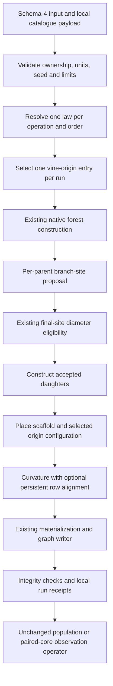

# Spatial construction features: detailed implementation plan

19 November 2026. **Design complete; implementation and empirical runs not started
by this planning task.** This expands the design for three schema-4 construction features.

The [implementation follow-up](SPATIAL_CONSTRUCTION_IMPLEMENTATION.md)
records the completed software checks and current field-evaluation status.

## 1. Outcome, scope and inspected baseline

Implement three independently selectable calculations inside the existing
`RootSystemSimulation.run(RootConfig(...))` engine:

| Feature | Intended behavior | First scientific application |
|---|---|---|
| Persistent row alignment | Encourage a curved axis to remain aligned with either direction along the planting row throughout its contour | SO4 across/along/depth allocation |
| Vine-origin catalogue | Select one coherent measured vine-origin record for a simulation, preserving relationships among its coordinates and primary origins | Population variation and crown placement |
| Length-dependent branching | Increase expected daughter count with usable parent contour length, retaining local diameter eligibility | Calvin main-axis branching; SO4 order-2 parents |

All are off for existing inputs. Keep the existing graph writer, materializer,
organ objects, integrity checks and public schema-4 entrypoint. No new complete
generator, supervisor, growth/time model, hydraulic service or automatic adoption.
The current order-2 angle and unknown primary counts remain optimizable. Measured
initial conditions remain fixed when their completeness is documented.

Inspected checkout: branch `codex/merge-native-engine-into-main-20261118`, HEAD
`57f6782cba05491c256766cce574548e1683d7e5`, with substantial uncommitted work.
HEAD is **not** the implementation baseline by itself. The local planning receipt
`.runtime/spatial-feature-plan-20261119/INPUT_SOURCE_MANIFEST.json` records hashes
of the working files inspected. Freeze and recheck the source owner's completed
working state before implementation; preserve intervening work.

Current source already includes per-order law resolution, keyed streams,
curvature realization, local parent-diameter filtering, branch receipts,
excavation observations and raw/RSML archive reconciliation. Reuse these rather
than repeating earlier repair tasks. This plan does not claim a fresh runtime
pass for those additions.

## 2. Shared architecture and invariants



This is a conceptual dependency diagram. Preserve the actual existing phase
ordering: parent sampling/site proposals and daughter allocation occur within
`prepare_forest`; origin placement occurs in `place_scaffold`; directions are
realized later. Do not move daughter construction after direction realization
or introduce a second forest merely to match the diagram.

Mandatory invariants:

- Model coordinates remain x across row, y along row, z positive upward.
  Origin depth is positive down from `parameters.soil_surface_z_cm`.
- Biological roots, vine identity, geometric cut nodes and nonmaterial crown
  support are distinct. One catalogue entry describes one vine, not a batch of
  vines disguised as primary trees.
- Parameters have one active consumer. Conflicts fail during resolution, before
  graph allocation. Disabled features cannot consume randomness or hidden inputs.
- Direction integration uses physical arclength stations. Adding attachment or
  material cuts must not add direction steps or OU innovations.
- Geometry errors remain errors. Limits reject excessive work rather than
  truncating a biological count, discarding a failed seed or relaxing tolerances.
- Source, supplied input, effective model, seed, realized choices and observation
  operator identities remain distinguishable. Across source revisions a run hash
  can change even when geometry remains identical; do not require false hash parity.

## 3. P0: freeze contracts and preserve current behavior

### Implementation preparation

1. Recheck the owning engine chat, current git status and relevant run receipts.
   Snapshot the exact working source, lock and synthetic fixtures. Do not stage
   other work, overwrite active edits or regenerate historical fixtures.
2. Inventory current consumers in `data_model/consumers.py`, current canonical
   types in `canonical_features.py`, and active/inactive serialization in
   `resolution.py`. Record current outputs for one native, one five-order curved
   and one mature-style invented configuration.
3. Freeze this plan's definitions and proposed JSON forms before implementation.
   These are engineering/scientific assumptions to test, not published laws.
4. Capture the existing point/disk origin, first-site/count branching and
   zero-row-alignment outputs/RNG state. Use meaningful current-engine checks;
   do not restore retired historical executors as a fresh-generation route.

### Exit evidence

A source manifest, exact commands/environment, small invented reference set and
an ownership/conflict matrix. This is a preservation checkpoint, not a request
for another broad source audit or a new calibration.

## 4. P1: persistent symmetric alignment along the row

### Definition

Use an **axis preference**, not a force sending every root toward +y. In version
1 the fixed row axis is `a = (0,1,0)` in model coordinates. Its sign is irrelevant.
Let `h` be unit heading and `k >= 0` be `row_alignment_per_cm` in cm^-1. Define
the deterministic heading tendency by:

```text
c = dot(h, a)
dh/ds = k * c * (a - c*h)
```

This rotates headings toward either +a or -a and preserves unit length in
continuous arclength. For a physical step of length d, apply the exact isolated
alignment map:

```text
parallel      = dot(h, a) * a
perpendicular = h - parallel
h_aligned     = normalize(parallel + exp(-k*d) * perpendicular)
```

Handle `k == 0`, exact axial and exact perpendicular headings explicitly. A
perfectly perpendicular axis stays perpendicular under this deterministic law;
OU curvature or a nonperpendicular initial heading can break that symmetry.
Do not add an undocumented random sign or a singular fallback. This is an
alignment mechanism, not a claim that the root physically senses vineyard rows.

### Interaction with the current integrator

Retain the existing sequence and insert one deterministic operation:

1. Advance the existing OU curvature state and heading at the physical station.
2. Apply the existing downward drift and normalization unchanged.
3. Apply the alignment map if and only if `k > 0`.
4. Apply the existing soil-surface reflection, OU-reset convention and frame
   transport exactly as before.

The exact map is exact for alignment alone; the combined OU/downward/alignment
scheme remains an operator splitting. Smaller physical steps can change full
paths. Test convergence rather than claiming exact invariance to physical step.
Graph subdivision, in contrast, must preserve the same realized physical curve.

Keep a numerical guard `k * step_cm <= 0.5` in version 1, with a clear error;
this is an engineering resolution restriction, not a biological upper bound.
Do not silently reduce `step_cm`, which would change the OU draw schedule.

### Proposed API fragment: not currently executable

```json
{
  "features": {
    "curvature": {
      "enabled": true,
      "settings": {
        "by_order": {
          "2": {
            "law": "correlated_curvature",
            "step_cm": 2.0,
            "curvature_sd_rad_cm": 0.02,
            "correlation_length_cm": 1.0,
            "downward_drift_per_cm": 0.02,
            "row_alignment_per_cm": 0.02,
            "boundary": "reflect_downward",
            "first_interval": "integrate",
            "initial_heading": "insertion_angle",
            "insertion_mean_deg": 35.0,
            "insertion_sd_deg": 10.0
          }
        }
      }
    }
  }
}
```

Values are invented. The existing complete configuration must still supply its
other orders, required parameters and consumers. The example does not reinstate
a requirement for a 35-degree fitted angle.

### Code changes and ownership

- Add canonical-only curvature settings with a finite nonnegative alignment
  scalar, default zero. Keep schema-1/2/3 adapters and their numerical defaults.
- Resolve the additional field in `resolution.py`; describe units, model-frame
  axis, composition order and a versioned `nematic_heading_v1` calculation.
  Omitted/zero alignment retains the original effective direction description;
  a positive value adds the new law component and changes effective identity.
- Add a pure helper, for example `model/row_alignment.py`, called through
  `cohort_geometry.integrate_curve`. Extend the integrator with a keyword whose
  default bypasses the helper. All archived callers keep that default.
- Pass the resolved scalar through `axis_laws.realize_correlated_curvature`.
  Use the same OU stream and number of draws; alignment draws nothing.
- Record strength, axis, numerical version, physical step and a length-weighted
  row-alignment diagnostic from the physical pieces. Do not use graph-node count
  as a spatial weighting. Keep existing reflection/validity diagnostics.

### Required tests

| Case | Required result |
|---|---|
| Omitted, disabled and zero scalar | Exact baseline geometry, material, native/keyed RNG state and effective direction meaning |
| Axis reversal a to -a | Identical deterministic update |
| Positive/negative along-row component | Alignment strengthens either sign without imposing a net +y preference |
| Zero-noise isolated alignment | Analytic map, unit norm and composition over two steps match the one-step heading map |
| Exact perpendicular/axial heading | Finite, documented fixed point; no extra draws |
| NaN, negative strength, guard violation | Informative pre-allocation rejection |
| Same physical curve with extra graph cuts | Same curve/length/material to existing numerical tolerances |
| Nonzero downward drift and surface reflection | Finite geometry and existing surface/validity rules retained |
| Physical step halving | Heading/path convergence reported under a declared synthetic tolerance; no false exact-path claim |

For the pure alignment analytic test use tight float64 agreement, e.g. 1e-12
absolute/relative on ordinary unit vectors. For full graph/material checks use
the existing stricter applicable contracts. Empirical gains remain a later test.

## 5. P2: length-dependent branching with explicit count meaning

### First implementation: a Poisson site process

Add a separately named canonical law, `length_poisson_sites_v1`. Keep
`first_branch_and_daughter_count` unchanged. For parent length L, positive basal
exclusion B, positive apical exclusion A and positive mean spacing d:

```text
W = max(0, L - B - A)
With probability p, activate this parent; otherwise propose no sites.
For an active parent: N ~ Poisson(W / d)
Given N: sample N positions uniformly within [B, L-A), then sort.
```

For W=0 propose no sites and issue no count/site draws. This law does not force
a first daughter at B. Its first-site distance, unconditional count and zeros
therefore differ from the old first-site/count law. Do not silently convert old
parameters into these new meanings.

Use `branch_probability` for p, preserving its explicit parent-level meaning.
For initial mechanism comparisons hold p fixed (prefer p=1 for an unconditioned
site process) and vary spacing before jointly tuning p and spacing. They can
otherwise trade off in mean count.

Let E be the measure of parent arclength inside this zone whose local diameter
is at least the configured branching minimum. Sample proposals over W, then use
the existing deterministic diameter filter before allocating daughters. For a
fixed material profile and no competing attachment transform:

```text
mu_eligible = E / d
Expected accepted daughters = p * mu_eligible
Variance = p * mu_eligible + p * (1-p) * mu_eligible^2
P(no accepted daughters) = (1-p) + p * exp(-mu_eligible)
```

These are pre-daughter-validity expectations. Later geometry failures are
recorded separately. The measure E may be discontinuous; proposals in a thin
interval are rejected, not moved to a thicker location.

An invented parent with B=A=10 cm, d=10 cm and p=1 has expected proposal counts
4 at L=60 cm and 8 at L=100 cm. If only 20 cm is diameter-eligible in the first
parent, its expected accepted count is 2. A parent of length 20 cm has no sites.
This demonstrates scaling with usable length, not the whole-axis length ratio.

### Proposed API fragment: not currently executable

```json
{
  "features": {
    "branching": {
      "enabled": true,
      "settings": {
        "by_order": {
          "2": {
            "law": "length_poisson_sites_v1",
            "basal_exclusion_cm": 10.0,
            "apical_exclusion_cm": 10.0,
            "mean_spacing_cm": 10.0,
            "branch_probability": 1.0
          }
        }
      }
    }
  }
}
```

The positive zone requirement is a version-1 restriction that keeps proposals
strictly inside the axis even at floating-point endpoint draws. Zero-zone
semantics can be added only with a separately tested endpoint contract.

### Implementation steps

1. In `canonical_features.py`, define explicit canonical branching variants and
   a discriminated union by `law`. Fields of one law are forbidden on another.
   Do not broaden archived schema-3 numerical meanings.
2. Dispatch `_resolve_branching` by law and add the new units, required fields,
   active order set and version to the consumer/inventory descriptions.
3. Add a pure sampler, for example `model/branching_laws.py`. It returns proposed
   arclengths and a small receipt; it constructs no nodes or complete forest.
   Use a new namespace `feature.branching_length_poisson`, version 1, keyed by
   the existing biological parent identity. Do not key by exported node IDs.
4. Call it from `NativeFeatureLaws.branch_sites`. Keep parent construction,
   native insertion of attachment cuts, taper evaluation and final-site diameter
   filtering in their existing owners. Accepted daughters enter the same native
   construction path as before.
5. Extend receipts with parent length, B/A, W, spacing/rate, activation decision,
   proposed count, placed count, diameter rejections, accepted count and invalid
   descendants. Do not put a nonexistent sampled first site in the old field;
   distinguish first proposed/accepted site and missing values explicitly.
6. Check the proposed count against available node/proposal budgets before
   allocating position arrays or cuts. A Poisson tail can exceed a budget even
   with a modest mean. Record the failure and reject; never clip N to a maximum.
   If needed add an execution-only `max_branch_proposals` limit, excluded from
   successful model meaning, with one owner and pre-allocation enforcement.

### Conflicts and version-1 limits

- Reject simultaneous exact-count conditioning, another branch-site/count owner
  or a native per-order count override on the same parent order.
- Reject attachment relocation for the daughters produced by this new law on
  that parent order in version 1. Otherwise the basal/apical zone would describe
  pre-transform rather than final sites. Existing relocation on other parent
  orders remains usable; old-law relocation remains unchanged.
- Defer maturity-scaled activation for the new law until an explicit bounded
  p*maturity contract is defined. An enabled scaling owner on an affected order
  must reject, not be ignored. Length/material scaling already chosen by other
  active owners must be applied before this law reads L and final eligibility.
- Do not reinterpret this static law as the author's age-dependent successor
  probabilities, or as a measured loss correction for excavation.
- Do not add gamma dispersion, hard minimum spacing, renewal processes and a
  second count cap in the same first implementation. Poisson is a clear baseline;
  later overdispersion needs separately justified semantics and qualification.

### Tests and numerical coupling

Use exact fixture checks for zones, terminal order, zero intensity, p=0, diameter
threshold equality, disjoint eligible intervals, malformed inputs, small limits
and strict interior positions. Use the analytic mean/variance/zero formulas for
bounded invented Monte Carlo leaf tests, with tolerances declared from sampling
error rather than chosen after observing a result. Test exact seeded replay,
receipt conservation and existing geometry/material postconditions.

Changing branch counts changes descendants and can change subsequent biological
IDs and native sequential draws. New keyed streams alone do **not** guarantee
that every unaffected root keeps its old geometry. Characterize this explicitly.
Use a frozen parent/material leaf fixture to establish the branching mechanism;
for full-system comparisons record primary scaffold, parent dimensions, stream
keys and any changed upstream geometry. Where isolation is needed, use a
qualified fixed-scaffold configuration already supported by the engine. Do not
silently overhaul the global RNG schedule as part of this feature or claim a
pure branching effect from common seeds alone.

## 6. P3: one coherent empirical origin entry per vine

### Catalogue data contract

Use a local, embedded catalogue payload in the canonical input. Runtime must
not follow a URL, load a hidden workbook or depend on a mutable absolute path.
A preparation notebook may read an explicitly chosen local derived file and
embed its frozen records and provenance into the exported JSON.

Version `vine_origins_v1` has two explicit entry forms:

| Entry layout | Content and application |
|---|---|
| `common_point` | One measured x/y/depth tuple for a vine. Translate the whole existing common-base forest using that tuple. Primary count and placement remain parameter-owned. This covers historical joint basal-origin catalogues. |
| `primary_layout` | A complete list of indexed primary-origin x/y/depth tuples for one vine, optionally with a complete list of measured unit headings. Use existing nonmaterial per-primary anchors. |

Preserve x/y/depth jointly. For `primary_layout`, select the entire vine record
once; do not sample a different observed vine for each primary. Preserve local
relationships and primary indices. Record whether origins, headings and the crown
census are complete, missing or inferred. Missing headings can fall back to a
declared existing heading owner; missing origins cannot be silently invented.

Coordinates supplied to the engine are already model-soil-frame centimetres;
z is computed as `soil_surface_z_cm - depth_cm`. Preparation preserves original
frame, landmarks, conversion version and source hashes locally. Do not mix
digitizer-frame offsets with measured variation in crown location.

### Selection and count ownership

- Selection is either fixed by unique `entry_id` or sampled once per run.
  Default sampling gives each observed vine equal weight. Optional weights must
  be finite and strictly positive and are normalized explicitly.
- Sample mode requires the existing explicit nonnegative seed contract. Use
  `feature.vine_origin_catalogue`, version 1, with a run-level key, not an organ
  or graph-node key. Fixed mode needs no selection draw.
- Canonicalize sample entries by unique entry ID and primary records by index,
  moving weights with entries. Reordering an otherwise identical payload must
  not silently change seeded selection.
- Keep `parameters.primary_root_count` a strict integer in this implementation.
  A selected/sampleable `primary_layout` must have exactly that number of unique
  primary indices. Reject incompatible sampleable entries; do not truncate,
  duplicate, average or silently filter them.
- If optimization compares different primary counts, its input builder must
  explicitly supply an appropriate catalogue pool for each count and record
  that conditioning. `common_point` entries can be used with variable candidate
  counts without pretending those counts were observed in that entry.
- Automatic empirical count distributions and a new count-owner API are deferred.
  They are not necessary to implement coherent origins and must not leak into
  the integer parameter through an implicit conversion.

### Proposed API fragment: not currently executable

```json
{
  "features": {
    "primary_origins": {
      "enabled": true,
      "settings": {
        "layout": "vine_catalogue",
        "catalogue_version": "vine_origins_v1",
        "coordinate_frame": "model_soil_cm_v1",
        "selection": {"mode": "sample"},
        "entries": [
          {"entry_id": "invented-A", "weight": 1.0, "layout": "common_point",
           "origin": {"x_cm": 0.0, "y_cm": 0.0, "depth_cm": 15.0}},
          {"entry_id": "invented-B", "weight": 1.0, "layout": "common_point",
           "origin": {"x_cm": 1.0, "y_cm": -1.0, "depth_cm": 20.0}}
        ]
      }
    }
  }
}
```

All coordinates and IDs here are invented. Measured catalogues and exported
inputs remain local. The example represents alternative single-vine records,
not two vines generated together.

### Implementation steps and conflicts

1. Add canonical-only catalogue types and validators in `canonical_features.py`.
   Preserve existing point/disk inputs. Reject duplicate IDs/indices, incomplete
   origin sets, negative depth, nonfinite coordinates, unknown frame, invalid
   weights and foreign fields. Validate numerical count/record limits before
   forest allocation.
2. Resolve the full distribution as model meaning. Select the realized entry
   once in a small pure helper, e.g. `model/vine_origins.py`, before
   `prepare_forest` chooses common versus per-primary workspace. Keep the choice
   on the current run state; do not mutate the caller's input or replace the
   supplied pool with its selected entry in the exported configuration.
3. Extend `prepare_forest`'s anchor-layout predicate and `place_origins` to consume
   that single selected record. Reuse subtree translations and existing
   nonmaterial anchors; retain one vine identity across all primary trees.
4. If the record supplies measured headings, require complete headings and
   primary curvature with `initial_heading: origin_heading`. Reject a competing
   primary yaw/inclination/explicit heading owner rather than rotating the
   measured arrangement twice. Coordinates alone can compose with an explicitly
   chosen existing heading law where its geometry assumptions are satisfied.
5. Version 1 rejects full `primary_layout` plus an explicit primary design until
   index/dimension/heading ownership is qualified. A `common_point` catalogue
   can compose with a common-base explicit design if existing owners allow it.
6. Record pool semantic digest, selected entry ID/digest, selected coordinates,
   primary-index mapping, selection policy/weight and source-frame provenance.
   Effective identity represents the complete active pool/policy; the run receipt
   records the selected realization. Comments/source-file presentation metadata
   remain provenance rather than numerical model controls.
7. Extend the offline preparation notebook using the current excavation/archive
   helpers. Unresolved duplicate IDs, raw/RSML mismatches or unavailable origin
   measurements remain visible. Do not turn the public archive into a fully
   observed catalogue by filling gaps without evidence.

### Required tests

Use two or three invented entries with deliberately correlated x/y/depth. Assert
that every selected tuple and complete primary layout equals an actual entry,
and that independent coordinate mixing cannot occur. Check equal-vine weighting,
fixed mode with no selection RNG, sampled mode reproducibility, entry-order
invariance, duplicate/count/frame rejection, common-point equivalence, complete
heading ownership and zero-material anchors. Verify that adding origins does not
add root mass, change primary count or assign every primary a different vine ID.
Export/reload must retain the complete pool and reproduce its selected entry.

## 7. P4: composition, callers and reproducibility

Extend the existing advanced schema-4 input path first. The CLI, Python API,
supported notebooks and application load/save builders must round-trip the same
document. A new visual editor for the full empirical catalogue is unnecessary
for this phase; it must not silently drop the advanced payload.

Update `consumers.py`, `inventory.py`, `explain_config`, active/inactive field
serialization and run summaries with each implemented field's units, owner,
order scope and RNG policy. Extend the existing offline matrix script with
invented R (row alignment), O (origin catalogue) and B (new branching) cases.

Test the full eight-case on/off composition matrix, including all-off, three
single features, three pairs and all three, with small bounded graphs. Existing
first-site branching can remain active when the new branching law is off.
Every supported combination must have finite geometry/material, intact parents,
coherent vine IDs, truthful receipts and exact seeded export/reload on the same
source/environment. Explicit conflicts must fail before writing outputs.

### Files expected to change

This is a proposed allowlist, not permission to overwrite existing work. Adjust
it only for a traced caller/dependency and record the reason.

| Area | Existing owners to extend | Proposed additions |
|---|---|---|
| Canonical input and resolution | `data_model/canonical_features.py`, `resolution.py`, `consumers.py`, `inventory.py`; `canonical.py` only for necessary cross-owner validation | Strict per-law canonical models |
| Physical direction | `model/axis_laws.py`, `cohort_geometry.py` | `model/row_alignment.py` |
| Branch proposals and budgets | `model/native_features.py`, `laws.py`, `budget.py`, existing receipt builder; `root.py` only where the traced integration requires it | `model/branching_laws.py` |
| Origin selection and placement | `model/engine.py`, `native_features.py`; current streams owner without changing old namespaces | `model/vine_origins.py` |
| Callers and export | Existing advanced simulation-form mapping, CLI/run-record serialization and notebook helper only where needed | Local research input-preparation cells |
| Validation | Existing contract/branching tests and `scripts/validation/native_engine_matrix.py` | `test_row_alignment.py`, `test_length_dependent_branching.py`, `test_vine_origin_catalogue.py`, `test_spatial_feature_composition.py` |
| Documentation/examples | `docs/NATIVE_EXECUTION.md` and the issue-closure task after implementation | Invented schema-4 examples; local empirical notebook/configs |

Do not change dependency manifests/lock, archived constructors, sealed fixtures,
raw observations, CONTRIBUTING, CODE_OF_CONDUCT or programme repositories.

## 8. P5: evaluate scientific usefulness separately from code correctness

Specify the diameter cutoff and freeze the quality masks before field
evaluation.

### Frozen comparisons

First verify the software with invented fixtures. Then freeze source, inputs,
catalogue, observation support, grids, seed lists, metrics and failure rules.
Use the existing SO4 spatial notebook and Calvin paired-core operators.

- **SO4:** retain the v2 soil frame, existing geometry/count/length criteria,
  marginal profiles, and joint XYZ/across-depth/along-depth scores. Keep the
  previous geometry winner and spatial comparator as distinct named references.
  A lower total-length error alone cannot select the winner.
- **Calvin:** compare RLD and dry-mass density in the same sampled cylinders,
  depth increments and diameter support. Hold complete cores together and
  compare the existing depth-only benchmark. Report mass-depth shares/centroid,
  matched-support magnitude errors, uncertainty and measurement-flag sensitivity.
  Report both cutoff arms and all-usable/strict-QC views, using common eligible
  support for paired comparisons. Scanned RLD and total retained dry mass have
  their own explicit diameter ranges; prediction operators must match each.
  Freeze observation cutoff separately from the parent branching gate. Do not
  delete samples because of large model errors or select the cutoff by held fit.
  Do not tune against a held set and continue calling it untouched confirmation.
- **Origins:** a catalogue built from the comparison vines is an in-sample
  conditional reconstruction. Fresh simulator seeds do not make those vines
  independent validation data. Use an explicit leave-vine-out design only if
  the measured support and sample size justify it.
- **Recovery:** preserve partial observations and existing local source-quality
  flags. Recovery multipliers are separate assumptions, not evidence that all
  parent orders or diameter classes lose two-thirds of their roots.

### One bounded comparison design within the existing 480-call envelope

This is a mechanism screen, not a new broad optimizer. Freeze one candidate
setting per feature/population from the existing local proposals. Example
alignment strengths 0/.005/.02/.05 cm^-1 are an optional engineering bracket,
not biological bounds; choose the nonzero screen strength before its paired run.
Do not run every bracket value in addition to the following budget.

| Stage | Allocation | Maximum new calls |
|---|---|---:|
| Development, SO4 | Eight R/O/B combinations on six common seeds | 48 |
| Development, Calvin | Eight R/O/B combinations on six common seeds | 48 |
| Confirmation, SO4 | One frozen candidate and one frozen comparator on 96 new seeds | 192 |
| Confirmation, Calvin | One frozen candidate and one frozen comparator on 96 new seeds | 192 |
| Total | Includes baselines and failed attempts | 480 |

The cutoff addition does not multiply these calls. Reuse sufficient saved
geometry to rescore both observation cutoffs and QC views. Any regeneration,
lower parent-diameter gate or subsequent optimization requires a recorded
reallocation of unstarted calls within 480 before execution; preserve a named
pending phase if it cannot fit. Follow the linked plan's paired/crossed design
to keep measurement-support and construction effects distinguishable.

Read the eight-case development result as paired ablations. Report single-feature
effects before interactions. Six seeds give limited exploratory precision; do
not turn them into a precise biological parameter estimate. If the development
result warrants tuning or more seeds, reallocate unstarted confirmation calls
under a recorded revised protocol; do not exceed the shared cap or silently
weaken a promised 96-seed confirmation. Mark an unexecuted confirmation pending.

Use one worker, two compute threads and at most 1 GiB of new empirical outputs.
Reuse valid existing evidence without rebinding it to new source identities.
Retain configs, source/operator hashes, seed-level scores, failures and receipts;
save representative full graphs and regeneration instructions rather than every
large graph if the compact policy is declared before execution. Preserve old
artifacts. Failures consume attempts and are never replaced without a recorded
protocol change. Stop at a resource cap rather than dropping evidence.

### Acceptance and interpretation

Software completion requires all new contract tests, applicable full integration
suite, changed-file lint, whitespace checks and exact same-source export/reload
to pass. Five-order curvature validity and source/input immutability remain
mandatory. This does not require a better empirical score.

SO4 research advancement requires the frozen existing scalar/marginal criteria
and an improved joint spatial result under the issue-closure protocol. The old
.20 marginal TV threshold is not an approved absolute joint-voxel tolerance.
Report tradeoffs rather than relaxing criteria after seeing a result.

For Calvin, predeclare the primary matched-support score and the mass-depth
non-regression margin before running. A credible improvement should reduce
mass-depth allocation error and paired core error without damaging RLD beyond
that declared margin. There is no approved universal Calvin percentage tolerance
in this plan; do not import SO4's thresholds. If no candidate improves both,
report the Pareto tradeoff and keep parameter adoption unresolved.

## 9. Deliveries, sequencing and handoff

| Delivery | Work and exit condition |
|---|---|
| D0 | Freeze current source/receipts and numerical contracts; existing feature-off reference recorded |
| D1 | Row alignment in canonical curvature; analytic/zero/symmetry/boundary tests pass |
| D2 | Length-dependent branching; analytic count/eligibility/budget/receipt tests pass |
| D3 | Catalogue selection and placement; joint-record/count/frame/identity tests pass |
| D4 | Eight-case invented matrix, caller round-trip, applicable full suite, lint and source binding pass |
| Q0–Q2 | Local Calvin source inventory, reproduced 0.93 mm and new 0.50 mm targets, frozen source-QC ledger and whole-core support/splits; complete before Calvin D5 |
| D5 | Local paired development/confirmation records, notebook, spatial plots and separate software/research dispositions |

Implement D1–D3 in separately reviewable changes, freezing the source after each.
The pure-law work is independent conceptually but edits share resolver/engine
owners; sequence them to avoid conflicting ownership. Do not introduce all
three behavioral changes in a single unreviewable patch.

The SO4 field test should emphasize alignment; Calvin should emphasize branching.
Catalogue infrastructure can be qualified with invented records while empirical
origin preparation remains pending. A missing qualified catalogue must not be
filled with invented measurements just to complete the factorial screen. In
that case omit the empirical O arm transparently, save its unused call budget,
and retain the software catalogue result as a separate completion.

Public deliverables: source changes, invented tests/examples, parameter semantics,
conflicts, execution/replay instructions and implementation report. Private local
deliverables: measured catalogues, revised parameter candidates, source/reliability
tables, notebooks, trial ledger, comparison figures and final assessment. Extend
the existing printable parameter report after evaluation, with editable source
and visual verification, rather than altering an old sealed list.

### Ready-to-use implementation task

Implement D0–D4 of this plan in the independently versioned DeepRootGen project,
preserving the current source owner's work and legacy defaults. Use canonical
schema-4 leaf laws within the existing engine. Start with the row-alignment
contract, then length-dependent branching, then coherent origin catalogues.
Keep code changes within the traced allowlist, validate each delivery on the
supported Python 3.10 environment, and report source-bound evidence and remaining
scientific assumptions. Do not deploy, upload empirical data, start workers,
upgrade dependencies, merge/push, or adopt fitted settings. D5 is the separate
bounded local research evaluation described above; record it as pending until
that phase actually runs.

## 10. Checks performed for this planning delivery

Read the repository/inherited instructions, engineering skill, architecture,
active SO4/Calvin state, current schemas/resolver, OU integrator, forest lifecycle,
origin placement, branch proposal/filter/receipt paths, random-stream/budget
owners, excavation helpers and existing tests. Inspected dependency/CI settings;
no packages installed or upgraded. Prepared and checked this design document and
its link from the parent task. No production code or empirical inputs changed,
no model simulations ran, and no historical test count is presented as a fresh
pass. The proposed field names and JSON fragments are design contracts until
implemented and tested.
