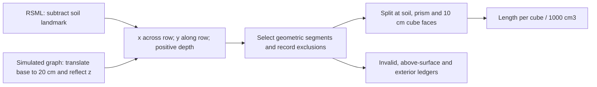

# Proposed Grapevine3D observation contract

Version `DRG-G3D-01-v1`, 14 November 2026. **PROPOSED_NOT_EXECUTED**; scientific
acceptance required before implementing scientific changes or fitting.
See [evidence](PAPER_REVIEW.md) and [pilot](PILOT_SPECIFICATION.md).

## Frame, units and alignment

Canonical observations use centimetres, x across rows, y along rows and depth
`d` positive downward, with origin at the soil-surface stem point. The existing
[converter](../../../scripts/data/grapevine3d_grid.py) subtracts the second
stem-polyline point (index 1) from every RSML coordinate. It checks `unit=cm`.
Keep this prepared definition. The 2024 Fig. 6 horizontal labels differ from
the 2025 Fig. 7 convention; raw hardware axes are a third convention. No
additional x/y swap is justified for the prepared grid.

For DeepRootGen coordinates, freeze the proposed transform before fitting:

```text
x_obs = x_sim;  y_obs = y_sim;  d_obs = 20 - z_sim
display_z = -d_obs
```

The model's single base at z=0 is translated to 20 cm depth, following the
published approximate planting depth. This is an **assumed fixed initialization**,
not a measured per-vine root-base depth or extra stem segment. Do not score the
surface-to-base translation as root length. Translation of all points preserves
attachments and length. Horizontal rotation is zero; no post-fit rotations or
reflections are allowed. Root-base depth and row anisotropy remain model-adequacy
questions. The current validator confines valid roots to generator z≈0 or below
(`root.py:459–476`). After translation this excludes approximately the upper20 cm
of soil. A shared synthetic/observation adequacy check must quantify this
representational gap before an empirical run; changing soil-origin/validation
or initialization needs a separate scientific decision.
Any later depth scenarios (15/20/25 cm) need a separate budget and
cannot be chosen using held-out performance.



## Segment and class contract

Observed geometry comprises consecutive points **within each nonstem RSML
polyline**. No stem or hypothetical child-to-XML-parent connector is counted.
Preserve the original polylines/nesting in later 3D displays; clipping affects
the scored geometry, not the raw archive. Simulated geometry is each explicit
parent→child edge, with child diameter/class/order attributes. There is no
implicit segment across organs beyond the generator's actual attachment edge.

Use Euclidean geometric length everywhere, including mass if later approved:
`length_source="geometric"` must be passed explicitly to every relevant API.
Grid aggregation and cylindrical cores currently default to recorded length,
while current summary statistics default to geometric. Do not use cylindrical
cores for this cube observation. Do not use the scalar whole-grid RLD API as a
voxel vector. Aggregator input is a lattice of **boundary points**, not centres.

Exclude base/order-0 rows and invalid **child segments** from scoring; retain
parent coordinates even if the parent is invalid. Report valid-child-of-invalid-
parent cases and raw/valid/invalid lengths separately. Missing parents,
duplicates, cycles, nonfinite coordinates or negative dimensions invalidate a
candidate; never silently drop them. Zero-length points may be displayed but
contribute no scored length; a positive recorded length with coincident endpoints
is a contract violation. Whole-organ and descendant invalid flags must remain
visible, rather than hiding geometry to improve a density score.

Proposed operational order mapping:

| Archive polyline label | Simulator integer order | Use |
|---|---|---|
| primary / secondary / tertiary / quaternary / quinary | 1 / 2 / 3 / 4 / 5 | Explicit order-length partitions after nesting QC |
| other | other/unmapped | Retain separately; never silently allocate |
| stem | 0/base | Excluded from root-length scoring |

This is a proposed label-to-order comparison, not proof that archive order equals
XML nesting depth or CPlantBox type1/type2/type3 physiology. The local nesting
audit found inconsistencies, so the mapping is **not qualified for an architecture
loss or topological validation**. Preserve label-partitioned length diagnostics;
reconcile raw digitizer topology before interpreting parent attachments,
insertion angles or branch spacing. DeepRootGen `order_type="secondary"` may cover
several orders. Its fine/structural strings are not the observed order labels:
primaries are always structural and daughter classification uses mean organ
diameter. No fine-root spatial target is available merely from order labels.

## Cubes, face convention and support

For integer indices `(i,j,k)` a scored cube is

```text
[10i,10(i+1)) × [10j,10(j+1)) × [10k,10(k+1)) cm,    k >= 0
RLD_ijk = selected geometric length inside cube / 1000 cm3
```

Split each segment at every crossed cube face and soil/prism boundary, then
allocate each positive-length piece using its midpoint. Along a face, use
`floor(coordinate/10)`, including negative horizontal coordinates. Thus an
entire horizontal root at depth 10 belongs to `[10,20)`, not `[0,10)`.
Endpoints alone have zero length. Soil depth zero belongs to the first layer.
At an outer upper face a face-parallel segment belongs outside the half-open
support; do not clamp it into the last cube. Tangent points contribute zero.

After depth reflection, `[d,d+10)` corresponds to simulator/display interval
`(-d-10,-d]` **after alignment**, with lower-open/upper-closed z faces. The
current negative-z aggregator uses the opposite internal tie convention. It
cannot be assumed interchangeable with the converter for face-parallel roots.
The next task must align the scorer to positive-depth indexing or implement
an explicitly tested reflected convention; no epsilon jitter of observations
and no regeneration of the prepared targets to conceal this mismatch.

For conditional reconstruction, freeze each observed prism from its saved
indices. Its cells include digitized-zero cells. A zero is “no digitized root
length”, not proof of biological absence. Outside the prism is unobserved;
exclude it from voxel loss and report exterior simulated length. Do not infer
an excavation detection boundary from observed extrema. Partial supports
would need their actual volume; this task has full 1000 cm³ cubes.

For population prediction, neither evaluation supports nor their selection may
depend on a held-out vine's observed extrema. Independent excavation coverage
and block/plot mapping are not yet verified. The current pilot therefore uses
**evaluation conditional on observed support** and cannot claim fully untouched
population prediction. A planting footprint is not a known complete excavation
volume, and neighboring roots cannot be attributed by a periodic assumption.

Maintain additive ledgers (length and, if defensible, mass):

```text
raw root geometry = invalid-child geometry + valid root geometry
valid geometry = above-surface + in-soil
in-soil = in-prism + exterior-prism
in-prism = sum(cube pieces) = sum(order partitions)
```

No exterior loss penalty is approved because detection coverage is unknown.
Report exterior proportion and treat large overflow as a review flag. Likewise,
report invalid fractions; density agreement alone is insufficient.

## Mass and dependency contract

Mass is **unconstrained** in this proposal. No per-vine dry-mass join was
established. VTP `radius` exists but has unverified measurement provenance,
units and segment correspondence. Diameter/dry tissue density are nuisance
scenario inputs; model-computed mass is not measured evidence.

If later accepted, whole-root dry mass should match the measured root
compartment/recovery definition, with soil-clipped and exterior contributions
reported separately. `M=sum(rho*pi*d²*L/4)` has units g for cm and g/cm³;
length times tissue density alone is dimensionally wrong. Whole-root
`SRL=sum(L)/sum(M)` has units cm/g. An organ-average SRL is a different quantity.
Keep length, mass and derived SRL from becoming three independent losses.

Depth profiles, horizontal maps, total in-prism length and occupancy derive
from the total RLD target. Order-resolved lengths require the additional label
channels and are not determined by total RLD alone. When those channels are
fitted, they are diagnostics or added priorities, not independent evidence.
Unfitted branching angles and counts can
add architectural information, but their dependence on density and any shared
paper priors must be disclosed. No direct physiological/drought validation is
available from these observations.

## Required synthetic cases and tolerances

These are **proposed checks, not executed results**. Use the same explicit
geometry in the converter and simulated-edge scorer. Numeric tolerances are
floating-point acceptance criteria, not measurement or biological uncertainty.

| Case | Required result |
|---|---|
| Axial/diagonal crossings, negative x/y and corner crossings | Analytic piece lengths; each occupied cube agrees across operators |
| Horizontal roots on depth 0/10/20 and x/y ±10 faces | Exact canonical half-open allocation; reflected z convention agrees |
| Upper outer faces, partly exterior, entirely exterior, tangent segments | Correct exclusion and exterior ledger; no clamping |
| Surface crossing and entirely above surface | Exact linear clipping and separate excluded length |
| Subdivide the same polyline without changing geometry | Same per-cube lengths and class partitions |
| Base, invalid child, valid child of invalid parent, missing parent and duplicate IDs | Declared policies; malformed graph fails loudly |
| Branched graph with attachment nodes | Acyclic single-parent graph, exact attachment; no fictitious connectors |
| Cylinder with L=10 cm, d=.2 cm, rho=.2 g/cm³ | M=.02*pi g; SRL=500/pi cm/g; base contributes zero |
| Fixed seed repeated twice; one different seed | Identical same-seed node/edge tables; finite variation for other seed |

Per-cube and total length error must be ≤`1e-8*max(1,L_valid_cm)`; class sums
use the same tolerance. Analytic cylinder mass relative error ≤`1e-10`, absolute
floor `1e-12 g`; RLD errors equal corresponding length error/1000. Synthetic
truth recovery must attain output discrepancy ≤`1e-6` at its known truth and
inverse recovery must improve over its declared baseline, attain balanced
normalized voxel absolute loss≤`.01`, total soil-length relative error≤`1%`,
and exact organ counts under matched noise-free seeds. Parameters need not
be uniquely recoverable.
Real inverse recovery and graph timing belong to the next accepted task.
