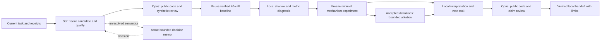

# DRG-G3D-02: two-day architecture diagnostic and model allocation

Prepared 14 November 2026, Pacific/Auckland. **Execution completed; historical plan below.**

Execution supplement, 14 November 2026: the user accepted the bounded four-arm
experiment. The baseline was verified and reused; 40 additional attempts
completed without failures or retries. The final byte-bound suite records 417
tests with no failures/errors/skips. Both Claude Opus 5.5 review checkpoints
and a focused correction re-review are documented; final claim amendments are
applied. No arm is recommended or adopted. All numeric comparisons remain
conditional on the unresolved joint observation/model coordinate mapping.
See the [local final report](../../.runtime/research/so4-t2-controlled-20261114-v1/FINAL_REPORT.md),
[matched-seed 3D view](../../.runtime/research/so4-t2-controlled-20261114-v1/comparison/roots_3d_all_seeds.html)
and [reproduction record](../../.runtime/research/so4-t2-controlled-20261114-v1/REPRODUCE.md).
The single proposed next improvement is the
[authoritative observation contract](GRAPEVINE3D_03_OBSERVATION_LANDMARK_CONTRACT.md).
The frozen controlled method/configuration were preserved after execution;
historical planning statements below describe what was known before authorization.

This planning task inspected source, existing receipts and test reports; it did
not run simulations, rerun tests, call additional GPT/Claude models or fit data.
The schedule means two working days, approximately 16 hours of scientist/agent
attention within 48 elapsed hours. It does not require continuous model calls.

## Recommendation and intended result

Continue the existing DeepRootGen SO4/T2 diagnostic with its opt-in
`fichtl2024` mechanism. Use **GPT-6.1 Sol, high reasoning**, as the principal
developer; **GPT-6 Astra, high reasoning**, for a bounded mechanism decision
if needed; and **Claude Opus 5.5, high effort**, for two independent reviews
of public evidence, source and synthetic fixtures. These are proposed roles,
not provider calls already made or newly installed workers.

Reuse the completed fixed-parameter ensemble and deliver verified local 3D
views, spatial and architectural discrepancy tables, an evidence-backed gap
assessment and one prioritized next task. A defensible result may establish
that the generator is inadequate. Do not promise a close fit, infer the exact
excavated topology, present synthetic outputs as observations, or adopt a
physiological calibration.

The language models write/review code and reasoning. Python generates the
architectures and computes comparisons. Keep biological simulation independent
of language-model prose or invented data.

## Current task and results: inspected baseline

HEAD is `d5918d8bd182e351817f374426687cb546eeaa10`. The checkout is dirty:
root/schema changes and research scripts, tests, configuration and documents
already exist. They are intervening work to preserve, not changes made by this
planning task. HEAD alone does not identify the executable candidate.

| Evidence | What was found | Consequence |
| --- | --- | --- |
| [Evidence task](GRAPEVINE3D_01_EVIDENCE_AND_CONTRACT.md) and v6 local execution receipt | Receipt records 96-vine geometry/grid checks, 104 parameter-evidence rows and reviewed proposal; topology remains `NOT_QUALIFIED` | Reuse preparation and parameter audit; do not repeat the literature/data task |
| [Current diagnostic method](../research/grapevine3d/SO4_DIAGNOSTIC_PILOT.md) | Four fixed scenarios, ten seeds each, eight SO4/T2 vines; method document still says generation pending | The method status is stale: the completed receipt takes precedence |
| `targeted-tests.xml` | Recorded 74 tests, zero failures/errors/skips | Useful algorithm evidence; execution was not repeated for this plan |
| `full-tests.xml` | Recorded 385 tests with five failures involving missing optional fields in lightweight test objects | Preserve the failed attempt; examine the subsequent correction rather than hiding it |
| `full-tests-final.xml` | Later report records 385 tests, zero failures/errors/skips | Recorded regression result, not proof of biological validity or current-source qualification |
| `full-tests-qualified.xml` | Newest report records 388 tests, zero failures/errors/skips | Preserve this later result; do not present it as tests executed by this planning task |
| Source and fixtures | Optional tropism/soil-surface code, graph/seed checks and pilot support-accounting tests exist | Inspect and reuse; do not replace working code wholesale |
| Completed diagnostic | Appeared during inspection: `COMPLETE_DIAGNOSTIC_ONLY`, 40/40 calls complete, 18.20 seconds reported | Reuse the completed ensemble; do not rerun it merely to start the two-day task |
| Run integrity | All 215 recorded artifact hashes verified; recorded model/script/config/lock hashes match current files | Technical artifact/source integrity checked here; biological validity remains separate |
| Model access | Local Codex model cache lists `gpt-6.1-sol` and `gpt-6-astra`; Claude Code 2.1.323 is installed | Candidate selection is supported locally; authenticated Claude model access/quota was not tested |

The four JUnit files and logs are in
`.runtime/research/so4-t2-diagnostic-20261114-v1/`. No complete contemporaneous
command/source manifest binding those tests to the present dirty source was
established. Read the reported counts as recorded results, not freshly executed
checks. The v6 evidence task's `NOT_RUN` statements describe that earlier task,
not the later test reports.

A local planning snapshot hashes inspected source/test/configuration/evidence
files and records JUnit summaries and the completed-run integrity check:
`.runtime/research/grapevine3d-two-day-plan-20261114-v2/evidence_snapshot.json`.
It identifies this inspection; it cannot retroactively bind earlier executions.
If another task completes a run, consume its verified receipt instead of
starting a duplicate job. Rebaseline this plan if the source changes. The first
inspection snapshot, v1, predates completion and is preserved as history.

## Findings that determine the next two days

These are means from the completed local report at the fixed physical 20 cm
base. The report is at
`.runtime/research/so4-t2-diagnostic-20261114-v1/comparison/REPORT.md`.
Values are descriptive in-sample diagnostics, not acceptance thresholds.

| Trait | Digitized observations | Fichtl-inspired scenario | Implication |
| --- | --- | --- | --- |
| Soil root length | 1778.85 cm | 1926.20 cm | Broad total-length agreement does not establish spatial agreement |
| Maximum depth | 71.33 cm | 70.23 cm | The deepest point is close while the depth distribution can remain wrong |
| Length fraction at depth <20 cm | 55.5% | 6.67% | Main discrepancy: shallow allocation, a 48.83 percentage-point difference |
| Primary/secondary/tertiary counts | 8.5 / 23.5 / 93.625 | 9 / 22.3 / 100 | Counts are much closer than spatial placement; label/order mapping is still a proxy |
| Row/across-row span ratio | 0.7167 | 0.9896 | Apparent anisotropy is not represented; verify frame/support before adding row bias |

The full-grid shape TV is 0.8048 for Fichtl-inspired roots versus 0.8587 for
the upstream example. However, normalized balanced MAE is 0.5467 for
Fichtl-inspired roots versus 0.4240 upstream. The upstream example also has
an in-prism relative-length error of −0.6362, versus +0.0735 for Fichtl-inspired
roots. Therefore a lower existing MAE can coexist with a severe length deficit.
Do not select the upstream configuration as biologically best from that score
alone, or describe the Fichtl-inspired variant as uniformly better.

Prioritize (1) verifying shallow/support accounting, (2) explaining metric
ranking disagreements, and (3) isolating mechanisms. Do not spend the two days
fitting downward probability or scaling length to force a preferred score.

## Language-model choices and call policy

| Role | Exact model | Suggested setting | Work and boundary |
| --- | --- | --- | --- |
| Main developer and task owner | `gpt-6.1-sol` | `high`; `medium` for routine documentation | Source audit, minimal repairs, synthetic tests, local commands, provenance and delivery; sole source writer |
| Scientific/mechanism adviser | `gpt-6-astra` | `high`; `xhigh` only for a specific unresolved issue | Examine parameter semantics, boundary rules, objective meaning and adequacy; return a decision memo; no competing implementation |
| Independent reviewer | `claude-opus-5-5` | `high` effort where the client supports it | Review source, public paper evidence and synthetic fixtures before the run and review the final code/claim boundaries afterward |

Sol is the default because this work extends existing code and needs disciplined
execution. OpenAI describes it as suited to complex coding at lower cost than
Astra. Astra is reserved for a specific difficult reasoning problem, rather
than repeating every development step. Anthropic describes Opus 5.5 as suited
to long-running coding and knowledge work. This allocation is an engineering
recommendation, not a measured benchmark on this repository.

Official model references checked for this plan:

- [GPT-6.1 Sol](https://developers.openai.com/api/docs/models/gpt-6.1-sol).
- [GPT-6 Astra](https://developers.openai.com/api/docs/models/gpt-6-astra).
- [Claude Opus 5.5](https://platform.claude.com/docs/en/models/opus-5-5/overview).

Use explicit IDs rather than moving `opus`/default aliases. Record the requested
and returned model identity, client version, effort, prompt/source hashes,
time, usage where exposed and review disposition. Record subscription usage
separately from direct API cost; neither quota nor a monetary budget was checked
or approved by this plan. Do not assume a cached model name establishes API
entitlement. Do not substitute `gpt-6.1-astra`, which was not in the observed
local model list.

Proposed allocation: one continuing Sol development session; zero or one Astra
decision review, with at most one clarification; two Opus review checkpoints,
with at most one focused re-review of corrections. These are task-level review
units, not limits on internal tool calls or estimates of billable requests.
Reuse an existing review only when its exact source/brief and scope match.
No broad model comparison or additional agents are needed.

For a direct API implementation, use `model="gpt-6.1-sol"` and
`reasoning={"effort":"high"}` on a supported Responses API route. The Claude
model ID is `claude-opus-5-5`; check the installed client's supported effort
option before composing its invocation. This plan does not add an API client,
embed credentials or launch either provider.

## Frozen scientific and computational scope

The current [configuration](../../configs/research/so4_t2_fichtl2024.json) owns
the executable diagnostic definition. Keep its bytes frozen for the first run.

| Item | Frozen choice |
| --- | --- |
| Population/stage | SO4/T2, eight vines, six months after planting |
| Generator | DeepRootGen static architecture; optional Fichtl-inspired heading search, not exact CPlantBox replay or temporal growth |
| Scenarios | `upstream_example`, `paper_proxy`, `branching_capacity`, `fichtl_tropism` |
| Seeds | 4101–4110, identical across scenarios |
| Geometry/frame | Geometric segment lengths; centimetres; fixed row axes; root base at 20 cm; depth = 20 − simulator z |
| Spatial support | Existing 10 cm cubes, half-open positive-depth indexing; matching measured/generated clipping and splitting |
| Observations | Prepared grid with SHA-256 `10e5b5332bd9bdf06cf73e1a64fb394c99ab174c822aa4744440fa7cd67fb4bf`; source geometry checked locally |
| Secondary alignment | Reuse each graph translated to a zero-depth base; sensitivity only, never a selected planting depth |
| Call budget | 40 ensemble generator calls; one worker, two threads; no automatic retries |
| Runtime/storage | 900 seconds generation-loop budget, 60 seconds per simulation; 1 GiB configured output budget |
| Evaluation design | All eight vines are descriptive comparisons; no independent holdout claim |
| Excluded work | Empirical optimization, SNPE, training, biomass fitting, dynamic growth, other rootstocks/timepoints, services and deployment |

The script's 900-second check is between generator calls and is not a hard
end-to-end deadline covering observations, aggregation and plotting. Its size
check is also inside the generation loop. Before execution, check that the
complete task has an external time/storage bound and a durable partial ledger;
record an interrupted run as partial, never complete. Proposed end-to-end bound
for this diagnostic is 30 minutes including plotting, with a reserved workspace
allowance of 1 GiB. This is separate from the two-day analysis schedule.

Algorithmic smoke/fixture simulations are separate from the 40-call empirical
ensemble. Account for them by command and purpose. Do not silently start another
40-call ensemble after a failure. A correction invalidates affected results;
preserve the attempt and record a new source identity and bounded rerun scope.

Published means/SDs are setup evidence. The conversion of between-vine SD to a
per-organ uniform distribution and the primary/order mapping remain explicit
assumptions. Root order does not establish a fine/structural diameter class.
Unobserved exterior volume is not biological zero; digitized zero is not proof
of root absence. Unverified topology, missing fine roots and unmatched biomass
remain limitations, not parameters to invent.

## Two-day work schedule

### Day 1, hours 0–2: accept the completed result as the baseline

Owner: Sol. Recheck the completion receipt and 40 complete ledger entries,
artifact hashes, input identities and current transitive source/config/lock
hashes. Reuse matching evidence. Capture the exact commands and source binding
of the 388-test report if available; rerun only affected checks if this evidence
cannot be recovered or the candidate changes. Do not rerun the completed
ensemble or passing suites without a specific evidence gap.

Use the existing Python 3.10 environment and run-local typing-extensions overlay.
The manifest requires Python `>=3.10,<3.11`; graph imports need Torch/PyG.
Preserve the lock and existing dependency versions. Update stale method/task
status only after matching the receipt; retain the historical failed test run.

Inspect actual PNG/3D artifacts locally, common axes, clipping and physical
frame. Check the number of sources/artifacts and recorded parameters, not just
file existence. The result is diagnostic completion, not biological acceptance.

Output: verified baseline receipt, evidence-reuse table and corrected status.

### Day 1, hours 2–4: independent code and observation-operator review

Owner: Sol, with Opus checkpoint 1 using a public-only packet. Trace parameters
through initialization, positioning, tropism, validation, graph export and
aggregation. Check parent tangents, degree/radian units, `sigma*sqrt(ds)`,
candidate-count rounding, objective switching, surface fallback and invalid
child-edge accounting. Confirm generated scaffold initialization is not the
measured CPlantBox initialization.

Reuse synthetic cube-face, negative-coordinate, surface-crossing, exterior,
invalid-edge, seed and legacy-regression fixtures. Existing geometry preflight
uses absolute per-cell tolerance `1e-8` cm; tropism length fixtures use
`rel=1e-5, abs=1e-6`. Preserve these numerical contracts unless a demonstrated
numerical issue justifies a reviewed change. They are not biological tolerances.

Opus returns file/function evidence and minimal synthetic reproducers. Sol
records dispositions and makes only necessary technical corrections. If a
correction changes model/operator behaviour, preserve the completed baseline
and identify which outputs need regeneration instead of rebinding its receipt.

Output: bounded review, dispositions and trustworthy operator definitions.

### Day 1, hours 4–6: explain the shallow-root and score discrepancies

Owner: local Python calculations and scientist inspection; Sol maintains code
and provenance. Recompute from saved graphs without generating new roots:
length by depth, order proxy, primary scaffold and lateral component; initial
versus prevalidation/validated geometry; shallow invalid length; in-prism versus
exterior coverage; occupied and digitized-zero MAE separately.

Test whether the 55.5% versus 6.67% shallow difference persists under the same
physical support, clipping and root-label policy. Locate branch emergence
depths and quantify whether the fixed scaffold and predominantly downward
headings can reach the shallow band. Distinguish a physical reachability limit
from validation loss and from a coordinate/operator error. Do not interpret
unobserved exterior volume as zero or solve the discrepancy by translating the
base to zero depth.

Explain why MAE ranks the short upstream roots more favourably while length
coverage and full-grid shape favour other configurations. Keep the existing
score unchanged. Publish a multi-metric descriptive comparison; any replacement
optimization objective is a later scientific decision.

Output: local attribution tables, discrepancy diagnosis and ranked hypotheses.

### Day 1, hours 6–8: freeze a minimal mechanism experiment

Owner: Sol; use one Astra decision memo only for unresolved public-code/synthetic
semantics. The preferred follow-up is a surface/insertion/tropism ablation,
because the current Fichtl-inspired comparison changes these mechanisms together.

Proposed experiment: four arms, all with the physical soil surface and the same
pre-generated topology, organ lengths, attachments and scaffold for each seed:

| Arm | Insertion headings | Subsequent heading search |
| --- | --- | --- |
| A | Legacy | Legacy |
| B | Fichtl-inspired | Legacy |
| C | Legacy | Fichtl-inspired |
| D | Fichtl-inspired | Fichtl-inspired |

All four arms share the physical-surface validation contract and omit the
legacy forced-downward-apex rule. Keep counts, spacing, length distributions,
base depth, frame, objective and observation support fixed. Freeze independent
random streams for scaffold, insertion and segment search; an identical integer
seed alone does not guarantee a matched scaffold when control flow changes.
Record a scaffold identity and verify its graph/length invariants in every arm.

Compare A with the retained legacy baseline to investigate the surface-validator
change as a bundle. Compare A/B/C/D to isolate insertion and heading-search
main effects and their interaction under the shared surface rule. Do not
attribute a pure surface effect to a comparison that also removes the legacy
apex rule. Confirm legacy semantics can be isolated cleanly before implementation.

This is a proposed new bounded research task, outside the completed 40-call
receipt. Before executing it, the scientist/task owner must accept these
mechanism definitions and algorithm tolerances, as required by AGENTS.md.
Planning this experiment does not authorize a new scientific implementation.
If those definitions are not settled, finish the two days with baseline
postprocessing and a concrete experiment specification.

Output: frozen hypotheses, parameter/scaffold/random-stream contract, synthetic
checks, run budget and a clear proceed/defer decision for the proposed extension.

### Day 2, hours 8–11: bounded ablation implementation and execution, if accepted

Owner: Sol as the only writer. Keep ablations in research code with the legacy
production default preserved. Reuse existing public evidence and tropism code.
Implement only the switches needed for the frozen experiment; do not add crown
geometry, per-order length fitting, row bias or temporal growth at the same time.

Qualify graph IDs/attachments, scaffold invariance, conserved segment lengths,
finite headings, physical-surface rules and deterministic random streams with
small synthetic fixtures. Run meaningful affected regression checks once after
the final code change. Bind their exact source/config/environment identities.

Proposed new run budget: four arms × ten fixed seeds = at most 40 additional
ensemble calls, one worker/two threads, 60 seconds per simulation, 15 minutes
for the generation loop, 30 minutes end to end and 1 GiB new outputs. Count
synthetic smoke calls separately. Use a new ignored output directory, durable
attempt ledger and no automatic retries. Do not reuse the old full-mechanism
arm unless its scaffold/random-stream/source identity is demonstrably compatible.
The old 40-call result remains an unchanged diagnostic baseline.

If implementation/qualification exceeds three hours, retain the working
baseline and deliver the experiment specification and precise blocker. Do not
rush an unqualified mechanism change to meet the calendar.

Output: qualified ablation code and local receipt/results, or explicit deferred
experiment with the reason and completed baseline analysis.

### Day 2, hours 11–13: interpret, review and choose one next improvement

Owner: local Python and scientist for empirical interpretation; Opus checkpoint
2 for public source/synthetic evidence and a public-only claim checklist.

For each accepted arm show all ten seeds and descriptive median/range/IQR.
Summarize directional changes, shallow allocation, invalid/exterior length,
root counts, total length and full/deep shape. The 80 seed–vine comparisons per
arm are not 80 independent biological replicates. Conditional seed spread is
not a posterior, population variance or uncertainty in measured root recovery.

If ablations are deferred, use this time to complete baseline sensitivity and
support analysis. Rank the next improvement from evidence: distributed buried
crown/scaffold, order-specific architecture or verified row anisotropy. Exact
private-data results remain outside the external review packet. Opus checks
algorithm and claim boundaries; it cannot certify the private-data comparison.
Record all dispositions and unresolved review issues.

Output: mechanism interpretation with limits and one prioritized next-task brief.
No claim of a uniformly superior or biologically validated model is required.

### Day 2, hours 13–16: reproduce and deliver

Owner: Sol and scientist. Recompute summaries from saved graphs with the frozen
operator, verify input/source/artifact hashes and inspect figures and local HTML.
Display representatives by the predeclared median valid-soil-length rule with
deterministic tie-breaking, never by best observed fit. Separate physical 20 cm
results from zero-depth sensitivity. Report all scenarios, including poor ones.

Deliver the completed baseline report and any accepted ablation result, exact
commands/environment, methods/status updates, review/disposition and next-task
brief. Reserve the last hour for an honest partial-result handoff if needed.
No commit, push, data upload, deployment, empirical fitting or calibration
adoption is part of this plan.

## Evaluation and interpretation

| Question | Required output | Interpretation |
| --- | --- | --- |
| Does geometry survive processing? | Full/soil-clipped/in-prism/exterior/invalid lengths and conservation checks | Algorithm and support accounting |
| Does the model produce enough roots? | Realized counts and current lengths by generated order; observed labels shown separately | Mapping assumptions remain visible; means do not establish distributions |
| Where are roots placed? | Depth profiles, shallow fraction, maximum depth, horizontal spread, orientation and row/across-row ratio | Describe mechanisms without selecting rotations or a convenient origin |
| How different are RLD grids? | Occupied-cell and digitized-zero-cell MAE in cm/cm³, existing balanced normalized MAE, in-prism length error and shape TV | Keep scale and shape distinct; scalar loss alone cannot establish architecture |
| Does apparent improvement persist? | Full and depth ≥20 cm diagnostics, invalid/exterior fractions and both fixed alignments | Identify shallow-boundary/support effects without fitting the transform |
| What uncertainty is represented? | Per-seed conditional variation and per-vine descriptive spread | Neither is posterior uncertainty or independent validation |

Keep the existing score definition: equal weighting of occupied and
digitized-zero cell MAE, normalized by pooled positive SO4/T2 RLD q75. This is
a frozen descriptive score, not an agreed biological acceptance threshold.
Do not tune weights after viewing results. No minimum biological improvement
percentage is justified by the current evidence. Report absolute values and
consistent scenario differences; if no scenario is adequate, say so.

## Review packets and suggested prompts

All public-only packets contain public paper excerpts/links, relevant code,
synthetic fixtures and their hashes. They exclude raw local observations,
prepared measured grids, measured 3D views and generated-observation comparison
tables/figures. Local deterministic scripts process those inputs without
transmitting their contents to other models or services. Do not give Claude a
repo-wide tool session that could discover protected data. This plan does not
relax AGENTS.md's local-data boundary.

**Sol continuation brief:**

> Continue DRG-G3D-02 from the inspected dirty candidate. Preserve all inherited
> work. First check for an active/completed matching diagnostic and reuse valid
> evidence. Reuse the completed SO4/T2 40-call diagnostic. Freeze transitive
> source/config/lock/input identity, qualify only evidence gaps, and prioritize
> shallow allocation and metric-disagreement diagnosis. Keep local observations out of model prompts/reviews.
> Preserve all attempts and report algorithm checks, descriptive comparison and
> biological evidence separately. Do not fit data or add mechanisms outside
> an accepted research definition. Deliver verified artifacts and one evidence-backed next task.

**Astra decision brief, only when necessary:**

> Review this public-only code/paper/synthetic packet for the specified unresolved
> issue. Trace definitions, units, root-order mapping, frame and stochastic
> semantics. Distinguish faithful transfer, explicit approximation and unsupported
> assumption. Return the smallest justified decision, counterexample and
> numerical test; do not edit files, infer private-data results or expand scope.

**Opus checkpoint 1:**

> Independently review the supplied public-only candidate and synthetic tests.
> Focus on parent attachments, conserved geometric length, deterministic seeds,
> degree/radian and segment-length scaling, surface behaviour and observation
> support accounting. List defects by severity with file/function evidence and
> a minimal reproducer. Mark unverified exact CPlantBox equivalence and parameter
> mappings explicitly. Do not access local data, run tools or rewrite the model.

**Opus checkpoint 2:**

> Review the final public-only diff, synthetic evidence and claim checklist
> against the frozen task. Check resolutions and identify unsupported statements
> about causality, fit, uncertainty, biological validation or exact reconstruction.
> Return ACCEPTABLE_WITH_LIMITATIONS or CHANGES_REQUIRED for this review scope,
> with evidence and remaining checks. You have not reviewed private comparison
> outputs; do not certify their correctness or biological agreement.

## Completion conditions and failure routes

Technical completion requires a matching source/config/input manifest, successful
relevant algorithm checks, all 40 ensemble calls, valid graphs and numerical
accounting, visually inspected artifacts, verified completion hashes, review
disposition and documented commands. Report separately whether regression tests
were reused, rerun or remain unbound. A test pass is never model qualification.

Scientific delivery requires honest scenario comparisons, explicit observation
and mapping limitations, no independent-validation/posterior/biomass claims,
and a justified next task. It does not require declaring a scenario adequate.

If access/runtime is blocked, deliver the qualified source/fixture evidence and
exact missing prerequisite. If a run stops, deliver its partial ledger and
failure cause. If model access fails, record reviewer/adviser unavailable;
continue independent local work and leave that review incomplete. Never invent
the review, silently switch model IDs or convert absence of evidence to PASS.

